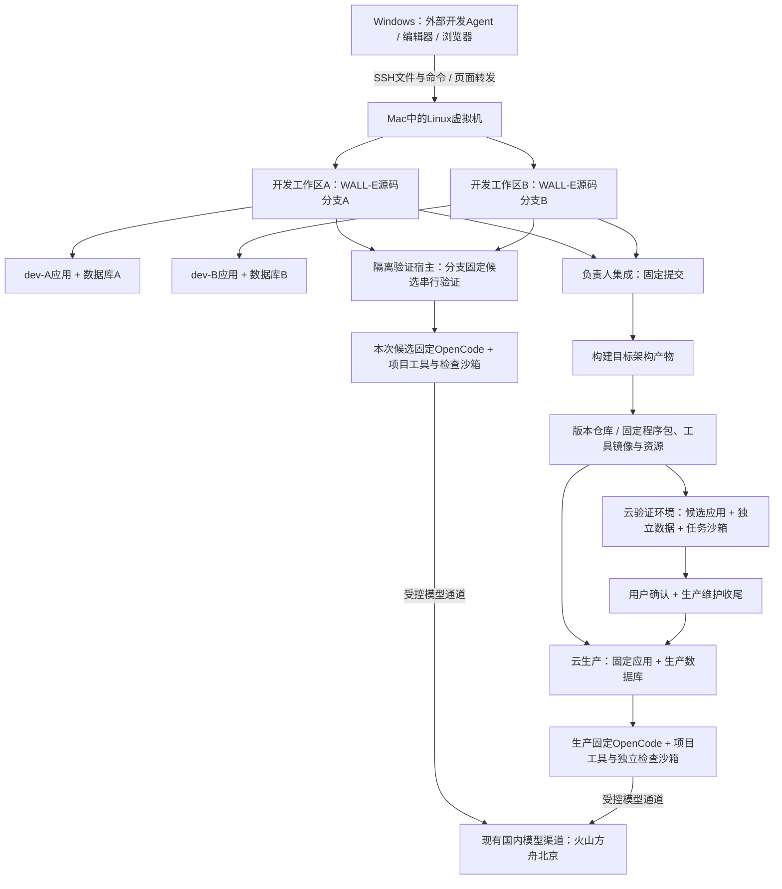
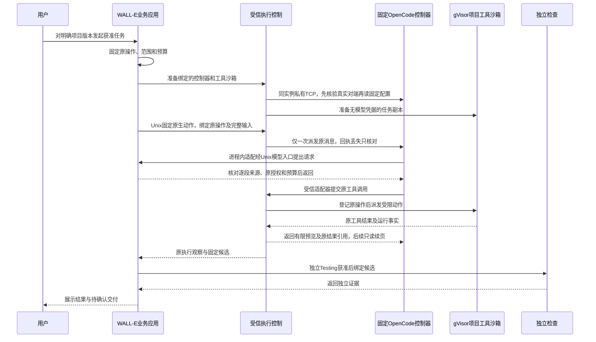

# WALL-E 架构与平台技术选型评审（V2.01）

日期：2026-11-20。修订1.34／BASELINED。性质：按用户要求收口的独立架构基线，附实施及平台准入条件；已开展P0及P1前置原型，产品迁移及部署尚未实施。本文维护平台选择、运行位置和技术取舍；具体对象、接口和交互以后端／前端1.0为准。BASELINED不代表候选技术已通过、云资源已采购、生产已准入或正式规格已合入。

## 1. 评审输入与推荐结论

用户已明确：不偏向Windows或Linux；以日常好用、长期维护和扩展为主；允许V2.0的进程控制、检查和平台执行部分重新采用Linux实现。现有Windows投入仅用于识别需承接的业务保护，不作为必须保留Windows的约束。

可用开发服务器为闲置M1 Pro Mac。2026-11-15通过已核对主机身份的SSH登录确认：10核CPU、16GB统一内存、macOS26.3（25D5087f，用户说明为beta）、ARM64，数据卷实际可用约133GiB；资源规划以该现场读数为准。日常仍可使用Windows电脑。最终正式服务计划上云，旧业务历史和任务成果不迁移。用户主要在中国大陆使用，云资源预算意向约100元／月；本稿暂按人民币、基础设施费用理解，模型API及开发工具订阅单列，不把该拆分写成用户已逐项确认。Windows到Mac及Linux虚拟机的SSH登录、远程文件修改和Windows浏览器访问已验证；当前开发接入采用Windows工具经SSH操作Linux；WALL-E内部执行器沿用OpenCode及现有国内模型渠道。Linux原生Codex接入仅为可选工具路径，其登录失败不阻塞产品Linux原型；产品执行及长期运行条件尚未验证。云厂商、具体机房及实际套餐未定，正式CPU架构默认建议x86_64。

**推荐Linux作为正式目标；采用多个代码工作区、按需开发实例和串行完整验证的轻量架构。Mac是优先试用的开发宿主，云验证机尽早验证正式目标；Mac不必承载全部执行能力。首期业务与控制采用systemd宿主服务，项目代码进入gVisor沙箱；Compose及Coolify后置，不作为开工前提。** 这是架构推荐，不是已验证的兼容结论，也不等于必须采用该运行时或平台所有功能。

不再把“先保住Windows实现”作为主路线。不默认建设Windows执行节点＋Linux业务节点的混合系统，也不同时维护两套正式执行器。若Linux候选关键能力不满足，应先比较其他Linux隔离方案与工作量，再重新评审，而不是悄悄削减Coding／Testing能力。

### 1.1 从完整架构比较，而不是从工具清单出发

本轮判断依据为当前少量开发者／Agent、单人集成、既有FastAPI＋SQLite及应用内工作器、内部Coding／Testing能力、16GB Mac和最终上云。已有基础连接和OpenCode离线原型证据，但尚无完整任务并发负载、云目标网络实测或符合账号条件的最终报价；以下比较仍是工程判断，不是完整性能验收或费用承诺。

| 完整路线 | 日常开发体验与主要代价 | 当前判断 |
| --- | --- | --- |
| Mac承担所有开发和完整执行，成熟后再上云 | 利用闲置硬件，但远程接入、ARM兼容和内存都成为所有工作的前置条件；正式云差异发现过晚 | 不采用这种强依赖顺序 |
| 全部云开发，另设云生产 | 开发与目标架构容易统一，扩容直接；日常编辑依赖网络、持续资源费用与远程工具体验 | 保留为Mac接入或容量不合适时的替代主路线，不是次等方案 |
| Mac普通开发＋尽早使用云验证机＋独立云生产 | 利用已有硬件，同时把正式架构问题提早暴露；需要清晰标记哪些能力在哪里验证 | 当前推荐；同一个任务只有一份活动工作区，固定提交用于跨机验证 |
| 从一开始建设工作区平台、沙箱平台和独立执行集群 | 长期扩容能力强，但当前先承担多套身份、元数据、升级及恢复系统 | 当前不采用；需求增长或原型证据证明必要时再评估 |

Mac不是架构必须长期保留的组成部分。若远程开发体验不好、睡眠／重启影响频繁或重任务排队妨碍实际进度，应把活动开发工作区迁到云开发机；不能因为已经有Mac，就继续投入复杂的本地兼容工程。云厂商未定不妨碍这个边界，但不应在访问与预算未知时指定购买方案。

### 1.2 应用与内部Agent是否从第一天分服务器

需要先分开职责和权限，再决定是否分机器。当前源码中的工作器直接参与业务数据库与恢复流程，抽到另一服务器并非部署配置变化。

| 部署方式 | 得到什么 | 新增成本／剩余风险 | 当前判断 |
| --- | --- | --- | --- |
| 同一Linux VM：业务应用＋受限执行控制＋任务沙箱 | 本地控制协议、文件交付和恢复较直接；保留现有单实例业务模型 | 共享宿主故障与资源；必须验证任务隔离、宿主配额及业务预留 | 首期受控使用的候选，不作为任意代码托管服务的普遍安全承诺 |
| 两台VM：业务与执行分开 | 执行主机资源耗尽／故障较少直接影响业务主机 | 增加身份认证、任务派发与去重、断网对账、产物传输和节点恢复；不能远程共享SQLite | 出现隔离要求或资源压力时采用；若同机准入失败则成为正式使用前置条件 |
| 业务应用＋托管沙箱服务 | 可复用沙箱创建、资源与远程访问接口，减少宿主运维 | 仍需验证网络出口、生命周期、结果持久化、地区与费用，WALL-E业务适配不会消失 | 列入执行底座对照验证，不因“托管”直接判定满足契约 |

首期不自建执行集群；只定义一个执行适配边界，让业务提交受控任务、查询原执行、停止原执行并取得固定产物。运行时对象与业务任务关联必须持久化。该边界不承诺未来换后端零成本，也不提前实现多节点调度、通用队列或双向数据库同步。

正式生产同机方案只有在任务不能访问业务数据／控制凭据、资源压力不会破坏业务恢复、全链停止和异常对账通过后才准入。不能为节省一台服务器而放弃这些条件。是否独立执行机是验证后的架构决策，不是“上云”三个字隐含的结果。

### 1.3 首期到底需要多少环境

两个Agent意味着两个独立代码工作区，不意味着两个完整WALL-E执行平台。建议初始配置如下：

| 资源 | 初始安排 | 生命周期 |
| --- | --- | --- |
| 外部开发工作区 | A、B各自克隆／分支、可写依赖和开发凭据 | 随开发任务保留；交付后明确清理 |
| 普通开发实例 | A／B按需启动，分别使用自己的数据和入口 | 调试时运行，可只启动其中一个 |
| 完整执行验证 | 一个隔离验证宿主，串行部署当前固定候选 | 候选切换先收尾、保留证据；不同开发任务使用独立环境与数据；同一环境的升级演练保留环境身份并按规则维护数据代次 |
| 集成与云验收 | 合并版本按需运行；可以复用空闲验证计算资源 | 复用计算资源不复用业务数据、许可或旧执行身份 |
| 正式生产 | 独立云环境，运行批准的固定产物 | 持续运行，不用于开发构建或分支验证 |

普通实例缺少内部执行能力时明确显示不可用；需要验证内部能力的分支送入完整验证环境。以后确实需要两项完整任务并行时，再增加隔离执行容量，不能为了“多Agent”先复制所有服务。此安排保留每任务独立环境能力，但不要求每个环境始终常驻。

### 1.4 收敛后的默认决策

下表作为本次收口后的默认设计基线，后续实施与原型沿一条主路线推进；具体执行底座仍是附准入条件的候选，不能仅凭设计收口取得运行资格。备选只在对应条件发生时重新评审，不同时建设；采购与生产启用按实际证据及授权另行处理。

| 项目 | 默认推荐 | 何时重新评估 |
| --- | --- | --- |
| 操作系统与正式架构 | Ubuntu24.04 LTS，云端x86_64；Mac用同发行版ARM64作开发，正式产物只维护一条目标架构发布链 | 目标运行包或云镜像不满足；ARM云若有明确成本／兼容优势，先验证再改正式架构 |
| 云产品与地域 | 中国大陆地域的Linux虚拟机；先比腾讯云Lighthouse套餐，阿里云轻量／ECS作报价与能力对照；不选要求放弃宿主执行控制的纯应用托管产品 | 套餐内存、磁盘、长期价格或内核／网络控制不满足，则换规格或标准云VM；不因促销价降低任务边界 |
| 首期生产拓扑 | 一台云VM承载应用与受信执行控制，任务使用gVisor沙箱；一次一个完整重任务，单实例SQLite | 隔离或资源实测不满足则不得启用完整生产，改独立执行机并补远程协议；预算不够须调整预算或可用范围 |
| 本地与验证资源 | Mac两个代码工作区、普通实例按需运行；完整验证串行；云验证与生产分宿主，云验证按使用周期准备 | Mac接入不适合日常开发则迁云开发机；额外机器成本进入总预算，不能借用生产做底座实验 |
| 执行底座 | Docker管理受控资源，项目代码隔离优先评估runsc／gVisor systrap；OpenCode保留1.19.5，完整执行部署仍待来源门槛 | 现成gVisor remote异步监测已排除为唯一同步鉴权。下一离线原型评估固定OpenCode与项目工具分离、插件适配及Unix逐段来源核验（后端4.15.2—4.15.6）；先证本地执行封闭、根来源与工具原操作，再决定替换部署，不默认fork或降级隔离 |
| 应用部署与入口 | systemd受限宿主服务、固定Python／应用包；Caddy提供统一入口；Docker／runsc仅承载受控项目与检查资源，见11.2.1 | 未来确需Compose／Coolify管理应用时，先重新证明双向身份与维护恢复，再替换适配；首期不并行建设两套部署控制 |
| 可视化管理 | 首期实现必要环境摘要及受控操作，复用云控制台看宿主指标；不要求先装Coolify、Coder或自托管沙箱平台 | 环境数量和人工操作成本实际增长，且平台通过维护／恢复准入后再接入；不取消大纲中的可视化交付 |
| 身份与凭据 | 单人私用阶段使用HTTPS入口认证，业务／管理／各开发环境分凭据；任务通道独立身份，详见11.4 | 多用户、统一登录或明确退出登录体验成为必要需求时接成熟身份方案，不自行扩成账户平台 |
| 用户项目与成果 | 负责人准备服务器侧仓库，产品完成本地分支交付，负责人显式取回／同步远端 | 自动拉取、push、PR作为新增产品能力独立定案，不把它们归为Linux适配细节 |
| 持久化与备份 | 业务库及内容在本地持久盘；一致性恢复资产用restic等成熟工具备份到独立存储，费用计入预算 | 容量、恢复目标或多写入者需求实际改变时再评估存储；不因上云先引入托管数据库 |

选择24.04不是声称它是最新版本；[Ubuntu官方支持周期](https://ubuntu.com/about/release-cycle)列出其标准安全维护至2029年5月，当前可作为统一验证基线。x86_64是为先固定一条正式验证链的工程默认，不是已测得它比ARM更快。云系统镜像、内核、Python／Node及运行包在原型准备时固定具体版本，不继承Windows锁文件或随安装使用latest。

## 2. 代码位置、运行位置与完整工作流程

### 2.1 先分清三类Agent与环境

“开发WALL-E的Agent”是我们使用的外部开发工具；“WALL-E自己的Agent”是用户在WALL-E里创建Coding任务后，由产品启动的执行器；“独立检查执行器”负责验证结果。三者不能因为都能执行代码就共用工作区、权限和结果来源。模型供应方负责模型推理，Agent进程负责调用模型及执行工具；使用远程模型不代表代码也在模型供应方机器上执行。

WALL-E产品内部编码执行器继续使用OpenCode1.19.5，模型沿用现有国内渠道，不因Linux迁移更换供应方。源码[ModelProfile](../../../../backend/app/infrastructure/model_profile.py)固定火山方舟北京入口，默认DeepSeek Profile；[编码模型配置绑定](../../../../backend/app/code_tasks/model_deployment_configuration.py)复用该Profile。模型密钥保留在受信控制侧，任务通过受控模型通道调用。这条产品链路不依赖ChatGPT账号、Codex CLI或OpenAI登录。

当前外部开发工具仍可使用Windows Codex，经SSH在Linux指定工作区读写文件、执行命令，再访问转发的测试页面；Codex控制进程留在Windows，工具命令按显式目标在Linux执行。Linux原生Codex远程项目属于可选接入方式，只有单独需要它时才验证远端Codex认证，不列为WALL-E运行或内部Agent验收前提。

| 对象 | 推荐运行位置 | 可操作的代码／数据 | 不应持有的能力 |
| --- | --- | --- | --- |
| 操作者的编辑器与浏览器 | 日常Windows电脑，可换其他客户端 | 通过受控连接操作指定开发工作区、打开相应环境页面 | 不自动获得生产部署或所有任务权限 |
| 开发WALL-E的外部Agent A／B | 当前工具控制进程在Windows，经SSH操作Mac Linux的独立工作区；若工具原生驻留Linux，另行验证该可选入口 | 各自WALL-E任务分支与开发数据 | 生产库、生产凭据、宿主容器控制接口 |
| 开发版WALL-E | Mac Linux中按需启动的dev-A／dev-B普通实例 | 对应分支构建出的程序、各自开发库 | 另一任务数据和生产数据 |
| 集成／候选版WALL-E | Mac Linux内，按需启动；目标架构验收另在云验证环境 | 合并后的固定版本和独立验收库 | 自动晋升生产的权限 |
| 生产版WALL-E | 云端Linux业务环境 | 经确认的固定程序及生产业务数据 | 开发工作区的可变源码 |
| WALL-E内部Coding Agent | 发起任务的WALL-E环境所属执行宿主上的任务沙箱 | 用户项目的指定版本副本、任务输出目录 | WALL-E自身程序、业务数据库、部署密钥、其他任务 |
| 独立Testing／浏览器检查 | 同环境的独立检查沙箱，按原业务规则绑定候选 | 被测候选、固定检查资源及隔离测试数据 | 直接改写可信报告依据、连接正常生产目标 |

首期执行宿主与所属WALL-E应用可以是同一Linux VM，但任务沙箱具有独立文件、权限、网络和资源范围；这不等于另设一台执行服务器。同宿主仍共享内核和硬件，不能承诺任务异常绝不影响业务。任务CPU、内存、进程数、磁盘与并发必须受限，并为业务服务预留容量；资源不足时不启动新执行。正式部署前必须验证同宿主隔离与容量是否足够。如果要求更强的宿主隔离或负载超限，再将任务执行迁至独立Linux节点；这需要明确的远程执行协议，不能只改一个地址。

### 2.2 推荐物理布局

图中普通开发实例与完整验证实例不是必须同时运行；验证宿主可在Mac或云端，按目标架构决定。箭头表示访问或交付关系，不表示共享磁盘。云验证与生产至少具有独立的数据、凭据和运行资源；正式生产与外部Agent开发／构建不共用宿主。云验证使用独立于生产的宿主，按使用周期建立；不能为省预算把待验证的执行控制程序放到生产宿主。云验证机的停机不等于免费，实例、磁盘、地址和快照的保留费用一并计入预算。

Mac开发验证与云目标兼容性核对分步交错推进，不要求Mac上的全部执行能力通过后才接触云目标。正式启用后，生产应用、内部执行器和必要资源全部在云侧。Mac不是生产的数据库、任务队列或执行节点，关闭Mac不会中断云端正在执行的产品任务。

### 2.3 WALL-E源码和用户项目代码分别存在哪里

下列是逻辑目录示例，不是已创建路径或最终配置格式：

| 数据类别 | Mac Linux示例位置 | 云端对应安排 |
| --- | --- | --- |
| WALL-E开发源码 | `/srv/walle-dev/workspaces/task-a`、`task-b`，不同分支 | 生产不挂载这些目录；云构建若需要源码，使用固定提交的独立工作区 |
| 开发／集成业务数据 | `/srv/walle-dev/environments/dev-a/data`等 | 每个云验证或生产环境单独持久化 |
| 内部任务的用户项目副本 | `/srv/walle-dev/environments/dev-a/tasks/<task-id>/workspace` | `/srv/walle/environments/prod/tasks/<task-id>/workspace`等环境专属位置 |
| 检查资源与结果 | 环境独立的checks、receipts、artifacts区域 | 同样由可信控制端保存，不能交给被测程序随意写入 |
| 固定交付物 | 本地候选可缓存，正式交付保存至明确的镜像／资源仓库 | 云端按目标架构和摘要取得，不依赖Mac在线 |

源码共享Git对象不意味着共享可写依赖、数据库或密钥。部署平台管理的是应用版本与运行资源；Git仓库保存源码提交；镜像／资源仓库保存交付物；业务数据库保存用户文档、任务及结果。这四类存储职责分开。

原Windows工作区当前含未提交开发成果，不能直接复制后宣布它是固定基线。将来实际迁入Mac时，先核对并保存这些成果，按明确授权选择提交或受控转移；不丢弃其他任务改动、不自动提交。迁移开发源码与“不迁移旧业务历史”是两件事。

### 2.4 一次修改WALL-E的完整过程

1. **分配开发任务。** 从明确基线创建任务A分支、工作区、配置及独立数据。外部Agent通过SSH在该Linux工作区修改WALL-E源码；控制进程可以继续运行在Windows。每次读写和检查明确目标工作区及执行主机，不通过反复复制目录维持两套活跃源码。
2. **运行开发版。** 使用分支A启动dev-A，前端和API明确绑定dev-A；另一Agent使用dev-B。修改A不能热更新B或生产。开发容器与应用容器不必相同，源码共享仅限本任务需要的范围。
3. **测试普通功能。** 用户打开dev-A页面，验证文档读写、交互、失败恢复。自动检查也访问dev-A及它的隔离数据，不能只跑单元测试后宣称整套应用可用。
4. **测试内部Agent功能。** 将分支A固定候选送入隔离完整验证环境，再创建Coding／Testing任务并启动所属沙箱，使用专门测试项目。普通dev-A未接入执行能力时不提供可执行入口；以后资源允许才为各分支分别配置完整执行环境。即使任务目标也是WALL-E代码，也只取得固定测试副本；不让它直接修改启动自己的活动源码或当前控制程序。
5. **交付并集成。** 外部Agent提交明确成果，由负责人处理合并与冲突。不同任务数据库不合并。组合版本重新检查，不把两分支各自通过当作组合通过。
6. **构建固定候选。** 从明确提交构建固定包或镜像，关联平台、依赖与资源摘要；候选应用不再热跟随源码。Mac的ARM64结果只证明相应架构，云端x86_64产物必须另行构建验证。
7. **云端目标验收。** 将同一目标产物部署到云验证环境，用全新测试数据检查启动、内部任务、完整停止、升级和恢复。仅ARM64本地通过不能跳过该阶段。
8. **发布生产。** 用户确认具体候选和目标；生产先禁止新任务并完成原任务收尾，再停止旧实例、处理必要数据维护、启用同一候选产物。只发布程序和受控配置，不搬入开发库或测试任务许可。
9. **保留成果并清理。** 工作区、数据、任务沙箱分别确认清理。代码合并、环境停止或关闭编辑器均不自动删除未交付成果。

### 2.5 用户在生产WALL-E里发起任务时发生什么

以“让WALL-E修改项目X”为例：用户浏览器向云端WALL-E提交任务 → 业务服务保存原请求与授权 → 可信执行控制准备项目X指定版本的任务工作区 → 启动固定执行器沙箱 → 执行器通过受控模型出口调用模型并在沙箱内修改项目X → 独立检查取得固定候选运行测试／浏览器 → 控制端核对报告、产物和原操作 → 按产品交付规则保存或交付成果。

这里没有开发WALL-E的外部Agent参与，也不依赖Windows电脑或Mac继续开机。用户浏览器断开不等于任务取消；重新连接查询原任务。Agent可以请求工具执行，但不能直接写WALL-E业务数据库或把自己的文字声明当作可信测试结果。

Coding与Testing按V2.0原业务规则衔接，不把上述示例解释成所有Coding任务都自动获准执行独立Testing。模型密钥留在可信控制／代理侧，任务沙箱只获得范围受限的访问能力，不能把完整供应方密钥作为普通环境变量发给不可信项目代码。

项目X如果来自原本电脑上的本地路径，云端不能直接读取。首期推荐由负责人先准备服务器侧独立仓库，再登记其中的固定提交及获准本地交付分支；V2.0的本地Git交付不能直接解释成远端拉取或推送。具体边界见第11.5节。纯本地文件需要明确转移或另行设计导入能力，不能悄悄同步整个电脑，也不能只传本机路径字符串。用户项目来源接入是正式云使用的必要设计项。

WALL-E自身也可以被登记为受控任务的目标项目，但其输出必须经过固定候选验证和用户发布确认，不能自动覆盖或重启正在运行的生产WALL-E；首期不启用自动自我部署。

### 2.6 执行控制、检查环境与部署权限

部署控制与内部任务控制使用不同权限。业务HTTP进程不直接挂载通用Docker控制接口；若执行适配需要调用容器运行时，应由受限的可信入口接受固定类型、固定环境和固定资源范围的动作，用户输入不能变成任意镜像、挂载或宿主命令。其Linux实现仍待验证，不声称systemd或Docker本身已经提供这些业务约束。

内部任务需要运行被开发应用时，在任务专属执行范围启动它；独立浏览器只获得该任务明确准入的测试地址。不能把“允许浏览器访问网络”扩大为可以访问WALL-E后台、云元数据或其他环境。被测应用及其子进程也纳入停止、配额和资源回收，不只停止Agent主进程。

取消内部任务时，由控制端针对原任务停止Agent、工具子进程和被测应用，核对原外发与交付结果后更新业务状态；停止应用容器、关闭终端或丢失连接都不能代替完整停止证据。运行时的资源终止属于故障事实，不伪装成任务成功或用户主动取消。

检查过程可能使用内部隔离网络或受控转发，具体由运行时原型决定；可信检查资源和原始证据由控制端绑定。测试代码、被测应用、检查程序并非一个拥有全部权限的容器。工作区、产物、回执保留与运行中进程分开：停止执行不自动删除结果。

### 2.7 资源与故障场景复核

| 场景 | 应有结果 |
| --- | --- |
| 两个外部Agent并行改代码 | 可各自编辑；不代表两套构建、浏览器和内部任务都能同时运行 |
| Mac内存紧张 | 重任务按配置排队，界面显示等待；不杀在途任务、不借用生产运行资源 |
| Mac关机／Linux VM停止 | 本地开发和验证不可用；未提交代码由持久磁盘保留，运行中任务按异常恢复；云生产继续独立工作 |
| Windows电脑断网／关闭浏览器 | 已受理任务仍由所属环境管理；重连查询原结果，不生成新键重做 |
| 云端失联／执行器崩溃 | 原任务显示未知或恢复中；核对原进程、外部交付及回执后推进，不自动重发模型或Git写入 |
| 正在更新WALL-E时内部任务未结束 | 阻止切换，用户选择等待、取消本次更新或按原规则取消任务 |
| 目标程序正在被测试 | 测试访问该任务固定候选和隔离数据，不访问正常生产业务 |
| 管理平台不可用 | 不自动停掉正常业务，也不自动解除已有维护；恢复后核对实际运行版本和原操作 |

以上为推荐架构及待验证行为。首期不增加通用分布式调度系统，但单宿主的资源准入和可见等待状态不能省略。16GB Mac上的完整并发能力以实际测量为准；开发、集成、候选实例按需运行，不要求全部常驻。

## 3. 本地资源与云预算

### 3.1 Mac本地开发验证方案

建议先建立一台Ubuntu24.04 LTS ARM64虚拟机。虚拟机内使用Linux版本的Python、Node、Git、数据库、容器工具和任务执行器；不让macOS程序承担Linux执行证据。源码、数据、依赖缓存及任务目录放在Linux文件系统，不依赖macOS共享目录的权限和文件监视语义。

| 资源 | P0链路验证起点 | 后续开发调整依据 |
| --- | --- | --- |
| 虚拟CPU | 2个 | 宿主已核实10核；进入项目开发后再按构建耗时和宿主响应评估4个 |
| 内存 | 4GB | 进入项目开发后再评估8GB；为macOS保留空间，依据峰值、交换和任务失败调整 |
| 虚拟磁盘 | 30GB | 宿主当前可用约133GiB；后续按镜像、浏览器及缓存实际增长扩容，同时为macOS、下载和备份预留空间 |
| 工作区 | 一个临时链路验证目录 | 接入通过后准备两个独立任务工作区；不等于保证两套完整浏览器／构建同时运行 |
| 重任务 | 初期全宿主同一时间一个重任务，包括构建、内部执行或浏览器检查 | 实测后增加并发，内存不足排队，不自动杀在途任务 |

上述是待测的链路验证配置，不是WALL-E完整运行容量承诺。先验证远程文件操作、命令执行、页面访问及重连，再安装项目依赖和测量完整负载。暂不在16GB机器上同时堆叠Coder、多个管理平台、大量VM和本地模型；进入项目验证后使用固定systemd服务和工作区工具，项目沙箱另行准入。

虚拟机优先候选为[Multipass](https://canonical.com/multipass/docs/latest/explanation/platform/)，便于重复创建Ubuntu环境；当前要求macOS14或以上，现场26.3满足版本门槛，但beta系统兼容性仍须实测。本轮已安装Canonical官方1.17.1稳定版，并使用固定镜像成功启动Ubuntu24.04 ARM64链路验证VM；这只证明本轮基础运行，不等于完整产品负载兼容。需要图形化控制时以[UTM](https://github.com/utmapp/docs.getutm.app/blob/main/settings-qemu/system.md)作为备选。M系列使用ARM64硬件虚拟化，不把x86模拟当主要开发环境。两者只选择一个，不重复维护。

Windows电脑通过受控SSH连接访问Linux工作区和应用。目前已完成Windows到Mac及Linux的SSH、远程文件修改、再次连接读取和Windows浏览器交互，可作为继续准备Linux产品原型的开发入口。Mac当前电源策略含1分钟系统休眠，长期运行、重启及断线恢复仍须验证；未修改系统电源设置。可选的Codex原生远程项目登录因服务地区限制未通过，过程保留在[连接验证记录](../../../verification/v2.01/remote-development-link-2026-11-15.md)，不作为产品Linux迁移阻塞。

本地通过对应依赖与运行时准入后，才可验证业务、任务执行、取消、隔离和恢复；云端仍须验证目标内核、存储、网络和无人值守重启。若Mac环境无法复现某项内核能力，应转到云端验证该项，不以关闭隔离功能获得通过。

模型网络验证以实际调用主体和已选供应方为准：WALL-E的受信模型通道访问现有火山方舟北京服务，外部开发工具按自己的运行位置使用各自账号与服务，包／镜像下载源单独核对。Windows Codex通过SSH控制Linux不要求Linux登录Codex；虚拟机无需为了产品内部Agent而取得OpenAI认证。2026-11-16已从Linux验证该国内入口的DNS、TLS证书及无凭据GET返回401；这仅证明基础可达，凭据、固定模型和实际工具请求仍待验证。不能把已有Windows证据直接当作Linux通过，也不因外部Codex的403重新选型产品模型。

### 3.2 中国大陆使用与约100元／月预算

预算作为约束，不作为容量证据。开发仍在Mac上的Linux中进行；常驻云生产只运行发布产物，内部Agent也在云端执行，不依赖Mac在线。云验证与生产分开，按阶段使用，不配置三套云环境常驻，不新增托管数据库、负载均衡或GPU。模型API及外部开发工具订阅暂单列；100元仍是用户预算意向，本稿不自行批准提高预算。

以2026-11-16可查的[腾讯云Lighthouse官方套餐价格](https://cloud.tencent.com/document/product/1207/73452)为公开参考：页面更新于2026-11-11，内地Linux套餐按12个月及以上购买／续费列示85折。下表为该规则的计算，尚未经用户账号结算页、目标地区库存核验；年付是一次支出，月均不是月付价格。

| 候选 | 官方月刊价 | 年付计算／折算月均 | 加备份10元、独立验证及余量25元后的月均 | 本项目用途 |
| --- | --- | --- | --- | --- |
| 入门2核4GB／60GB SSD／5Mbps／500GB月流量 | 65元 | 663元／55.25元 | 90.25元 | 普通业务及低负载原型起点，不能据此承诺完整Agent生产 |
| 入门2核8GB／80GB SSD／7Mbps／800GB月流量 | 95元 | 969元／80.75元 | 115.75元 | 首期完整执行优先核验的价格参考；内存、磁盘及CPU仍须实测 |
| 通用2核8GB／120GB SSD／8Mbps／1200GB月流量 | 120元 | 1224元／102元 | 137元 | 80GB磁盘预算不成立时的比较项，不自动采购 |

10元和25元是原方案的规划额度，不是存储或按量主机报价。以8GB／80GB参考计算，保持这两项余量需约116元／月，比100元意向多15.75元；主机与备份用去90.75元后，只剩9.25元用于独立云验证及其他费用，不能断言足够。若要求严格控制在100元内，应取得更低的同等配置实际报价或证明验证费用可压到余量内；否则继续开发验证，待用户选择预算／配置，不共享生产做试验、不削减隔离，也不把生产执行迁回Mac。

[腾讯云活动页](https://cloud.tencent.com/act/pro/lhsale)的首购优惠与上述标准价分开，不能用某个4GB活动价推导8GB价格或长期成本。阿里云轻量保留为同等配置比较候选；其[计费说明](https://help.aliyun.com/zh/simple-application-server/product-overview/billable-items)要求以实际购买页为准，本轮未取得可核验的内地8GB同口径报价，不能据此断言阿里云更贵。Lighthouse作为首个报价和原型参考，是为了便于核算少量单机应用，不是性能结论或最终厂商决定。

云验证若选按量CVM，应另核对计算、磁盘、镜像、IP和带宽价格。[腾讯云关机计费说明](https://cloud.tencent.com/document/product/213/19918)表明即使满足“不收计算资源费用”的关机条件，磁盘及部分网络资源仍计费；在系统内关机也不等于满足该条件。每次验证计划须列使用时长、剩余资源与释放步骤，不能将“已关机”记为零成本。本稿未创建云资源。

### 3.3 首期云部署输入与放行顺序

参考候选为中国大陆单区、Ubuntu24.04 LTS x86_64、2核8GB／80GB套餐、同宿主串行一个重任务；完整Agent、被测应用及浏览器是否能共存须用实际项目验证。4GB只作普通业务／低负载候选，8GB也不是任意用户项目容量保证。以下输入缺一不可，公开价表不能替代验收：

| 输入 | 必须取得的事实 | 不满足时 |
| --- | --- | --- |
| 地区与费用 | 具体地区／SKU／系统镜像、账号结算价、期限、首付／续费、流量及超额规则；独立验证、备份、请求与取回费用分别核算 | 保留候选，不购买年付或宣称预算达标 |
| CPU／内存 | 普通业务常驻、控制与隔离底座、一个真实重任务、被测应用及浏览器的并存峰值；停止／恢复时仍有余量 | 排队或调整套餐；不得靠杀在途任务或关闭隔离过关 |
| 磁盘 | 系统与固定运行包＋当前／上一可回退产物＋镜像／浏览器＋实际项目副本＋一次完整备份暂存＋一次完整恢复副本＋明确预留；共享块只有实测后才能扣除 | 80GB不够就重新报价；不能在故障时临时删除原库、唯一备份或未交付成果腾空间 |
| 平台证据 | 固定内核、cgroup、文件系统、稳定锁、SQLite、Git持久性、浏览器隔离及完整停止；ARM64与x86_64分别记录 | Mac通过不替代云通过；缺证据的能力不启用 |
| 网络与入口 | 操作者到入口、云端到现有国内模型、Git／依赖／镜像与备份存储分别验证；使用第11.4节受控入口与认证 | 不暴露数据库、Docker控制口或开发服务；不能用“能打开网页”代替实际路径 |
| 独立恢复 | 异机固定快照实际取回、密钥材料可用、新宿主恢复及Mac离线时仍能运行 | 同机副本或Mac唯一备份不能放行生产 |

顺序为：固定候选及费用上限 → 在独立短期云验证机核验目标平台／有内容数据／完整任务 → 根据实测重算容量及预算 → 用户批准具体采购 → 首次云新环境初始化及上线验收。开发和正式服务不能因只有一台付费主机而混跑；短期验证机的产物可按摘要发布，验证数据和身份不带入生产。生产不现场构建；失败时按维护／固定候选流程处置，不由云控制台自动滚动覆盖。

旧Windows历史不迁移只适用于用户已明确的首次云新建范围，不适用于未来生产故障。发布后新增正文、任务、费用和未决写入均按后端恢复规则保护。后续页面只展示实际登记的部署与恢复事实；首期不做云采购、套餐推荐器、云账单抓取或跨云资源编排界面。

### 3.4 首期备份策略、恢复目标与兼容门槛

采用已有“SQLite一致快照＋全部引用资产＋Restic封存包”设计；主机备份暂存与异机对象存储分开。首个存储候选为私有COS标准存储桶，与参考云主机同区便于验证；这是异机副本，不是跨地域灾备。同区传输是否免费按实际访问路径与账单确认，不预设Lighthouse访问COS免费。

默认策略建议如下，最终登记到固定backup_policy而不是散落在脚本参数中：

| 项目 | 首期规则 |
| --- | --- |
| 频率与维护 | 每日一次一致备份；发布、配置／数据变更前另建适用恢复点。沿维护流程等待在途任务收尾，不能到点强杀；没有安静窗口则记录延期及最新有效截止时间 |
| 目标 | 数据RPO目标24小时，以最新OFFHOST_VERIFIED的cutoff_at计算；超过即显示未达标。恢复到“已核验资料可只读查看”的RTO目标4小时，从故障确认开始计时，需演练验证；替换主机、操作者、密钥及存储不可用的延迟计入并说明，不能事后改起算点 |
| 保留 | 建议按7个日点、4个周点、2个月点取并集；另保留当前／上一发布所需点及关联未决事实的点，固定snapshot ID，不把重复命中算多份或承诺一定只有13份 |
| 清理 | 先生成保留／删除清单；只有已授权、目标点已异机取回验证且无未决依赖时，受信维护工具才执行Restic保留／清理。普通环境清理不得触发；不设可能先删包的COS对象过期规则 |
| 观察 | 最后尝试、最近成功本机／异机截止时间、距今时长、延期／失败原因、所需资产与密钥可用性分别展示；定时器运行成功不等于备份完成 |
| 恢复材料 | 仓库密码、受限存储凭据、安装锚点恢复资料在独立受保护位置；生产主机和Mac都不能是唯一副本，业务Agent不能读取 |

首期可由系统定时器调用同一受信BACKUP入口，不另造调度平台；定时器持有明确限于该环境／策略的备份权限，不取得任意发布、恢复或模型权限。一次计划窗口绑定一个原操作；上次未收尾时只观察／报告延期，不叠加备份和取得第二份环境锁。采用恢复原运行的策略时沿原计划执行，原本停止的环境保持停止。启用定时器属于后续部署授权，本轮未安装定时任务。

24小时备份目标不代表最多丢失24小时外发事实就能安全恢复Agent：宿主损坏可能同时丢失备份后新增的调用／Git结果索引。数据能读与外发能重新开放是两个结论；后端四项审阅未通过时，仍可按受控只读条件查看核验资料，完整任务恢复持续受阻，不能承诺4小时恢复AI。单区单机首期方案存在这一可用性限制，仍需在生产启用前用实际供应方能力和故障演练确认可接受的恢复范围；未通过不能把“异机备份已验证”写成完整Agent灾难恢复通过。当前不自研实时跨机账本来虚构零丢失；若要求有保证的完整执行RTO，应另行评审外部事实保存和成本。

Restic与COS必须做真实兼容验证。[COS官方域名要求](https://cloud.tencent.com/document/product/436/102489)规定2024-01-01后新建桶只支持虚拟托管式访问；[Restic官方S3配置](https://restic.readthedocs.io/en/stable/030_preparing_a_new_repo.html)说明自动模式对一般兼容端点默认采用路径式。候选应显式使用HTTPS、实际区域的COS端点、`s3.bucket-lookup=dns`及`s3.region=<实际区域>`；仓库地址语法里的桶路径不等于实际HTTP请求采用路径式。禁止照抄默认值后把403或签名错误误判为存储不可用。实际Restic版本／摘要、桶名和区域在部署时固定，当前未建桶或证明兼容。

准入覆盖列表／读写、范围读取、大文件与中断、仓库锁、固定快照取回、完整资产核验以及受控保留／清理。最小权限须按实际动作核验：不能因日常备份不清历史，就声称客户端完全不需删除锁对象。日常凭据与受控清理权限尽量分离；不向业务任务暴露云账号。原生S3适配通过前，不为绕过配置错误额外引入Rclone、MinIO或自建存储网关。

备份10元额度需按压缩／去重后的实际保留量、版本／未决保留点、请求、每日取回验证和故障下载总成本核算。[COS计费组成](https://cloud.tencent.com/document/product/436/50201)不仅含存储；本稿不使用单个示例单价保证月费。费用超出时重算保留策略和预算并批准，不能静默删除唯一可用点或把OFFHOST_VERIFIED降为“上传成功”。

## 4. ARM64与云端发布策略

Mac使用ARM64；当前正式架构默认推荐x86_64，先固定一条生产发布链。同时核对两种架构的运行包，但ARM64验证完成不是云验证的前提；只有具体报价与完整兼容证据支持时才把ARM64改为正式目标。

- 云端也采用ARM64：可晋升同一架构的已验证固定产物，但仍需目标宿主验收。
- 云端采用x86_64：从同一源码提交和资源清单构建x86_64产物，并在该架构验证；不能把Mac验证通过写成x86发布包已通过。
- 多架构镜像具有各自的实际镜像摘要；发布绑定目标架构及其产物摘要，不能只记录一个可变标签。候选到生产必须是该目标架构的同一产物。

[Playwright支持Ubuntu ARM64](https://playwright.dev/docs/intro)，[gVisor支持ARM64](https://gvisor.dev/docs/user_guide/install/)，但这不证明项目锁定的全部组合已兼容。OpenCode保留1.19.5；已从[官方发布资产](https://github.com/anomalyco/opencode/releases/expanded_assets/v1.19.5)下载非musl Linux ARM64包，按官方SHA256校验，并在Ubuntu ARM64运行通过版本、断网健康与鉴权检查、17项必需接口声明及空会话生命周期。没有调用模型或执行用户项目，也没有验证gVisor、完整工具协议、插件运行包或x86_64云目标；不能据此宣布执行链通过。产物摘要和检查边界见[验证记录](../../../verification/v2.01/remote-development-link-2026-11-15.md)。

gVisor优先评估不依赖硬件嵌套虚拟化的[systrap模式](https://gvisor.dev/docs/user_guide/platforms/)。不能预设M1上的Linux虚拟机可以提供Firecracker所需KVM能力；微虚拟机方案若成为必要候选，使用明确支持它的验证宿主另测。

## 5. 平台路线比较与选择原则

| 方案 | 优点 | 对本项目的代价 | 推荐 |
| --- | --- | --- | --- |
| 全Linux：Mac Linux开发＋云Linux | 本地与云采用同一操作系统体系；部署和隔离工具可复用 | V2.0原生执行和维护适配重做；ARM与x86需分别验收 | 目标主路线，先过完整执行验证门槛 |
| 全Windows云端 | 现有原生实现可继续适配 | 不符合Mac原生ARM Linux开发路线，仍需另建Windows验证环境 | 不作为默认，仅保留对照依据 |
| Linux业务＋Windows执行 | 能利用部分既有执行实现 | 双平台运维及跨机任务协议同时增加 | 首期不选 |
| macOS直接运行正式服务与执行 | 使用闲置机器直观 | macOS权限／进程机制又成为第三套平台，且最终还要上云 | 不选；Mac仅作为Linux虚拟机宿主 |

选型关注真实创建环境、交接、排错、升级及恢复体验，不能只比较“一键安装”或项目星数。Windows历史工作量不作为否决Linux的理由；但原有安全和一致性要求必须承接，不能把允许重做理解为可以删除这些行为。

## 6. V2.0平台影响与源码依据

2026-11-14的静态读取基于HEAD `28a7c9e13c73a9d386081a6dd894244b51746a45`及当时的未提交工作区；该工作区不是冻结发布包。对`backend/app`全部Python模块做AST导入扫描时，共509个模块，其中49个文件名以`windows_`开头，另有151个模块直接导入这些模块：基础设施85个、Coding57个、Testing9个。扫描包含函数内及条件导入，反映检查范围，不代表151个模块全部要重写，也不能据此计算迁移百分比或工期。V2.0仍有执行准入待验证，不能把已有源码数量等同于Windows方案已验收。

| 层次 | 现场依据 | 换到Linux的影响与处理 |
| --- | --- | --- |
| 前端页面与编辑器 | React、TypeScript、Vite、Milkdown；`frontend/package.json` | 主要页面和业务交互保留；调整构建交付、入口地址、认证和浏览器环境绑定。无需因上云重写前端框架 |
| HTTP与普通业务 | FastAPI／Uvicorn；`backend/app/service.py`统一装配业务和后台工作器 | 业务规则优先保留；应用入口同时接入Coding／Testing和恢复，不能凭FastAPI跨平台就宣称整个服务可直接迁移 |
| 数据与事务 | `__main__.py`先调用`sqlite_runtime.activate()`；当前仅接纳固定Windows x64 SQLite3.54.1，`process_lock.py`已有POSIX分支 | Linux实测被当前准入拒绝；Ubuntu默认SQLite3.45.1不能替代固定库。先准备Linux固定运行库及Python绑定，保留真实版本／源码身份检查，再验证新库及事务；不因上云自动换PostgreSQL |
| 任务状态及原命令 | Coding／Testing的任务、预算、原操作和回执契约 | 保留业务语义；这些模块与本机执行混合调用，要把平台操作隔开，不能仅把Win32调用替换成shell命令 |
| 受管进程与权限 | `windows_job.py`、LPAC、Token／SID、SYSTEM Guard、受保护命名管道 | 高影响。Linux需要新的执行适配与身份／权限证据；成熟运行时可承担隔离原语，任务归属、原操作核对与完整停止仍需接入 |
| 网络限制与模型通道 | `guard_task_network.py`、`windows_wfp.py`，按任务限制原端点 | 高影响。需要在Linux运行边界外约束网络，并保留受控模型出口和预算。容器可联网或设置一个网络名称不等于原规则成立 |
| 文件及固定程序包 | NTFS文件身份、ACL、句柄锁、PE镜像、私有记录；`program_package.py`、`windows_private_record.py` | 高影响。Linux重新定义目录／文件身份、不可变产物及可信回执；现有Windows包不能直接作为Linux镜像使用 |
| 浏览器与独立检查 | 固定浏览器驱动、LPAC私有桌面、受控HTTP转发；`check_driver_private_desktop.py` | 高影响。Linux浏览器运行、沙箱、目标访问及报告归属须重验；普通Playwright成功不等于原独立检查边界等价 |
| 数据初始化／升级／恢复工具 | `schema_v20_cli.py`、`schema_v20_upgrade.py`、`schema_v20_assets.py`使用Windows路径与私有包保护 | 中至高影响。SQLite本身跨平台不代表这些工具跨平台；全新云数据可以跳过旧历史迁移，但不能跳过初始化、备份及今后版本升级 |
| 执行器与依赖发布 | `opencode_binary.py`固定OpenCode1.19.5的Windows x64包；Python锁文件来自Windows环境 | 新平台重新锁定产物、摘要和依赖；不得顺带升级OpenCode大版本。固定版本的Linux产物可得性、协议及浏览器兼容性列入验证 |

关键源码：[应用装配](../../../../backend/app/service.py)、[进程锁](../../../../backend/app/infrastructure/process_lock.py)、[执行工作器](../../../../backend/app/code_tasks/repository_registration_worker.py)、[Job与LPAC](../../../../backend/app/infrastructure/windows_job.py)、[网络规则](../../../../backend/app/infrastructure/guard_task_network.py)、[程序包](../../../../backend/app/infrastructure/program_package.py)、[私有浏览器桌面](../../../../backend/app/infrastructure/check_driver_private_desktop.py)、[数据维护](../../../../backend/app/infrastructure/schema_v20_upgrade.py)、[固定执行器](../../../../backend/app/infrastructure/opencode_binary.py)。

作为对照，Windows云服务器也不是本机的无条件复制：必须核对选定Windows Server镜像、账户权限、无人登录时的服务及浏览器运行、磁盘权限和重启恢复。服务器上存在Windows API不等于现有完整执行链路已通过。

### 6.1 首个Linux业务闭环的前置顺序

2026-11-16接续基线为HEAD `a0f40592702cb702ed928849ac540479c22c224f`；本轮仅依赖核对、隔离原型和方案调整，未迁移或修改产品源码。固定SQLite及文件保护已取得基础原型证据；产品运行库准入和调用方适配仍是普通业务启动的前置条件。

| 顺序 | 具体工作 | 完成依据 |
| --- | --- | --- |
| 1. 固定运行依赖 | Linux候选固定Python3.13.18及Node24.22.3；ARM64与云x86_64分别记录摘要与平台锁 | ARM64候选已构建，31项原后端依赖实际安装／pip check／关键导入通过，完整前端输入通过类型检查与构建；云x86_64、正式带hash依赖锁和运行镜像仍待准入，见6.4 |
| 2. SQLite运行库与绑定 | 保持现有3.54.1及源码身份，准备Linux原生产物和固定Python绑定；更新平台身份及Schema发布元数据 | Python3.13候选无需临时库搜索变量即可加载正确SQLite，事务专项及db20-r50最终结构验证通过；产品运行库准入、发布清单及初始化入口仍待适配，见6.2和6.4 |
| 3. 路径及受信文件操作 | 将Windows绝对路径、NTFS身份与句柄保护收敛为Linux文件身份和受控目录操作；初始化／发布工具复用对应边界 | 基础越界／链接／权限／原子发布与锁失效反例已有临时原型证据；产品调用方、并发竞争及完整权限仍需专项验证，见6.3 |
| 4. 普通业务装配 | 在平台依赖适配后初始化全新隔离库，启动同一业务规则的普通实例；内部执行能力未就绪时明确不可用 | 文档创建、保存、重启读取及异常恢复通过；不使用已有Windows业务库，也不为了启动删除共同恢复逻辑 |
| 5. 内部任务与独立检查 | 在独立验证范围接入固定OpenCode、国内模型受控通道、gVisor候选及Linux浏览器 | 原任务身份、权限、真实工具、取消、完整停止及检查结果归属通过；真实模型调用另按明确次数和预算授权 |

浏览器现有锁文件包含Windows wheel、嵌入式Python和win64 Chromium；须为Linux另行锁定安装清单，不能只把路径或扩展名替换。OpenCode本轮约359MiB的空服务常驻内存读数不代表完整任务峰值，4GB VM仍只是原型起点。以上顺序细化既有P0—P2，不启动第二套业务流程或扩大为多平台通用框架。

### 6.2 固定SQLite与Python作为同一发布单元

推荐保留SQLite3.54.1及当前源码身份，复用官方SQLite与CPython构建能力，不自研数据库绑定或替换业务仓储。Linux ARM64和x86_64各自生成受信产物；版本号相同不代表二进制或编译选项相同。

| 边界 | 设计要求 |
| --- | --- |
| 构建输入 | 固定SQLite源码归档及解包后sqlite3.c摘要、Python3.13具体补丁与来源、编译器／系统基础镜像、编译参数；记录实际产物及Python绑定摘要 |
| 加载方式 | 正式产物在构建期将CPython的_sqlite3绑定到随包私有库，固定加载路径并校验真实加载对象；不修改宿主/usr/lib，不靠操作者的全局PATH或LD_LIBRARY_PATH选择库 |
| 启动准入 | 在打开任何业务库之前核对平台、清单、字节、实际sqlite_source_id()、版本及必要编译能力。启动环境由受信入口构造，不能在Python已加载不可信模块后才清理变量；一个进程不得混入两份SQLite实现 |
| 编译行为 | 保留多线程支持、外键、STRICT、JSON、WAL及现有FULL同步要求。记录完整compile_options，对限值和实际使用的能力逐项核对；不为复制Windows附带的所有可选扩展而扩大业务依赖 |
| 发布绑定 | sqlite_runtime与Schema发布清单共同改为明确的平台运行包身份和摘要，保留require_active及源码身份检查。现有dll_sha256和Windows清单不改名伪装Linux产物；新平台形成新发布清单，原Windows资源字节不覆盖 |
| 业务结构 | 复用现有SQL与最终对象校验；逻辑Schema与平台运行包分别标识。需在新固定库上重新验证最终结构、事务、初始化及恢复，不能凭SQLite能够连接就复用旧验收结论 |

CPython提供LIBSQLITE3_CFLAGS／LIBSQLITE3_LIBS构建入口；动态库的实际查找还受加载器规则影响，因此“链接参数已设置”仍须与进程实际加载对象对照。[CPython构建配置](https://docs.python.org/3.13/using/configure.html)、[Linux动态库加载规则](https://man7.org/linux/man-pages/man8/ld.so.8.html)。平台清单、依赖产物锁、两段启动、FRESH_ONLY结构发布及原初始化核对已在[后端第7.4—7.8节](WALL-E.环境分离后端迭代设计_V_2.01.md)定义。普通开发、候选、生产沿同一准入原则，实际权限和发布等级分别验证。当前绝对RUNPATH候选按固定prefix准备，新位置需新产物；受保护运行包和Schema资源的发布方式分别处理，不能将临时目录改名一概当作运行包可搬迁。

当前ARM64候选已构建Python3.13.18与私有SQLite3.54.1，在最终目录、干净环境中核对实际加载对象及源码身份，并通过约束、事务、WAL、双进程写入互斥、崩溃回滚、备份重开和现有Schema最终结构检查。正式构建所需的MAX_TRIGGER_DEPTH已对齐Windows包的100；其他可选扩展差异仍按实际业务能力核对。系统Python与SQLite没有被替换。候选尚未接入产品准入和初始化，未验证云x86_64；完整摘要与命令见[验证记录](../../../verification/v2.01/remote-development-link-2026-11-15.md)。

### 6.3 Linux文件保护按实际语义重新实现

Windows现有LocalPathGuard通过不共享DELETE的句柄阻止文件及祖先目录被改名。Linux持有目录描述符只能继续指向原对象，不能阻止父目录的写入者改名；flock也只约束合作方。原型已复现：持有目录时仍能改名，锁文件被改名并重建后，第二个进程可以锁住新文件。因此，不以“保持fd打开＋flock”代替Windows保护。[rename语义](https://man7.org/linux/man-pages/man2/rename.2.html)、[flock语义](https://man7.org/linux/man-pages/man2/flock.2.html)。

**目录归属先建立，路径检查随后执行。** 业务数据、运行包、维护资产、控制回执与任务可写工作区必须分开；受信父目录及挂载安排由部署维护方控制。任务不能改受信根、祖先目录或其他环境目录，不与业务／控制进程共享可写宿主身份、补充组或宿主管理能力。同一UID下换目录、只做chmod，不能隔离该UID可控制的两个Agent。开发工具能够修改的源码不作为完整候选环境的受信运行包。此处落实第11章权限边界，不增加一套账户平台。

| 对象 | Linux处理与必须保持的不变量 |
| --- | --- |
| 登记根目录 | 由受信安装配置固定实际挂载根、允许的本地文件系统、所有者及访问权限；根及祖先不得被任务改写。首条验证基线为VM内ext4，不把Mac共享目录、网络盘或任意容器覆盖层视作已准入数据盘 |
| 根内路径 | 使用相对已打开根的openat2，约束BENEATH、NO_SYMLINKS、NO_MAGICLINKS、NO_XDEV；对实际打开对象再检查类型和普通文件链接数。运行时探测必要能力，不支持则拒绝，不静默退回resolve后再open |
| 挂载边界 | 先核对并打开明确登记的卷根，再限制根内跨挂载；NO_XDEV也拒绝bind mount，不能从系统“/”开始一律禁止跨挂载而让合法数据卷无法使用。私有根和任务可写项目分别准入，不能把私有文件的禁链接规则全局套给Git源码树 |
| 对象身份 | 当前操作绑定环境／数据代次、根身份和真实dev／inode／类型；权限同时考虑UID、GID、补充组及ACL。长期回执另绑定内容摘要和发布身份，重启后重新打开核对；inode或PID不能单独成为跨重启授权 |
| 稳定进程锁 | V2.01固定为独立lock_root/environment.lock，锁根／祖先由安装方控制，应用仅能打开预建锁文件；control_root可原子更新控制数据但不能替换锁。Linux统一OC201-ENV-LOCK-1记录锁及独立持有者查询，全部入口同协议；同环境换库仍竞争同一对象，不删除／覆盖／自动补建。具体fd生命周期、真实peer联合证明及错误边界见后端7.2／7.11.7 |
| 不可变产物与维护文件 | 在同一受信文件系统临时位置完成写入、flush／fsync和权限核对，再用不覆盖既有对象的原子发布，随后fsync父目录。任务写入者停止并撤销可写访问后才捕获固定候选；目录改成只读不保证已经打开的写句柄失效 |
| 可更新控制记录 | 单一获权写入者在原操作及预期版本核对后原子替换，先同步文件，再同步父目录；与不可覆盖的发布产物分开。文件发布和业务事务不是一个原子事务，失败后按原操作查证，不盲目重放 |

锁文件只读或root所有并不足以防止被替换：unlink／rename受父目录等权限约束，应用可写的控制数据目录不能同时承担不可替换锁命名空间。[unlink权限规则](https://man7.org/linux/man-pages/man2/unlink.2.html)。因此独立保护lock_root及祖先；实际记录锁选择、查询方和进程内额外close风险由后端7.2统一规定，不将当前flock分支视为已完成归属证明。此锁用于合作进程协调，程序准入和任务隔离仍需各自成立。

openat2约束的是单次路径解析；它不会冻结文件内容，也不替代根目录的权限和写入者收尾。仅O_NOFOLLOW不能解决所有祖先链接，O_PATH打开的末端链接还必须通过实际文件类型检查拒绝。本轮临时原型已拒绝越界、绝对路径、祖先／末端链接、多硬链接、FIFO和跨挂载，并验证不同UID无权读取或改名私有文件；这仍不是产品所有调用点、ACL组合或并发攻击的完整验收。[openat2规则](https://man7.org/linux/man-pages/man2/openat2.2.html)。

**活动SQLite文件采用专门规则。** 官方说明，在同一进程额外打开并关闭数据库文件可能释放该文件上的POSIX锁；多份SQLite实现、使用中改名／删除及多路径别名也会破坏协调。本轮在全新DELETE模式临时库复现：BEGIN EXCLUSIVE原本阻止另一个进程读取，额外原始open／close后限制失效；只检查目录fd及stat的对照保持阻塞。该复现不声称全部WAL锁具有相同表现，但足以排除通用文件Guard机械移植。[SQLite锁与文件使用约束](https://sqlite.org/howtocorrupt.html)。

据此，Linux数据库保护在连接前完成路径与权限准入，活动期间持有受保护目录并检查路径元数据；不另行读文件头、计算活动库文件摘要或套用会自行打开／关闭数据库的通用Guard。内容检查使用SQLite连接，备份使用Backup API；主库、WAL、SHM保持同一受控目录和固定命名，不能以/proc/self/fd别名规避路径设计。原始文件级校验须先确认全部相关连接关闭；生产库不能按普通配置文件原子替换。文件所有权保护不防宿主root或已受控的业务进程，完整执行隔离仍按P2单独验证。

本节落地首先影响sqlite_runtime、schema_v20_release、process_lock及初始化／维护入口，随后逐个接入assets、references、records、plan和私有包权限检查。新云环境使用全新数据，不实施旧Windows历史搬迁；一致性备份、今后升级及未知结果恢复仍保留。产品适配前应在后端详细设计写清接口和错误契约，不能直接让Linux新类继承Windows字段或编造NTFS／SID身份。

### 6.4 首批后端适配与构建交付边界

普通实例继续复用现有业务代码和Schema200业务规则，不通过省略schema_release退回旧版数据库路径。其目标是新隔离环境的文档创建、保存和重启读取；[后端迭代设计](WALL-E.环境分离后端迭代设计_V_2.01.md)已展开首批数据归属、初始化、装配、能力限制和HTTP绑定草稿。该稿新增库内环境元数据，须形成新结构及平台发布，原db20-r50不能直接作为新增结构的验证依据。下面保留架构接入边界，字段与错误契约由后端负责；[前端迭代设计](WALL-E.环境分离前端迭代设计_V_2.01.md)已补齐P1入口、客户端与本机存储隔离。两份仍为待实施／验证草稿，不代表完整环境管理与发布设计完成。

| 入口或能力 | 输入与输出 | 接入规则及拒绝条件 |
| --- | --- | --- |
| sqlite_runtime.activate／require_active | 受信安装清单与实际平台 → 已核对的Python／SQLite运行包身份 | 版本、源码、编译能力、二进制或实际绑定不同，均在打开业务库前拒绝；不删除检查来让Linux启动 |
| 数据目录与ProcessLock | 明确环境、数据代次、登记根及数据库位置 → 当前操作所持目录与锁身份 | 根内定位、所有权和稳定锁对象按6.3；不能直接沿用Path.resolve后重新按字符串打开的保护假设。锁仍由现有GuideWorker或维护入口持有，装配层不另建第二套锁／owner |
| Schema发布与初始化 | 新平台发布清单＋显式新库目标 → 原有初始化结果及持久来源标记 | 原SQL和最终对象契约复用，新平台重新发布准入；初始化仍是单独维护动作，启动不建库、不修Schema。DDL结构检查不替代初始化标记、权限及重入检查 |
| service.create_app装配 | 私有启动配置与实际可用能力 → 同一业务应用及可说明的能力状态 | 平台原生导入与业务模块分开，禁止靠捕获ImportError后静默少装路由。能力开关由受信启动配置决定，不能接受HTTP传入的宿主路径、身份或任意执行实现 |
| 启动与恢复 | 当前环境、原锁、真实持久数据 → 恢复后的接单资格 | 路径／运行包检查、只读Schema预检、取得原锁、锁内复核、恢复、开放接单分别处理；部分失败关闭本轮已取得资源。不能把没有安装执行器理解为可以忽略已有任务或未知外发 |
| 普通环境的受限能力 | 新环境及明确关闭的内部执行／真实模型能力 → 只开放已准入动作 | 后端在分配外部执行或付费外发前拒绝不可用动作，前端说明具体原因；读取与原操作核对保留。若存在需原执行控制恢复的活动或未知状态，阻断相关启动／接单，不自动降级为普通模式 |
| 关闭与维护 | 原活动应用、请求租约及其工作器 → 可核对的关闭结果 | 沿用ExecutionLease退休、停止接单、原工作器收尾和锁释放顺序；目录保护的生命周期覆盖全部数据库连接。取消等待不视作底层线程或外部执行已停止 |
| 构建与部署输入 | 固定仓库快照、锁文件、资源及平台运行包 → 固定前后端候选产物 | 构建上下文从仓库依赖关系收集，至少包含frontend、shared和被前端导入的backend/resources；不能只复制frontend。运行镜像只收运行产物，生产不现场npm安装或重构建候选 |

当前__main__先激活SQLite，再导入local_deployment和service；local_deployment直接引用SID、Win32进程和私有包，service在无registration_installation时仍会导入Coding／Testing模块并执行部分恢复和后台任务。因此，“不配置安装清单就能运行普通版”尚不成立。适配必须沿真实装配调用链处理，不能只在最外层加操作系统判断。普通模式若要关闭模型，需同时覆盖GuideWorker文档调用与Testing计划调用，不能只关闭OpenCode。

2026-11-16已验证的构建候选为Python3.13.18＋私有SQLite3.54.1，以及Node24.22.3／npm11.19.1；版本来自[Python官方固定发布](https://www.python.org/downloads/release/python-31318/)和[Node官方固定发布](https://nodejs.org/en/blog/release/v24.22.3)。Python候选仍依赖本次Ubuntu的系统库，正式镜像应固定相同构建输入和基础镜像，再以其运行身份及路径完成准入；用户目录中的候选不直接成为生产可信运行包。

现有后端31项锁定依赖已在该Python候选的临时环境安装，pip check及关键Python／原生模块导入通过；没有升级项目依赖。前端在完整输入下通过npm ci和原npm run build，后者包含严格类型检查；仍有大包告警，未做页面或性能验收。Schema200的db20-r50建表SQL在新临时库生成299个对象、72张表，与原对象清单一致并可重开；未执行产品初始化、来源标记、维护准入或业务接口。以上证据允许进入应用适配，不能提前标记P1完成。

## 7. 开源选型与职责边界

| 能力 | 候选及来源 | 本项目采用建议与必须补齐的边界 |
| --- | --- | --- |
| 独立代码工作区 | [Git worktree](https://git-scm.com/docs/git-worktree) | 受限外部Agent优先独立克隆；同一信任范围可使用worktree独立分支。共享仓库元数据不隔离进程、密钥或运行数据 |
| Linux应用／控制进程管理 | [systemd](https://github.com/systemd/systemd/blob/v255/man/systemd.service.xml) | 首期采用固定宿主服务与独立身份／资源组，复用其进程生命周期和只读身份查询；业务维护、原任务授权和停止证明仍由WALL-E约束 |
| 后续容器化应用部署 | [Docker Compose](https://docs.docker.com/compose/intro/compose-application-model/) | 后置候选；普通容器的PID视图和控制端点不能直接复用宿主证明。任务工具仍使用固定Docker／runsc资源，但不要求应用也采用Compose |
| 可视化应用管理 | [Coolify](https://coolify.io/docs/start-with-self-hosted)、[部署方式](https://coolify.io/docs/applications/deployments/overview) | 后续确需平台时优先评估；必须适配当前受控维护与部署，不能直接接管宿主执行控制或要求放宽身份校验 |
| 可视化备选 | [Dokploy Compose](https://docs.dokploy.com/docs/core/docker-compose)、[部署模式](https://docs.dokploy.com/docs/core/deployment-options) | 功能符合候选方向；保留Compose模式作对照，不因平台支持Swarm就启用集群。若Coolify无法满足关键控制接口，再做同场景替代验证；不并行建设两套管理平台 |
| 云端开发工作区 | [Coder](https://coder.com/docs/user-guides/workspace-management/)、[Windows VM模板](https://registry.coder.com/templates/azure-windows-vm) | 同时适用于Windows／Linux工作区候选。初期两个任务工作区时，独立克隆／worktree配合现有工具更轻；确认需要云端开发入口和批量工作区后再引入，不将其AI调度功能自动纳入本迭代 |
| 开发依赖描述 | [Dev Containers](https://containers.dev/) | Linux开发路线采用可复现环境描述；它不是生产发布平台，也不证明现有Windows执行能力已迁移 |
| Windows普通应用服务 | [WinSW](https://github.com/winsw/winsw) | 仅作为Windows对照，不进入Linux推荐栈；Linux宿主守护与应用容器生命周期分别采用原生机制，避免多个守护器同时重启同一实例 |
| 入口与反向代理 | [Caddy](https://caddyserver.com/docs/running)／所选平台自带入口 | 未接完整平台时选Caddy作参考入口；后续平台接管时统一入口职责，不叠第二套代理。HTTPS、入口认证与业务授权分别处理 |
| Linux受管执行隔离 | [gVisor](https://gvisor.dev/docs/)、[兼容边界](https://gvisor.dev/docs/user_guide/compatibility/) | 作为第一条原型路线，使用固定runsc的systrap模式，不自行重造容器内核。必须验证固定OpenCode、Git、构建与浏览器；宿主身份、网络许可、可信结果和任务停止仍需业务适配，不能声称等价替换LPAC／WFP |
| 更强隔离的备选 | 独立云VM；[Firecracker](https://github.com/firecracker-microvm/firecracker/blob/main/docs/getting-started.md) | 若任务运行时兼容或隔离目标不满足，比较独立VM成本；Firecracker依赖KVM，不作为普通云VM一定可用的默认设施，也不同时建设第二套执行器 |
| 备份存储 | 现有一致性快照／资产核验＋[Restic](https://restic.readthedocs.io/en/stable/030_preparing_a_new_repo.html)封存包存储 | 采用方向：先生成并核验一致恢复包，再交Restic保存固定快照；本机与异机取回验证分开。实际安装版本／摘要、存储后端和费用待部署准入；不备份活进程、不以普通卷副本代替数据一致性 |

托管沙箱作为主路线遇到硬性阻塞时的对照，不与本地运行时并行建设。参考[Daytona Linux沙箱](https://www.daytona.io/docs/en/linux-sandboxes/)与[E2B持久化](https://docs.e2b.dev/sandbox/persistence)：前者区分共享宿主内核的容器和独立内核VM，后者区分暂停／恢复与终止。不能把供应方“停止／暂停”直接映射成WALL-E完整终止，也不能从产品宣传推断隔离类型。需用固定OpenCode、网络许可、取消、产物导出和失联恢复场景比较适配工作量，未验证前不推荐采购或替换。

[Daytona平台架构](https://www.daytona.io/docs/en/architecture/)含API、Runner、元数据存储等多个组件；若自行部署整个平台，运维规模可能超过当前少量任务的需要。现成工具不等于没有接入成本，托管服务与自托管平台也必须分别评价。

未来引入应用管理平台时，Coolify仍先于Dokploy评估；当前systemd主路线不以它们可用为前提，也不要求为迁就平台先将控制层装入容器。需先证明应用身份、固定产物与受控维护发布兼容，不能把平台支持Compose当作满足本项目契约。工作区平台、应用部署平台和不可信任务执行运行时各有职责，不能找一个“支持AI”的工具就替代全部三层。

许可证与版本也纳入选型：[Coolify仓库](https://github.com/coollabsio/coolify)当前标示Apache-2.0；[Dokploy当前许可证](https://github.com/Dokploy/dokploy/blob/canary/LICENSE.MD)区分普通部分与proprietary目录；[Coder仓库](https://github.com/coder/coder)区分AGPL开源部分和企业功能；WinSW标示MIT。这里只记录来源，不把所有版本／功能都视为免费可用。采用时固定发布版本，核对所需API、权限和生命周期能力属于哪个版本，不直接照搬主分支或自动更新。

本轮推荐组合按先后采用：独立任务工作区 → 单Linux VM与systemd／Caddy，同时尽早验证云x86_64目标 → gVisor完整执行验证 → 最小环境管理交付。Coolify只在实际管理负担需要且通过控制准入时接入，不是版本完成前必装组件。外部Agent受限工作区优先使用独立克隆；worktree仅用于同一信任范围且由负责人管理的工作区，不将共享Git元数据视为隔离边界。Coder在明确需要云端工作区门户及批量管理后再引入。暂不选Kubernetes、Swarm集群或自建通用Agent调度平台。gVisor未通过时比较其他Linux运行时或独立VM，不同时实现多套备用执行链。

## 8. 接入平台的硬约束

1. **单个业务环境仍保持一个活动应用进程。** 当前进程锁、应用内工作器和恢复逻辑不支持随意扩成多个Uvicorn worker或多副本。先保留SQLite与宿主本地持久存储，每环境独立库；不挂共享网络目录来实现跨机并发，也不为平台自带数据库菜单而顺手更换存储。参见[SQLite适用边界](https://www.sqlite.org/whentouse.html)。
2. **发布采用先收尾、再停止、再替换的受控流程。** [Coolify滚动更新](https://coolify.io/docs/applications/deployments/rolling-updates)可能重叠新旧容器；Compose模式虽不用同一滚动机制，也不自动保证我们的收尾顺序。[Compose停止](https://docs.docker.com/compose/support-and-feedback/faq/)存在超时后强杀行为，不能用延长超时冒充无限等待。生产关闭自动发布；平台UI、API和运维入口均不能在正常流程中绕过环境分离大纲的维护与恢复章节。
3. **开发工作区生命周期不得丢失在途任务或未提交成果。** [Coder调度](https://coder.com/docs/admin/templates/managing-templates/schedule)包含自动停止、休眠和自动删除策略。若采用，必须配置并验证它们不会越过我们的手动收尾／清理规则；平台无法提供必要约束时，不接管这类任务。
4. **应用运行与执行任意代码分开保护。** 不能向任务容器暴露生产挂载、平台管理凭据或Docker控制接口；[Docker守护进程权限](https://docs.docker.com/engine/security/)是宿主控制边界。gVisor或VM提供隔离能力，不代替模型预算、原意图、交付确认和可信检查报告。
5. **备份、健康检查和回滚不能只相信平台按钮。** [Coolify持久存储](https://coolify.io/docs/core/persistent-storage/storage-mounts/overview)不等于备份；镜像回滚也不等于数据回退。以本项目的恢复点、真实停止、数据代次和只读就绪证据判定。
6. **不把操作系统切换与其他重构绑在一起。** 保留前端框架、HTTP业务契约、任务和文档对象；不默认引入PostgreSQL、Redis、Celery或Kubernetes。执行适配确有需要时再拆接口，不能以删掉Coding／Testing能力换取“云迁移成功”。

预计保留的自研范围是任务与环境关联、应用身份与浏览器绑定、业务维护收尾、原操作及结果核对、调用授权、数据兼容和交付确认。通用镜像构建、环境基础资源、日志与部署界面优先复用工具。平台维护资源的实际事实，WALL-E维护业务事实；避免两套登记都能独立发起相互冲突的动作。

## 9. 实用性复核与必须修正的开发边界

### 9.1 结论及适用规模

本方案适合目前“单人负责集成、少量Agent并行开发、单实例业务服务、先使用闲置设备”的阶段。Linux目标、Mac作为开发宿主、云端独立生产这三个方向合理；不需要先建设集群或通用开发平台。但是，当前只能判定架构方向可进入验证，不能认定完整执行链已经能落地。

实际工作量集中在执行控制、可信检查、文件／网络边界和维护恢复的Linux适配，不在React页面或Compose配置。允许重做Windows部分是合理前提，但不意味着简单改路径即可完成迁移。原方案中“Mac全链通过后才上云验证”的顺序应取消，否则一个ARM特有问题可能拖住全部开发。

### 9.2 普通开发与高权限底座开发分开

两个开发实例分库、分目录，可以降低普通业务改动互相覆盖的风险；但如果Agent修改的是能操作宿主运行时的可信执行控制程序，仅做上述分离仍不足。尚未验证的新控制程序可能操作错误任务或错误挂载；不能让每个分支都在同一共享宿主上拥有管理其他环境的权限。

- 普通页面、API和业务开发使用各自工作区与开发实例，调用固定版本、按环境限定操作范围的执行入口。
- 修改执行控制、挂载、网络规则、升级恢复工具时，在无生产凭据、无其他任务可写磁盘的独立可丢弃Linux验证VM中运行固定候选。此VM中的控制端权限仅影响该验证VM；不挂Mac宿主目录或主开发VM的活动数据盘。
- 16GB Mac不要求同时常驻两台完整VM。保存开发成果后按需串行启动底座验证VM，或使用按需云验证机。资源不足不能改成向开发Agent开放共享宿主的Docker接口。
- 调试入口保留在WALL-E之外：负责人可用固定启动／检查工具诊断应用，不依赖WALL-E内部Agent先正常工作才能修复WALL-E。外部开发Agent产生的结果仍经独立检查和人工集成。

这不是增加第二套业务执行器，而是隔离尚未可信的底座候选。单机普通容器仍共享宿主内核；如开发任务本身需要更强隔离，应使用上述独立VM范围，不宣称普通工作区是安全沙箱。

### 9.3 远程开发必须验证到实际操作

现有[前端开发配置](../../../../frontend/vite.config.ts)只监听127.0.0.1，API目标也限制为本机回环地址。Windows浏览器不能直接用自己的localhost访问Mac中的服务。Multipass在Mac上的网络还涉及宿主网络共享与防火墙，不能假设VM地址天然可从Windows局域网访问。参见[官方网络排错说明](https://canonical.com/multipass/docs/latest/how-to-guides/troubleshoot/troubleshoot-networking/)。

首选验证受控SSH连接及端口转发，必要时经Mac跳转进入VM；前端与其API代理保留在同一开发环境。转发端口只解决连接，不解决会话隔离；dev-A、dev-B与管理入口按第11.4节使用独立访问来源和凭据，不能把同一localhost的不同端口当作敏感会话边界。若前后端拆成不同容器，当前回环API配置也需要明确调整为环境内部目标，不能原样照搬。HMR连接、上传、长请求及断线重连须按实际页面使用方式检查，不能只验证首页HTTP200。

外部Agent的控制进程、工具命令和浏览器可以位于不同机器，验收必须分别记录。当前路径为Windows Codex通过SSH在Linux工作区执行文件和命令操作，Windows浏览器经转发访问Linux服务；这不表示Codex本体运行在Linux。首个开发接入验收应明确工作区、每类命令的执行主机、依赖安装位置、浏览器目标及断线后成果读取。普通SSH路径已具备基础证据，后续继续验证产品依赖和实际检查；原生远程项目登录仅在选用该工具入口时追加，不要求所有开发方式都通过。

### 9.4 两个Agent不等于两套流水线同时跑

两套工作区允许并行编辑和讨论；完整执行任务、独立构建或集成验收共用宿主重任务准入范围，初期一次一个完整执行单元。单元内部必要的Agent、构建、被测应用和浏览器按整组峰值预留资源，不让父任务占住唯一名额后再排队等待自己的子步骤，否则会自锁；超出预留容量时明确拒绝或失败恢复，不无限等待。不能分别给外部构建和内部任务各设“并发1”，最终仍同时耗尽8GB VM内存。开发人员手动启动的重任务也要遵守同一排期；自动化准入实现前，以显式人工串行为边界，不宣称已有统一调度器。

需测量普通应用常驻、一次典型构建、一次内部执行与浏览器检查的峰值，再确定实例数量。内存、进程数及磁盘限制需要宿主实际支持并验证；达到硬限制可能造成任务异常，因此提前拒绝新工作，异常后按原任务恢复，不能保证仅靠排队就消除资源故障。

镜像、依赖缓存、任务成果和业务数据分别管理。磁盘低水位时暂停新重任务并提示清理对象，不自动清除未交付工作区、业务库或可信证据。代码推送只保存已提交代码，不能代替未提交成果和环境配置备份；VM快照和同盘备份也不能替代异机恢复能力。开发恢复流程须能在Mac磁盘故障后从保存的源码、配置和必要备份重建，而非依赖唯一一份VM。

### 9.5 Linux执行证据不能照抄Windows实现

当前[应用入口](../../../../backend/app/service.py)会装配工作器及恢复流程，不是天然独立的纯HTTP层；[工作器停止](../../../../backend/app/guide/worker.py)存在10秒宽限及退休逻辑。迁移时必须区分业务维护收尾、进程退出和故障恢复，不把容器停止成功视为所有业务收尾成功。

[gVisor资源模型](https://gvisor.dev/docs/architecture_guide/resources/)说明其内部进程不会逐个表现为宿主进程。因此不能把Windows主PID／子进程检查机械改成Linux宿主进程列表。Linux适配至少须关联环境、任务、执行代次、运行时对象及可信回执；通过选定运行时核对沙箱终止、关联被测应用终止和资源归属，再核对原外发结果。具体字段和接口留给后端设计，不能依赖可能重复使用的PID作为唯一身份。

停止沙箱不等于撤回已经发出的模型请求或Git写入。控制端崩溃后应先对账、再决定状态；取消、超时、资源终止、已交付四类事实分别记录。不得通过重试创建新任务来掩盖未知结果。

### 9.6 管理平台不能成为第二个业务指挥入口

WALL-E环境页负责环境身份、任务占用、维护状态与允许动作；第三方平台负责实际部署资源与技术日志。管理入口及操作记录不依赖被更新的业务进程继续运行，业务导航可以跳转该独立入口；不能把发布控制仅做成业务服务中的页面／API，导致停止业务后无法继续切换或恢复。独立入口可以先由受控工具和最小状态界面承担，不要求先部署完整平台。首期可展示这些必要业务状态并链接平台详情，不复制一套完整平台控制台。维护失败时环境页保留原因和恢复入口，不显示一个可绕过收尾的通用“重启”按钮。

平台的根管理员始终可能在系统外强制停止服务，方案无法从应用内部绝对阻止。正常发布权限及入口必须经过维护约束；特权人工救援属于故障操作，恢复后核对真实程序、数据代次和原在途任务，不自动解释为正常发布成功。若候选平台无法限制普通发布入口，就暂不让其接管生产发布，使用受控发布工具；不能仅写一条操作提醒后宣称约束成立。

[Coolify默认可在部署服务器构建](https://coolify.io/docs/core/infrastructure/servers/build-servers)。本项目选择生产只拉取已验证产物，构建失败时也不能回落生产宿主构建；采用时核对固定版本是否支持相应设置。管理平台故障不应阻止既有生产任务继续运行；管理能力恢复后先对账，不重复发布。

### 9.7 云端入口是上线条件，不只是部署地址

浏览器访问、Agent执行网络和管理入口是三个不同边界。云端正式使用前必须明确用户认证、会话与写操作保护、HTTPS和允许访问者；不因为暂时只有一位用户就把现有本地信任模型直接暴露到公网。初期采用私用受控入口，单人认证参考方案见第11.4节；详细设计补齐实际地址、代理信任和权限契约，不追加多租户系统。

云区域与架构选择需实际核对：操作者访问、模型供应方、Git仓库、镜像及依赖源能否稳定访问，固定产物是否可得，数据盘与备份能否恢复。任何一项不通都可能影响日常开发或产品任务，所以先做小规模目标环境验证，再决定长期资源。生产备份、产物仓库和执行资源不能依赖Mac在线。

## 10. 验证顺序、退出条件与后续交付

### 10.1 先排除阻塞，再扩展功能

下表是分阶段实施门槛。P0已有SSH、页面、固定OpenCode离线原型及国内模型入口基础连通证据，仍有浏览器、隔离底座和云目标待验证；P1—P5未完成。负责人指用户或获明确授权的实施者，具体操作仍按当前任务范围执行，阶段名称不自动授予采购、产品服务更新或付费调用权限。

| 阶段 | 最小交付与完成证据 | 不通过时处理 |
| --- | --- | --- |
| P0：开发接入与平台可得性 | 核对Mac系统；Windows实际编辑Linux工作区、执行命令并访问对应页面；核对所选开发入口及WALL-E现有国内模型通道，原生Codex登录不作为必需项；核对固定OpenCode、浏览器和运行时在ARM64及拟选云架构的产物与协议 | 客户端不支持则调整接入工具；ARM特有阻塞则Mac继续普通开发，完整执行验证先放云端目标架构，不升级执行器或降级隔离来绕过 |
| P1：普通业务最小闭环 | 先完成固定Linux SQLite／Python绑定及文件保护，再进行Linux真实装配、全新库初始化、文档创建保存、重启后读取；平台能力未就绪时明确显示不可用，不伪造任务结果 | 根据实际导入及初始化依赖拆出平台适配边界，不要求先移植全部执行层才能修普通业务 |
| P2：执行底座最小闭环 | 独立验证VM中验证固定执行器启动、受控文件与网络、工具子进程、被测应用及完整停止；云目标特殊能力此时介入 | 明确是产物、运行时兼容还是适配问题；比较独立Linux VM或托管沙箱的适配成本；远程执行需补齐协议并验证，不把换VM当作免适配；选定一种后推进 |
| P3：完整业务与恢复 | Coding、独立Testing、候选、Git交付、异常及未知结果恢复贯通；离线基础证据与获授权真实模型证据分开 | 未通过能力不得进入正式使用；普通功能开发可继续，不将执行入口标为可用 |
| P4：并行开发与发布演练 | A／B普通实例隔离、完整验证资源串行交接、人工集成、固定候选、独立管理入口及维护／停止／替换、失败恢复；低资源拒绝新任务；数据恢复实演 | 调整资源与控制边界；不得以手工清库或重发任务代替恢复 |
| P5：生产准入 | 目标架构同一产物验收；认证与访问、独立备份恢复、重启与离线运行；关闭Mac及Windows后云任务继续；平台入口受控 | 保持云验证状态，不开放正常生产；失败项分别解决后再决定启用 |

云目标兼容验证可从P0开始，在P2之前明确主要目标架构；P5是最终生产准入，不是第一次接触云服务器。初期只维护选定生产架构的正式发布链，Mac ARM开发产物不自动成为第二条正式发布线。若本地ARM无法完成内部任务验证，文档应清楚标示该能力只能在云验证机测试，不能继续声称本地全链等价。

### 10.2 迁移收敛与自研上限

先从一个真实调用链隔开平台操作，保留任务、预算、原命令和结果核对规则。优先验证“固定项目版本→启动执行→产生候选→停止→重启后核对”这一条纵向路径，再接独立Testing与交付。不要按Windows文件逐个机械翻译，也不要先设计覆盖所有云平台的通用接口库。

必须自研的是WALL-E业务授权、原操作映射、环境身份、报告准入和维护协调；容器／VM创建与终止、宿主资源限制、基础日志和镜像存储复用成熟组件。如果适配层开始包含通用集群调度、镜像构建平台或完整远程桌面管理，应暂停扩大实现，重新比较现成沙箱产品。薄适配指职责受限，不代表工作量小；现有本机文件访问、私有回执和数据库事务耦合需要逐条重构。

Windows旧环境在迁移期间保留作为当前工作基线，不因本评审停止其他实施。开始Linux实施时固定承接版本并明确共同业务变化的集成负责人；避免两条平台分支长期各自演进。Linux达到完整验收后，再单独安排入口切换和旧环境受控退出；不承诺长期双平台正式支持，也不删除旧数据。未有Linux真实证据前不指定切换日期。

### 10.3 前后端设计编制边界

普通环境页面、业务实例隔离、配置来源等稳定规则可以先细化；执行接口、停止证据和平台控制契约需结合P0—P2结果定案。前端设计写清环境身份、开发／集成／生产提示、能力未就绪、资源等待、维护失败及恢复入口；后端设计写清应用装配、执行边界、可信身份、数据代次、网络许可、操作幂等与原结果核对。共同契约由后端承担，前端引用，不另建第三份共同规格。

实施批次按“普通业务闭环→执行底座→完整任务→环境管理→生产准入”推进，各批可独立交付证据；这只是开发顺序，不裁减最终Coding／Testing目标。本文不提前建立实施完成记录，不给尚未验证的路线承诺工期或容量。

### 10.4 当前结论与未决事项

可以继续采用：Linux作为正式目标、Mac作为可替换开发宿主、云生产独立、代码工作区与运行环境数量解耦、完整验证串行、固定产物发布、单实例SQLite、轻量工具起步。需要验证后才能定案：Mac远程接入体验、固定Linux产物、运行时兼容与可信停止、实际内存峰值、云目标架构、管理平台发布权限及恢复流程。

主要使用地区已明确为中国大陆，预算意向约100元／月；云品牌推荐先比较腾讯云Lighthouse与阿里云对照，具体机房及账号报价、完整Linux业务／执行兼容性仍待核实；外部开发的SSH与浏览器基础链路已有历史证据，完整产品工作区及日常负载尚未验证。这些影响资源落地，不再作为所有架构方向都未定的理由。总体结论为“方向合理，按上述门槛逐步落地才实用”，不是“已验证可直接迁移”。首要投入应是P0—P2的有限验证，而非先建设完整可视化平台。

当前已完成源码与官方资料核对、Mac Linux基础链路、OpenCode离线原型、国内模型入口基础连通、Python3.13／SQLite固定绑定、后端依赖安装、前端构建及现有Schema结构兼容验证。尚未运行完整Linux产品或创建云资源；产品启动仍需运行包准入、文件保护与能力装配适配。可选Codex原生远程项目未通过，不改变普通SSH开发接入的基础证据。本文不改变其他任务正在执行的V2.0工作，不授权停止、卸载或删除现有Windows组件；接续时仍须核对工作区、目标版本和服务现场。

## 11. 首期参考部署与集成边界

本章把第1章的推荐路线落实为组件和开发单元，不新增完整管理平台或通用执行集群。名称表示职责，最终进程名、目录、字段和HTTP接口由前后端详细设计确定。生产同机执行仍受第1.2节准入条件约束。

### 11.1 三类运行组合，共用一套业务代码

| 组合 | 必要运行内容 | 启动准入及用途 |
| --- | --- | --- |
| 普通开发 | 本任务前端开发服务、一个后端业务进程、独立SQLite及资源；开发工具只进入本任务工作区 | 用于文档／页面／普通API开发；内部Coding执行与独立检查未配置时明确不可用；非生产真实模型和计数默认关闭 |
| 完整候选验证 | 固定前后端产物、一个后端业务进程、Linux执行控制、受控模型通道、任务与检查沙箱、独立验证数据 | 验证内部任务与发布恢复；每个候选使用明确环境身份，切换候选前完成原执行收尾；不挂活动开发源码 |
| 正式生产 | 经验证的完整组合、生产独立配置与持久数据、独立管理入口、备份恢复资产 | 只运行固定产物；不启动Vite开发服务、不现场构建、不继承测试许可；只读就绪核对后开放 |

普通与完整组合是部署所需能力集合，不是两套业务实现或两份数据库模型。现有[应用装配](../../../../backend/app/service.py)会创建工作器并执行恢复，不能靠不传一个安装参数就证明Linux普通模式可启动；需在装配边界明确能力要求、平台依赖和恢复规则，复用相同业务路由及事务逻辑。

新建普通开发环境可以不要求内部执行能力，但缺失能力的动作必须由后端拒绝并给出可识别原因。完整环境若执行控制失联，显示异常／恢复受阻，不能自动改成普通模式或把旧任务忽略后开放。数据库、固定资源和环境身份校验失败时，不以“部分可用”绕过基础准入；已有任务数据的模式变更必须先核对原活动。

### 11.2 组件、持久状态与权限归属

| 组件 | 首期部署安排 | 自己负责的持久事实 | 权限与边界 |
| --- | --- | --- | --- |
| 业务应用 | 每环境一个活动应用进程；现有业务工作器继续由它管理 | 正文、任务、预算、原操作及业务结果，保存在本环境业务库和原有内容存储 | 不能管理其他环境或取得通用宿主运行时接口；后台工作器与HTTP共同遵守维护 |
| 执行控制适配 | 需要完整执行的宿主上每OpenCode实例一份固定受信进程，任务沙箱外运行；环境／实例分别绑定身份与允许根目录 | 原操作与运行时对象的对应、执行归属及可信回执 | 只创建／观察／停止已登记范围内的执行；不直接改业务正文、任务状态或预算 |
| 模型受控通道 | 首期留在业务应用进程，复用原模型网关及受限Unix入口；不为跨重启续转新增常驻模型代理 | 仍由原业务机制记录许可、用量和外发结果 | 不复制第二份预算账本；供应方密钥不进任务沙箱；不能充当任意HTTP转发器 |
| 独立检查控制 | 复用Testing的计划、资源与结果准入；固定驱动与被测项目分权 | 可信运行回执和绑定候选的证据；业务报告由原业务逻辑准入 | 被测代码生成的日志不是可信通过结论；检查入口只访问准入目标 |
| 环境管理及部署适配 | 独立于业务进程；同宿主一个活动管理写入者；初期最小入口，后接平台 | 环境登记、配置版本、发布操作、资源归属及观察时间 | 不直接修改业务库；业务停机后仍可核对发布；不共享外部Agent凭据 |
| 专用数据维护工具 | 在明确停写与维护权下按次运行，不常驻为第二个业务服务 | 维护计划、恢复点及核验结果 | 数据维护时与正常业务写入互斥；不能因工具启动自动开放业务 |
| 容器运行时与入口代理 | 复用成熟组件，配置由受控部署维护 | 运行时保存资源实际状态，代理保存路由配置 | 平台状态不等于业务成功；运行时故障不能由应用伪造终止证据 |

本批管理细化采用一个固定管理程序与独立SQLite登记库，保存跨环境占用和原操作；不加载业务工作器、不复用内部EnvironmentRecord，不增加分布式调度。Git负责工作区，systemd／选定部署适配负责实际进程，Caddy负责认证入口；自有代码限于环境／任务关联、权限约束、原操作及事实展示。创建与启动分开，交接保留未提交成果，清理按服务端预览逐项确认；详细契约见后端第3.4—3.5、4.6—4.9、6.5、7.9节及前端管理章节。创建服务端环境与Windows首次名称解析／证书／转发准备分别报告，不把已生成URL当成已可访问。

这些职责不表示需要七个常驻微服务。普通开发主要运行前后端；完整环境额外需要受信执行控制。模型通道、检查控制尽量保留既有业务模块，只在权限确实要求时分进程。业务库仍是一个活动应用的事务边界，控制侧最小持久日志不是第二套业务数据库。

若部署与执行控制共用同一宿主容器运行时，必须预先划分应用资源与任务资源的可操作范围；部署控制不能因重启应用而清空所有沙箱，执行控制也不能停止应用容器。范围依据可信登记与实际资源身份共同核对，不仅依赖可修改标签。更新共享安装的执行控制包须先核对引用该包的全部环境／实例，在开发验证宿主完成验证后才能进入生产维护；各活实例的control进程并不共用一个运行任期。

### 11.2.1 首期运行位置与故障边界

当前明确采用“受限宿主服务＋项目沙箱”的组合：业务后端、执行控制和固定OpenCode都在Ubuntu内部运行，由systemd分别管理；三者保留同一宿主PID／user视图；业务与各实例使用不同非root身份。同一实例的control／OpenCode按后端7.11.9共用专属UID及私有网络，使用不同强制profile、私有可写根和受限挂载，不能靠同UID或chmod宣称隔离。项目命令、项目服务及检查仍放入gVisor隔离资源。Linux命名空间中的进程可见性有方向，不能把宿主和普通应用容器中的PID直接比较；因此首期不再默认Compose承载业务控制层，也不通过特权容器或host PID配置补通。[PID命名空间依据](https://man7.org/linux/man-pages/man7/pid_namespaces.7.html)。

| 在哪里 | 首期具体安排 |
| --- | --- |
| Windows | 外部Codex／编辑器通过SSH修改Linux中本任务工作区，浏览器访问明确环境；不保存服务器业务库或承接产品后台任务 |
| Mac的Ubuntu VM | A／B独立代码工作区和按需普通实例；完整候选另用固定包，独立数据／身份，串行验证。macOS只提供虚拟机宿主 |
| 云验证VM | 按x86_64重新构建／准入同一systemd职责布局；与云生产隔离，验证真实内核、文件、浏览器、停止与资源峰值 |
| 云生产VM | 固定业务服务＋每OpenCode实例独立执行控制；用户项目只进沙箱。SQLite由原业务进程使用，未增加数据库服务；Caddy和管理程序独立运行 |
| 每个内部任务 | OpenCode负责模型编排和受限工具调用，实际项目命令在任务沙箱；会话元数据不与项目可写树混放，模型仍走原国内供应方及业务网关 |

后端7.11.8的OC201-HOST-SERVICE-1定义具体程序／unit及权限证明：从真实连接取得pidfd，经systemd的GetUnitByPIDFD绑定unit／InvocationID，再核对当前主进程、固定程序闭包、有效配置和实际强制策略。读取服务状态不用授予业务通用管理权限；系统服务名称、UID、Python解释器或active状态单独都不证明是原程序。

app、control、OpenCode分别属于独立资源组，业务重启不通过服务依赖自动杀掉后两者；它们也不自动重启原任务。正常维护先完成业务收尾，再停已登记资源，超时仍待核对。控制程序或宿主重启后，原活能力不能从unit名字或日志重建。systemd负责真实进程生命周期，WALL-E负责原业务授权、恢复和事实展示，两者不重复调度。

此布局不增加一台必需服务器或第二套业务数据库；常驻内存、受限启动适配和安装维护工作仍要计入原容量／预算实测，不能据此宣布100元预算已满足。普通开发可运行任务源码，完整候选／生产必须运行固定包。

原生控制连接已选择后端7.11.9的OC201-NATIVE-CONTROL-1：业务后端通过受保护Unix通道下发固定原生动作，同实例control在共享私有loopback中核验OpenCode真实TCP连接后发送Basic凭据；不对宿主发布端口，不增加通用代理或修改OpenCode核心。模型仍由OpenCode进程内适配直接进入原业务Unix网关，控制转送不承接模型请求。

为避免全局调试权限，control与唯一原Agent共用专属UID并以不同强制策略隔离，允许control单向读取原根fd链接，结合内核socket诊断证明实际连接；同UID本身不安全，反向读取／信号／改回执必须实际被拒绝。这是待验证的权限选择，替代早期control跨环境共用和三者全部分UID的细节；无法同时做到只读观察与强制隔离时退出候选。普通业务不依赖此能力，完整执行仍须离线原型通过。

启动权限与凭据交付按后端7.11.10的OC201-STARTUP-1收敛：固定启动器只核验原控制进程并领取本次秘密，随后在同一PID中执行固定OpenCode，运行阶段失去bootstrap、总线与再exec权限。NNP保持启用，通过叠加约束进入运行标签；同UID、dumpable与单向proc权限必须在实际exec后共同成立，不能靠增加调试能力补通。systemd／AppArmor继续承担系统机制，项目仅写原范围的有限装配，不引入另一个凭据守护服务。

原生Basic只留control，业务持有独立的内部模型能力，真实供应方密钥不进入Agent；迁移口令持有者时同步迁移原请求／结果泄密检查。core管道、swap、继承FD和错误输出纳入安装准入，启动结果未知不补发凭据或另起实例。这些规则尚无实际策略／二进制证据；目标包若无法在最小权限下工作，就重新比较部署，不通过放松限制维持当前选择。

冷启动先完成真实端点核验，再读取固定配置触发实例／插件初始化，不让“插件先提供控制入口”与“先访问控制入口加载插件”互相等待。64KiB控制报文与原4MiB请求之间采用独立有界分帧，完整输入核验前不派发；回复丢失、SSE断开和后端接管只核对原结果，不重新发送副作用请求。每活实例增加的控制进程及队列／日志开销计入原容量额度，未进行实际资源验证。

### 11.3 一次内部执行跨越哪些边界

以下图示为下一离线原型的控制器／工具分离候选；只说明应验证的职责，不表示该部署已经准入。具体接受／退出条件见后端第4.15.2—4.15.6节。

模型入口仅向经核验的控制器开放必要路由；项目工具沙箱没有模型凭据或业务／管理入口权限。控制器自身也不是任意宿主命令入口。独立Testing仍由原业务授权决定，图示不新增自动测试许可。

V2.0的guard_task_model_source与TaskModelIngress验证真实连接属于原OpenCode根进程；容器ID／IP／token不提供同等证明。2026-11-16进一步核查gVisor remote源码，确认事件异步且可丢失，没有逐请求放行协议，因此排除其作为唯一同步鉴权机制。固定OpenCode来源提交已提供远程MCP，但本地执行路径、配置加载及远端工具原操作身份并未因此自动闭合。后端1.0第4.15.1列出固定源码与证据，第4.15.2定义控制器／项目工具分离候选：先验证封闭本地不可信执行、根连接来源、工具调用不重复及完整停止；不把MCP接通当隔离完成。图示按该候选展开职责顺序，实际组合未准入；不能据此宣称新拆分部署已定案。

固定源码进一步表明，自定义工具运行时能取得原session／message／callID，但公开工具类型缺callID；必需插件加载失败又可能不阻止进程启动，原生file附件和命令入口也不全部经过普通工具hook。因此下一步只评估一个固定版本的小型工具适配器，加上实际配置／入口封闭和就绪校验；不是“装插件即可隔离”。准确源码、原身份绑定和SRC-06—09见后端第4.15.3节。若实际只能通过长期fork或大量替换原生流程满足，则淘汰候选，保持完整执行不可用。

根来源下一步优先验证同机Unix方案：OpenCode固定provider的进程内fetch直接访问受保护Unix套接字，业务网关对每段HTTP数据核对内核发送凭据，复用原窗口／许可／费用准入。不能让中间代理代发后把代理PID当Agent来源；连接建立时身份也不足以证明后来每段数据的发送者。原pidfd、防同PID程序替换的强制策略、完整正文摘要与发送提交点重查共同组成候选，详细固定源码、AppArmor边界及交付包见后端第4.15.4／7.11.1。当前只完成机制与来源审查，内嵌Bun、实际内核／策略、插件与业务完整兼容仍待原型；不要求增加eBPF监控平台，也不将Unix或AppArmor名称本身作为安全证明。

冷启动与原生功能已按固定源码进一步收敛（后端第4.15.5节）：依赖／配置在安装时备齐并固定，控制器运行期不下载修复；有进程或bootstrap返回不能代替就绪。控制器使用无仓库的独立元数据目录，关闭本地Git快照／LSP／格式化，WALL-E继续从真实任务副本固定候选。保留问题、权限和业务角色交接；禁用额外标题生成及未经登记的原生子任务，压缩固定走原COMPACTION用途与预算。可写会话状态和只读程序配置分开，不能为了隔离把会话保存也锁死。

还需避免一个实际兼容问题：OpenCode会把超长自定义工具输出落到控制器本地，再提示模型读文件。候选采用后端第7.11.2节的有界预览与原结果续读，完整结果由受信工具控制侧保留，引用绑定原任务及操作；不会因此新增任意文件服务。结果部分、超限或丢失保留原命令效果，不自动重跑。以上适配仍限固定工具／模型传输的小型插件和已有执行控制，不修改OpenCode内核；若实际需要大规模替换原生流程，则按原条件退出候选。

工具动作现按后端第4.15.6、6.7.1及7.11.3映射到原授权：6个固定工具负责读取／搜索、单文件写入／补丁、登记命令及结果续读；可用工具列表不代替实际对象检查。命令只接收command_id，程序／参数／目录及网络来自已登记定义；每条项目命令使用独立短时工具沙箱，网络不借给控制器或相邻命令，全部子资源仍占同一个原任务名额。CHECK／SERVICE沿独立检查流程，Agent命令退出0不直接变成合格报告。

权限仍复用原问题／权限与配置应用机制：已生效范围内按原策略自动处理，需要ask的才确认一次；越界不能靠一次点击扩大。文件变化、取消或配置换代须在派发前再核验。拒绝原生权限会影响同会话待批集合，需逐项回执；取消请求不等于命令已停止或文件未修改。前端复用原权限卡片，不新增通用授权中心。上述规则尚待固定插件与原调用链联合实现，不能仅凭工具接通宣称已隔离。

执行生命周期继续按原操作、关闭后启动许可、restart=no和完整停止证据处理；前端1.0接原任务观察及许可界面。后端1.0定义环境许可、所有外发用途绑定、撤销／发送并发边界与恢复提交：许可和hold在同一control更新生效，不自动开放维护环境或重放任务。策略与不可变许可／审阅放在受保护control_root，业务LLMUse、费用预留和CountingJournal继续各司其职，不新增环境钱包；Guide Token预算不冒充统一金额硬上限。历史调用或费用证据缺失时仍受阻。自有代码限定于原业务／固定协议的适配，不建设容器运行时或通用远程执行平台。

工具恢复进一步区分三个结果：原执行回执是否完整、当前文件效果是否核清、原会话是否还能接续。后端4.23.1的有限文件候选保留原对象／准备材料，按原身份及提交前后位置查证；恢复观察不追认历史成功，不重做原动作。它需要同文件系统的受保护材料区、排他的写入控制及可靠的同步／清理；固定运行时挂载模式不支持所需语义时应退出候选，不扩建通用文件事务系统。源码核对提供可行性依据，实际runsc构建、ARM与云x86环境仍待验证。

接续按后端4.23.2区分活的原会话、仅业务后端重启、执行器退出和宿主重启。原会话可证明已结束且控制／费用等条件齐备时，用户明确继续才登记新消息；先确认收到，再解除原等待。后端重启的有限接管已按后端3.8.2／4.23.3／7.11.6展开：原宿主执行控制进程必须连续存活，保留原根进程引用及临时能力；新后端取得独立绑定，只先观察／收尾，不能自动续发模型。原控制进程也重启、包／数据代次变化或旧业务投递未完时，不提供直接继续；原执行器或会话消失同样不保证透明恢复，已有修复仍有候选及活实例前提。系统应保全可信成果并准确说明限制，不能因为页面重新连上，就显示Agent已经恢复工作。首期接受这种有界恢复能力，是否满足实际使用需由断点原型和任务体验判断。

执行适配仅需覆盖下列职责，不先设计任意命令API：

| 动作 | 必须绑定的输入／输出 | 不确定时的处理 |
| --- | --- | --- |
| 准备／启动 | 环境、数据代次、当前控制方运行身份、原操作、固定运行包、准入输入及资源范围；返回原执行身份 | 接收与启动分开；响应丢失后按原操作查证，不能另造执行 |
| 观察 | 原执行身份及调用方权限；返回观察时点、运行事实和证据引用 | 查不到或无法访问不等于未执行；不能仅按PID重新认领 |
| 停止 | 原执行及其关联工具、被测应用范围；返回停止进展与可核对事实 | 接收停止不代表已停止；尚未核清时保留占用及未知状态 |
| 取得候选／证据 | 固定对象及摘要、大小、来源和归属；禁止任意宿主路径读取 | 程序校验后才准入，部分传输不能作为完整成果 |

业务事务与外部运行时不能组成一个数据库事务。沿用原操作先持久化、派发可能性记录、固定身份查证的规则，保证重复请求不会生成第二次执行；外部副作用结果未知时不承诺“恰好一次”。受信控制旧实例失去控制资格后不得继续新派发；重新启动先核对旧执行、回执和外发，不把新进程当作新任务授权。

工具操作的持久关联已进一步落到后端3.8.1／4.23／7.11.4：每次工具调用是原任务执行证据的子记录，原业务操作仍保留固定步骤，命令沿用CommandExecution，界面日志不承担执行回执。登记、意图、实际效果、结果与业务补记分别处理断点；原控制证据不随业务备份倒退，命令／观察ID只补原事实。第6.7.2及前端5.12.2复用原核对和继续入口，查明结果不会自动再次执行。原文件提交回执丢失时的可靠判据、完整停止和容量仍须固定平台原型验证；这不是新增调度平台，也不宣称仅凭原子写文件即可恢复全部故障。

首期同机控制通道推荐Unix域套接字：只有登记的业务运行身份能连接，安装配置固定环境和动作范围，任务沙箱不挂载该套接字。文件权限、对端身份与运行代次共同校验，不能仅信请求体声明的环境或用户名。模型通道按第4.15.4候选另用专用Unix入口，收取完整请求后才交原模型网关；与执行控制套接字分开，不能透过控制通道调用模型。远程TCP控制API不在首期默认实现，未来分机时必须增加传输认证、产物传递和失联协议，而不是直接转发本地套接字。

产物固定时须阻止写入者继续修改被采集范围，按现有候选规则封存并校验；仅记录路径或对仍在变化的目录计算一次摘要不算固定候选。同宿主通过受控文件传递，跨机方案另补内容传输与完整性核对，不能使用共享SQLite或共享可写任务目录代替协议。

Linux检查侧继续复用原Testing、受控断言与Playwright数据协议，可信driver和不可信页面／项目分权；现成镜像能启动不等于浏览器隔离、原端点及结果通道合格。固定候选捕获要求先结束全部项目写入者，检查只用只读产品副本；Coding自检、独立验收、Git成功和任务完成分别保留事实。候选工具分离、浏览器组合或Git持久性任何一项缺证据，对应能力保持不可用，不追加自制浏览器或通用执行平台。

### 11.4 网络和会话按用途连接

| 发起方 | 可以连接什么 | 默认不开放什么 |
| --- | --- | --- |
| 用户浏览器 | 指定业务入口；有独立权限时访问管理入口 | 运行时接口、执行控制、数据文件和任务内部端口 |
| 业务应用 | 本环境受信执行控制、获准模型与必要固定服务 | 其他环境数据／控制接口；无范围限制的运行时操作 |
| 固定OpenCode控制器（分离候选） | 通过逐段来源核验的专用Unix模型入口、固定受信工具桥 | 项目本地执行、普通业务／管理API及任意外网；不能仅凭任务令牌取得权限 |
| 项目工具沙箱（分离候选） | 任务确实需要且已准入的依赖／工具网络，默认无网络 | 模型入口及凭据、管理入口、业务数据库、宿主控制、其他任务、云元数据及任意外网 |
| 独立检查 | 本次固定候选的准入测试目标 | 正常生产业务、任意用户URL及其他环境 |
| 外部开发Agent | 本任务代码、普通开发实例及任务允许的开发网络 | 生产密钥、管理身份和共享宿主控制接口 |

依赖获取与任务运行分开设计：固定运行包中的依赖先准备；用户项目必须下载额外依赖时，明确来源、范围和检查策略，不能为安装方便临时开放全网。无法满足的项目说明具体阻塞，不暗中关闭网络约束。完整环境需验证任务不能通过代理访问非许可目标，不能仅凭容器网络名判断隔离成功。[Compose默认网络](https://docs.docker.com/compose/how-tos/networking/)会让同网络服务相互可达，所以任务、业务和管理不能无差别放进同一默认网络。

推荐业务前端与自己的API同源访问，减少跨来源配置；管理和不同环境使用独立访问来源。云端初期优先私有访问；使用Cookie时采用限定主机的会话并做跨来源写入保护，不给开发入口可收到的上级域Cookie。开发与正式管理／生产使用分离的站点范围，不能只改子路径或端口。P1的具体来源、认证、可信代理和CSRF规则已在后端迭代第6.3节固定为待实施契约；未来引入Cookie会话仍遵守本段隔离要求，不能把SSH连通当认证完成。[Cookie不按端口隔离](https://www.rfc-editor.org/rfc/rfc6265.html#section-8.5)。

单人私用首期的参考实现采用Caddy HTTPS入口加[内置Basic认证](https://caddyserver.com/docs/caddyfile/directives/basic_auth)，以减少独立身份服务的资源与维护成本；浏览器使用原生认证提示，不能把它包装成已有完整账户／会话系统。每个环境和管理入口独立凭据及认证范围，配置保存密码哈希，不在URL、日志、仓库或前端配置保存密码；限制外部访问来源，后端不直接对外暴露。若需要统一登录、多用户、单点注销或更完整登录体验，改接成熟身份提供方，作为明确需求推进，不叠一套自研密码系统。

入口认证不替代应用权限：代理移除调用方伪造的身份头，只从验证成功的入口生成身份；后端只接受可信代理通道并核对具体环境及允许动作。浏览器自动携带Basic凭据，因此写请求仍要做来源及CSRF保护，有副作用的GET必须按实际副作用处理，不能只保护POST。凭据轮换在入口生效后拒绝旧凭据，不声称关闭标签或普通“退出”按钮即可可靠清除浏览器缓存。开发自动化使用本环境独立身份；模型通道使用绑定任务／代次的独立能力，不接收用户登录密码。

P1采用每环境独立HTTPS主机名，Windows只转发Linux受信入口端口；Caddy分别路由公开配置、API和Vite，后端通过受保护Unix套接字接入，开发WebSocket同样经过认证。浏览器使用的地址必须通过隔离检查，实际证书信任与转发尚未配置；精确字段及验收以[后端第6章](WALL-E.环境分离后端迭代设计_V_2.01.md#6-http与其他入口)为准。固定前端通过独立公开配置绑定目标，不在候选晋升生产时重构建；配置只含必要身份与入口，不含管理或供应方秘密。页面先核对再启动业务，正常重启保留原请求，数据更换阻止旧作用域写入；存储与恢复以[前端第4、7章](WALL-E.环境分离前端迭代设计_V_2.01.md)为准。

### 11.5 云端项目来源与成果交付

需分清两条Git路径：开发WALL-E的外部Agent如何交付WALL-E代码，和WALL-E产品如何交付用户项目代码。前者由负责人按开发任务集成；后者必须沿用产品的预览、确认、固定候选与原结果核对，不能借外部开发工具权限绕过。

现行[V2.0 Git交付协议](../v2.0/WALL-E.Git交付协议与并发恢复迭代_V_2.0.md)针对已登记的本地仓库与直接分支，不自动fetch、修改检出工作树、push或部署。Linux具体契约见后端第3.11—3.12、4.19—4.21、6.9、7.13—7.14节：复用原候选／报告／预览／接收／原结果核对，另准入LinuxGit、检查器、浏览器与文件／进程证据，不将平台迁移解释成远端Git能力已完成。

首期推荐保留这条较小的产品边界：

1. 负责人通过明确授权的准备流程，在目标服务器创建项目的独立仓库副本，固定可用提交和允许交付的本地分支；来源凭据不交给任务代码。此项是上线准备，不声称产品已有自动仓库导入功能。
2. WALL-E登记服务器侧仓库及固定提交，按原规则生成任务副本。同一实际git_common_dir长期归属单一WALL-E环境，多环境使用独立仓库副本；linked worktree不能绕过归属。任务只修改副本，不能写登记仓库元数据或正常用户工作树。
3. 取得候选、验证和用户确认后，由可信交付路径更新服务器侧获准本地分支，保留原比较、交付窗口及结果核对。目标仓库与任务副本分别授权，不能因为都在服务器上就共用写权限。
4. 用户要把成果带回电脑或远端仓库时，由负责人采用明确授权的Git传输流程取回固定成果；服务器本地交付成功不代表GitHub已更新，也不代表电脑工作树已改变。成果不得只留在会被任务清理的目录。

基线保留引用改为包含原environment_id、data_generation及snapshot_id，原来源随Snapshot固定；恢复旧库不重命名历史引用，避免新旧数据复用数值ID时冲突。P1即采用包含该约束的最终新Schema，不能先建临时结构后补列。Git效果保存在业务恢复范围之外；恢复后旧Delivery缺失也不能释放可能已写入的仓库。新增原来源策略与Linux固定Git持久性均待实际验证，当前只完成设计。

若日常使用必须要求在产品内自动拉取仓库、推送分支或创建PR，应另行定案该能力范围；需要远端身份、目标保护、并发及未知推送结果恢复，不能只新增一个Git命令。当前不新增远端自动写入承诺。未来采用托管沙箱时，任务副本可以在供应方运行，但登记仓库和可信交付仍须有明确归属；供应方磁盘不能成为唯一成果保留位置。

### 11.6 冷启动、发布和故障恢复

首期采用可接受维护窗口的单实例发布，不承诺无停机或高可用。云重启、宿主损坏和任务失联仍可能造成暂时不可用；备份恢复不能恢复已丢失的进程，也不能消除外发结果未知。

| 阶段 | 顺序与成功依据 |
| --- | --- |
| 新环境准备 | 明确宿主、环境身份、能力要求和固定资源；准备配置与新库；校验后标记已准备，不自动运行真实任务 |
| 正常启动 | 按已启用能力核对必要依赖→应用取得本环境单实例资格→核对数据与持久维护状态→按原操作恢复→核对所需能力→按原有效START开放；普通P1不依赖管理服务或执行器 |
| 主动发布 | 固定候选及恢复方案准备→维护关新准入→原任务收尾→核实停写和停止→必要数据维护→固定新程序在维护状态启动→只读核验→开放 |
| 应用崩溃 | 按故障事实处理，保留原执行归属；重启后先核对，不能直接重发启动、模型或交付；正常发布等待与故障回收分开 |
| 执行控制失联 | 阻止新执行及未经核实的交付，原任务显示待核对；运行时硬终止如实记录故障，不能假报用户取消或成功 |
| 管理进程崩溃 | 正常业务继续；已有维护不解除；管理恢复后先查原操作及资源，不能再次执行整套发布 |
| 数据恢复 | 按大纲恢复点、数据代次及许可规则完成核对；新程序已经产生业务数据时，不直接用旧备份覆盖 |

后端设计已将上述顺序细化为独立持久control记录、稳定环境锁、原工作收尾分类、同机制发布计划、完整部署元组切换及新代次恢复；前端对应维护只读、草稿保全、计划确认和原进度。维护控制与业务数据分开，恢复旧库不恢复旧OPEN或外发资格；管理备份也不能覆盖更晚的实际控制事实。先准入普通无外发的兼容发布／恢复，再以完整执行证据扩展。Restic仅保存已封存包，不承担业务停写或许可核对；异机存储、保留／恢复目标及费用仍为云部署必填输入。

现用方舟提供单请求用量查询和计量明细导出，可作为补证来源，但不能因此删去独立原外发证据。代码当前保存的HTTP追踪ID与供应方查询所需推理响应ID有区别；导出计量数量不是人民币金额，正常后付费明细也不覆盖所有调用状态。后端第4.22.4及7.12固定查询身份、受限维护适配、归属和覆盖判断；前端沿四项审阅说明“查到资料”与“核清范围／完成结算”的差别。首次云新建可以不迁旧Windows历史，未来云故障仍必须保护新生产原绑定及结果；原绑定或完整范围永久丢失时，当前方案只保证尽力保全已核验资料，不承诺全部Agent自动恢复。

发布／升级演练不能每次只用空库：先在隔离环境用旧版本和明确夹具形成有内容的基线，再演练维护、数据兼容、升级失败与恢复。正常升级保留同一环境身份；恢复旧快照或替换数据集时才按大纲切换数据代次。此项不使用或迁移旧生产历史。

首期systemd的启动顺序和Type=exec不等于业务就绪，具体核验按后端7.11.8。健康检查只读取必要元数据；完整执行能力验证在隔离环境完成，不能每次健康探测都发模型或创建测试任务。相关unit首批Restart=no，由原明确启动／恢复动作推进，不得绕过持久维护。停止／替换业务的过程由独立管理入口推进，不要求旧业务进程在关闭后继续执行发布代码。

### 11.7 分批交付与失败影响

先形成能日常使用的Linux普通业务闭环，同时尽早验证执行平台最难的系统机制。两条路径共享必要的运行包与基础保护，但普通文档开发不等待OpenCode、Docker／runsc、完整控制台或云采购。具体依赖、现有代码拆分和验收编号以[后端8.2](WALL-E.环境分离后端迭代设计_V_2.01.md#82-实施依赖与交付判定)及前端8.2为准；这些是实施输入，尚未启动产品实施。

| 交付路径 | 最小交付及完成含义 | 不随之获得的资格 |
| --- | --- | --- |
| 普通业务A／B／C | 固定运行包与最终新Schema→首环境离线准备→真实普通装配→两套scope下文档编辑、重启与浏览器隔离 | 不代表内部Agent、管理平台或生产上线完成；不建一套删减Schema的临时产品 |
| 执行候选P2-a | 独立验证VM中的真实系统原语／固定假角色，先证来源、权限、启动与失效；可在普通页面未完成时做 | 不给实际OpenCode或业务包签发通过资格；失败不能增加特权补通 |
| 固定组合P2-b与真实模型 | 通过机制门槛后验证固定OpenCode、原操作、工具／网络及恢复；先假供应方，再按当时授权做真实国内模型闭环 | 假供应方成功不证明真实供应方效果／费用；已有一次许可不自动续用 |
| 检查与交付P3 | 按实际依赖推进CLI、HTTP／浏览器、Git效果和恢复；独立无模型检查不依赖付费授权 | 仍须对应执行与原任务证据，本地交付不是远端推送或发布 |
| 管理M与维护R | 复用离线准备已用的控制规则，先真实观察再控制；先普通无外发维护，再扩展完整执行和费用恢复 | 不重复建设启停／维护机制；未通过资源保持不可操作 |
| 云目标 | 获准使用目标资源后尽早复核x86_64差异、容量／访问及恢复，最终验证Mac离线 | 不沿用ARM证据，不把本地准备成功写成云可用或预算已满足 |

普通启动当前仍与Windows部署类型、原执行工作器及默认后台循环相连，后端7.3.1已明确必须拆开的导入／构造与统一就绪点；不是简单增加一个“关闭AI”按钮。保留原业务对象、唯一持锁工作器、幂等和恢复，关闭能力不装配相应执行依赖；首环境通过LOCAL_TOOL复用同一持久控制，不必先实现M页面。

P2候选失败只阻断相应完整执行资格，不取消已独立通过且输入未变化的P1；若失败涉及共享运行库、数据保护或恢复，则受影响普通实例也阻断。完整环境不能为了保持页面可用而自动删掉必需能力。候选必须放宽既定边界或长期fork时重新选型，不在当前路线累加例外。

“可独立推进”不等于Mac同时跑多个重任务；仍遵守第9.4节名额与实际容量。底座验证使用第9.2节独立可丢弃VM，云准入与现有大陆使用／约100元预算约束保持。源码、Schema来源与运行包分开更新：同DDL／对象的来源刷新可保留原数据和草稿，真正结构变化不能以改标记或自动清库处理。

### 11.8 架构收口与实施准入

2026-11-20按用户要求结束本轮架构设计，本文1.34、业务大纲1.19及前后端1.0构成同一独立迭代基线，均保留pending位置。第1.4节固定默认方向；不再同时设计多条部署路线。技术候选先接受实际原型检验，未通过不得启用其能力。

| 当前结论 | 已确定的内容 | 后续门槛 |
| --- | --- | --- |
| 日常开发路线已定 | Windows外部开发工具经SSH修改Linux工作区；Mac运行Ubuntu ARM64开发实例；多工作区、按需实例、串行完整验证 | A／B／C真实产品闭环、双环境隔离和日常负载；基础SSH连通不是这些证明 |
| 业务与管理设计收口 | systemd受限宿主服务、Caddy独立身份入口、固定程序／数据隔离、管理与维护、许可、检查及服务器本地Git交付 | 按后端8.2逐批实现与联合验收；P1不等待完整执行或管理页面 |
| 同机执行仍为条件候选 | 固定OpenCode、专属control、Unix模型来源、工具分离与Docker／runsc隔离，身份／权限／恢复规则以详细设计为准 | 先P2-a原语，后P2-b真实固定组合，再按授权验证国内模型；同UID强制策略、原生连接、停止／接管和资源峰值未证实前不准入 |
| 云生产目标已定、采购未定 | 独立大陆Linux x86_64生产、新数据、不依赖Mac在线；独立验证与异机备份计入费用 | 实际账号／地区报价、续费、容量、入口、Restic／COS取回和恢复演练；约100元为约束，参考方案超额必须明确调整，不把历史公开价格当当前报价 |
| 数据与恢复边界已定 | 初次FRESH_ONLY、正常SAME_SCHEMA更新；不迁旧Windows历史，保全新云数据及原外发事实 | 不兼容结构转换需具体源→目标方案；资料可读与Agent可重新外发分别准入，不能承诺全部历史可补证或完整执行在4小时恢复 |

已有历史证据仅包括基础连接、固定OpenCode离线原型、国内入口基础连通，以及固定Python／SQLite、依赖／前端构建和文件保护前置原型；其准确范围见[验证记录](../../../verification/v2.01/remote-development-link-2026-11-15.md)。这些不替代最终新Schema／运行包、真实产品、完整执行、管理发布、Linux浏览器或云目标验收。本次没有新增运行证据。

后续工作从实施计划及需求映射开始，依[后端8.2](WALL-E.环境分离后端迭代设计_V_2.01.md#82-实施依赖与交付判定)推进；共享前提失败阻断受影响实例，未启用的执行候选失败不自动否定独立P1。候选需要放宽既定保护、通用代理或长期fork才能成立时停止该候选，重新评审相关平台边界；不继续用文档细节代替可行性验证。其余常规实施不重新开启整轮架构设计。

本轮只收口文档，不采购云资源、安装系统策略、更新服务、调用模型、提交／推送或合并正式规格。可选Linux原生Codex登录不作为产品实施前提；产品内部Agent继续采用国内模型渠道。
