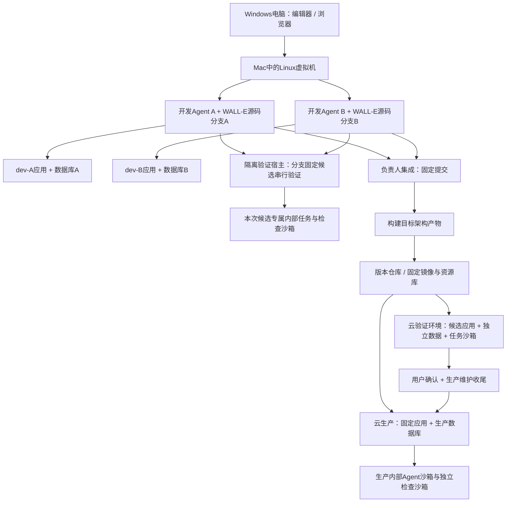
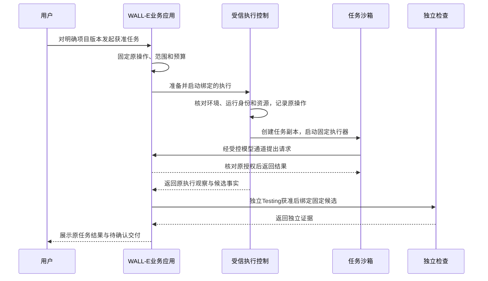

# WALL-E 架构与平台技术选型评审（V2.01）

日期：2026-11-15。修订1.5／REVIEW。性质：独立架构选型建议，待原型验证及定案；未实施、未部署。本文不替代业务大纲或后续前后端契约。第11章给出首期参考部署及集成边界，作为后续原型与详细设计的输入，尚不是已批准的接口或运行配置。

## 1. 评审输入与推荐结论

用户已明确：不偏向Windows或Linux；以日常好用、长期维护和扩展为主；允许V2.0的进程控制、检查和平台执行部分重新采用Linux实现。现有Windows投入仅用于识别需承接的业务保护，不作为必须保留Windows的约束。

可用开发服务器为闲置M1 Pro Mac，16GB统一内存、约500GB可用磁盘；日常仍可使用Windows电脑。最终正式服务计划上云，旧业务历史和任务成果不迁移。用户主要在中国大陆使用，云资源预算意向约100元／月；本稿暂按人民币、基础设施费用理解，模型API及开发工具订阅单列，不把该拆分写成用户已逐项确认。Mac的macOS版本、网络与长期运行条件尚未核实；云厂商、具体机房及实际套餐未定，正式CPU架构默认建议x86_64。

**推荐Linux作为正式目标；采用多个代码工作区、按需开发实例和串行完整验证的轻量架构。Mac是优先试用的开发宿主，云验证机尽早验证正式目标；Mac不必承载全部执行能力。Compose用于应用部署，内部执行运行时单独准入；Coolify等管理平台后置，不作为开工前提。** 这是架构推荐，不是已验证的兼容结论，也不等于必须采用该运行时或平台所有功能。

不再把“先保住Windows实现”作为主路线。不默认建设Windows执行节点＋Linux业务节点的混合系统，也不同时维护两套正式执行器。若Linux候选关键能力不满足，应先比较其他Linux隔离方案与工作量，再重新评审，而不是悄悄削减Coding／Testing能力。

### 1.1 从完整架构比较，而不是从工具清单出发

本轮判断依据为当前少量开发者／Agent、单人集成、既有FastAPI＋SQLite及应用内工作器、内部Coding／Testing能力、16GB Mac和最终上云。尚无持续并发负载、网络实测或预算依据，因此以下比较是工程判断，不是性能测试或费用报价。

| 完整路线 | 日常开发体验与主要代价 | 当前判断 |
| --- | --- | --- |
| Mac承担所有开发和完整执行，成熟后再上云 | 利用闲置硬件，但远程接入、ARM兼容和内存都成为所有工作的前置条件；正式云差异发现过晚 | 不采用这种强依赖顺序 |
| 全部云开发，另设云生产 | 开发与目标架构容易统一，扩容直接；日常编辑依赖网络、持续资源费用与远程工具体验 | 保留为Mac接入或容量不合适时的替代主路线，不是次等方案 |
| Mac普通开发＋尽早使用云验证机＋独立云生产 | 利用已有硬件，同时把正式架构问题提早暴露；需要清晰标记哪些能力在哪里验证 | 当前推荐；同一个任务只有一份活动工作区，固定提交用于跨机验证 |
| 从一开始建设工作区平台、沙箱平台和独立执行集群 | 长期扩容能力强，但当前先承担多套身份、元数据、升级及恢复系统 | 当前不采用；需求增长或原型证据证明必要时再评估 |

Mac不是架构必须长期保留的组成部分。若远程开发体验不好、睡眠／重启影响频繁或重任务排队妨碍实际进度，应把活动开发工作区迁到云开发机；不能因为已经有Mac，就继续投入复杂的本地兼容工程。云厂商未定不妨碍这个边界，但不应在访问与预算未知时指定购买方案。

### 1.2 应用与内部Agent是否从第一天分服务器

需要先分开职责和权限，再决定是否分机器。当前源码中的工作器直接参与业务数据库与恢复流程，抽到另一服务器并非部署配置变化。

| 部署方式 | 得到什么 | 新增成本／剩余风险 | 当前判断 |
| --- | --- | --- | --- |
| 同一Linux VM：业务应用＋受限执行控制＋任务沙箱 | 本地控制协议、文件交付和恢复较直接；保留现有单实例业务模型 | 共享宿主故障与资源；必须验证任务隔离、宿主配额及业务预留 | 首期受控使用的候选，不作为任意代码托管服务的普遍安全承诺 |
| 两台VM：业务与执行分开 | 执行主机资源耗尽／故障较少直接影响业务主机 | 增加身份认证、任务派发与去重、断网对账、产物传输和节点恢复；不能远程共享SQLite | 出现隔离要求或资源压力时采用；若同机准入失败则成为正式使用前置条件 |
| 业务应用＋托管沙箱服务 | 可复用沙箱创建、资源与远程访问接口，减少宿主运维 | 仍需验证网络出口、生命周期、结果持久化、地区与费用，WALL-E业务适配不会消失 | 列入执行底座对照验证，不因“托管”直接判定满足契约 |

首期不自建执行集群；只定义一个执行适配边界，让业务提交受控任务、查询原执行、停止原执行并取得固定产物。运行时对象与业务任务关联必须持久化。该边界不承诺未来换后端零成本，也不提前实现多节点调度、通用队列或双向数据库同步。

正式生产同机方案只有在任务不能访问业务数据／控制凭据、资源压力不会破坏业务恢复、全链停止和异常对账通过后才准入。不能为节省一台服务器而放弃这些条件。是否独立执行机是验证后的架构决策，不是“上云”三个字隐含的结果。

### 1.3 首期到底需要多少环境

两个Agent意味着两个独立代码工作区，不意味着两个完整WALL-E执行平台。建议初始配置如下：

| 资源 | 初始安排 | 生命周期 |
| --- | --- | --- |
| 外部开发工作区 | A、B各自克隆／分支、可写依赖和开发凭据 | 随开发任务保留；交付后明确清理 |
| 普通开发实例 | A／B按需启动，分别使用自己的数据和入口 | 调试时运行，可只启动其中一个 |
| 完整执行验证 | 一个隔离验证宿主，串行部署当前固定候选 | 候选切换先收尾、保留证据；不同开发任务使用独立环境与数据；同一环境的升级演练保留环境身份并按规则维护数据代次 |
| 集成与云验收 | 合并版本按需运行；可以复用空闲验证计算资源 | 复用计算资源不复用业务数据、许可或旧执行身份 |
| 正式生产 | 独立云环境，运行批准的固定产物 | 持续运行，不用于开发构建或分支验证 |

普通实例缺少内部执行能力时明确显示不可用；需要验证内部能力的分支送入完整验证环境。以后确实需要两项完整任务并行时，再增加隔离执行容量，不能为了“多Agent”先复制所有服务。此安排保留每任务独立环境能力，但不要求每个环境始终常驻。

### 1.4 收敛后的默认决策

下表是当前推荐基线，供详细设计与原型沿一条主路线推进；“推荐”不表示已采购、已验证或已获正式定版批准。备选只在对应条件发生时启用，不同时建设。

| 项目 | 默认推荐 | 何时重新评估 |
| --- | --- | --- |
| 操作系统与正式架构 | Ubuntu24.04 LTS，云端x86_64；Mac用同发行版ARM64作开发，正式产物只维护一条目标架构发布链 | 目标运行包或云镜像不满足；ARM云若有明确成本／兼容优势，先验证再改正式架构 |
| 云产品与地域 | 中国大陆地域的Linux虚拟机；先比腾讯云Lighthouse套餐，阿里云轻量／ECS作报价与能力对照；不选要求放弃宿主执行控制的纯应用托管产品 | 套餐内存、磁盘、长期价格或内核／网络控制不满足，则换规格或标准云VM；不因促销价降低任务边界 |
| 首期生产拓扑 | 一台云VM承载应用与受信执行控制，任务使用gVisor沙箱；一次一个完整重任务，单实例SQLite | 隔离或资源实测不满足则不得启用完整生产，改独立执行机并补远程协议；预算不够须调整预算或可用范围 |
| 本地与验证资源 | Mac两个代码工作区、普通实例按需运行；完整验证串行；云验证与生产分宿主，云验证按使用周期准备 | Mac接入不适合日常开发则迁云开发机；额外机器成本进入总预算，不能借用生产做底座实验 |
| 执行底座 | Docker管理受控资源，固定runsc／gVisor systrap作为第一条待验证路径；OpenCode保留1.19.5 | 先区分配置、平台适配和运行时兼容问题；硬性不兼容才比较独立VM或托管沙箱，不静默换普通容器继续执行不可信任务 |
| 应用部署与入口 | Compose、固定镜像及资源清单；Caddy作为未接平台时的入口；独立最小管理适配保留业务收尾 | 后续若Coolify通过控制与资源评估，统一替换入口管理，避免两套代理／发布入口相互覆盖 |
| 可视化管理 | 首期实现必要环境摘要及受控操作，复用云控制台看宿主指标；不要求先装Coolify、Coder或自托管沙箱平台 | 环境数量和人工操作成本实际增长，且平台通过维护／恢复准入后再接入；不取消大纲中的可视化交付 |
| 身份与凭据 | 单人私用阶段使用HTTPS入口认证，业务／管理／各开发环境分凭据；任务通道独立身份，详见11.4 | 多用户、统一登录或明确退出登录体验成为必要需求时接成熟身份方案，不自行扩成账户平台 |
| 用户项目与成果 | 负责人准备服务器侧仓库，产品完成本地分支交付，负责人显式取回／同步远端 | 自动拉取、push、PR作为新增产品能力独立定案，不把它们归为Linux适配细节 |
| 持久化与备份 | 业务库及内容在本地持久盘；一致性恢复资产用restic等成熟工具备份到独立存储，费用计入预算 | 容量、恢复目标或多写入者需求实际改变时再评估存储；不因上云先引入托管数据库 |

选择24.04不是声称它是最新版本；[Ubuntu官方支持周期](https://ubuntu.com/about/release-cycle)列出其标准安全维护至2029年5月，当前可作为统一验证基线。x86_64是为先固定一条正式验证链的工程默认，不是已测得它比ARM更快。云系统镜像、内核、Python／Node及运行包在原型准备时固定具体版本，不继承Windows锁文件或随安装使用latest。

## 2. 代码位置、运行位置与完整工作流程

### 2.1 先分清三类Agent与环境

“开发WALL-E的Agent”是我们使用的外部开发工具；“WALL-E自己的Agent”是用户在WALL-E里创建Coding任务后，由产品启动的执行器；“独立检查执行器”负责验证结果。三者不能因为都能执行代码就共用工作区、权限和结果来源。模型供应方负责模型推理，Agent进程负责调用模型及执行工具；使用远程模型不代表代码也在模型供应方机器上执行。

| 对象 | 推荐运行位置 | 可操作的代码／数据 | 不应持有的能力 |
| --- | --- | --- | --- |
| 操作者的编辑器与浏览器 | 日常Windows电脑，可换其他客户端 | 通过受控连接操作指定开发工作区、打开相应环境页面 | 不自动获得生产部署或所有任务权限 |
| 开发WALL-E的外部Agent A／B | 优先Mac Linux中的独立开发工作区；接入不合适时迁云开发机；执行进程靠近源码 | 各自WALL-E任务分支与开发数据 | 生产库、生产凭据、宿主容器控制接口 |
| 开发版WALL-E | Mac Linux中按需启动的dev-A／dev-B普通实例 | 对应分支构建出的程序、各自开发库 | 另一任务数据和生产数据 |
| 集成／候选版WALL-E | Mac Linux内，按需启动；目标架构验收另在云验证环境 | 合并后的固定版本和独立验收库 | 自动晋升生产的权限 |
| 生产版WALL-E | 云端Linux业务环境 | 经确认的固定程序及生产业务数据 | 开发工作区的可变源码 |
| WALL-E内部Coding Agent | 发起任务的WALL-E环境所属执行宿主上的任务沙箱 | 用户项目的指定版本副本、任务输出目录 | WALL-E自身程序、业务数据库、部署密钥、其他任务 |
| 独立Testing／浏览器检查 | 同环境的独立检查沙箱，按原业务规则绑定候选 | 被测候选、固定检查资源及隔离测试数据 | 直接改写可信报告依据、连接正常生产目标 |

首期执行宿主与所属WALL-E应用可以是同一Linux VM，但任务沙箱具有独立文件、权限、网络和资源范围；这不等于另设一台执行服务器。同宿主仍共享内核和硬件，不能承诺任务异常绝不影响业务。任务CPU、内存、进程数、磁盘与并发必须受限，并为业务服务预留容量；资源不足时不启动新执行。正式部署前必须验证同宿主隔离与容量是否足够。如果要求更强的宿主隔离或负载超限，再将任务执行迁至独立Linux节点；这需要明确的远程执行协议，不能只改一个地址。

### 2.2 推荐物理布局

图中普通开发实例与完整验证实例不是必须同时运行；验证宿主可在Mac或云端，按目标架构决定。箭头表示访问或交付关系，不表示共享磁盘。云验证与生产至少具有独立的数据、凭据和运行资源；正式生产与外部Agent开发／构建不共用宿主。云验证使用独立于生产的宿主，按使用周期建立；不能为省预算把待验证的执行控制程序放到生产宿主。云验证机的停机不等于免费，实例、磁盘、地址和快照的保留费用一并计入预算。

Mac开发验证与云目标兼容性核对分步交错推进，不要求Mac上的全部执行能力通过后才接触云目标。正式启用后，生产应用、内部执行器和必要资源全部在云侧。Mac不是生产的数据库、任务队列或执行节点，关闭Mac不会中断云端正在执行的产品任务。

### 2.3 WALL-E源码和用户项目代码分别存在哪里

下列是逻辑目录示例，不是已创建路径或最终配置格式：

| 数据类别 | Mac Linux示例位置 | 云端对应安排 |
| --- | --- | --- |
| WALL-E开发源码 | `/srv/walle-dev/workspaces/task-a`、`task-b`，不同分支 | 生产不挂载这些目录；云构建若需要源码，使用固定提交的独立工作区 |
| 开发／集成业务数据 | `/srv/walle-dev/environments/dev-a/data`等 | 每个云验证或生产环境单独持久化 |
| 内部任务的用户项目副本 | `/srv/walle-dev/environments/dev-a/tasks/<task-id>/workspace` | `/srv/walle/environments/prod/tasks/<task-id>/workspace`等环境专属位置 |
| 检查资源与结果 | 环境独立的checks、receipts、artifacts区域 | 同样由可信控制端保存，不能交给被测程序随意写入 |
| 固定交付物 | 本地候选可缓存，正式交付保存至明确的镜像／资源仓库 | 云端按目标架构和摘要取得，不依赖Mac在线 |

源码共享Git对象不意味着共享可写依赖、数据库或密钥。部署平台管理的是应用版本与运行资源；Git仓库保存源码提交；镜像／资源仓库保存交付物；业务数据库保存用户文档、任务及结果。这四类存储职责分开。

原Windows工作区当前含未提交开发成果，不能直接复制后宣布它是固定基线。将来实际迁入Mac时，先核对并保存这些成果，按明确授权选择提交或受控转移；不丢弃其他任务改动、不自动提交。迁移开发源码与“不迁移旧业务历史”是两件事。

### 2.4 一次修改WALL-E的完整过程

1. **分配开发任务。** 从明确基线创建任务A分支、工作区、配置及独立数据。外部Agent在该工作区修改WALL-E源码。Windows电脑主要提供操作界面，不通过反复复制目录维持两套活跃源码。
2. **运行开发版。** 使用分支A启动dev-A，前端和API明确绑定dev-A；另一Agent使用dev-B。修改A不能热更新B或生产。开发容器与应用容器不必相同，源码共享仅限本任务需要的范围。
3. **测试普通功能。** 用户打开dev-A页面，验证文档读写、交互、失败恢复。自动检查也访问dev-A及它的隔离数据，不能只跑单元测试后宣称整套应用可用。
4. **测试内部Agent功能。** 将分支A固定候选送入隔离完整验证环境，再创建Coding／Testing任务并启动所属沙箱，使用专门测试项目。普通dev-A未接入执行能力时不提供可执行入口；以后资源允许才为各分支分别配置完整执行环境。即使任务目标也是WALL-E代码，也只取得固定测试副本；不让它直接修改启动自己的活动源码或当前控制程序。
5. **交付并集成。** 外部Agent提交明确成果，由负责人处理合并与冲突。不同任务数据库不合并。组合版本重新检查，不把两分支各自通过当作组合通过。
6. **构建固定候选。** 从明确提交构建固定包或镜像，关联平台、依赖与资源摘要；候选应用不再热跟随源码。Mac的ARM64结果只证明相应架构，云端x86_64产物必须另行构建验证。
7. **云端目标验收。** 将同一目标产物部署到云验证环境，用全新测试数据检查启动、内部任务、完整停止、升级和恢复。仅ARM64本地通过不能跳过该阶段。
8. **发布生产。** 用户确认具体候选和目标；生产先禁止新任务并完成原任务收尾，再停止旧实例、处理必要数据维护、启用同一候选产物。只发布程序和受控配置，不搬入开发库或测试任务许可。
9. **保留成果并清理。** 工作区、数据、任务沙箱分别确认清理。代码合并、环境停止或关闭编辑器均不自动删除未交付成果。

### 2.5 用户在生产WALL-E里发起任务时发生什么

以“让WALL-E修改项目X”为例：用户浏览器向云端WALL-E提交任务 → 业务服务保存原请求与授权 → 可信执行控制准备项目X指定版本的任务工作区 → 启动固定执行器沙箱 → 执行器通过受控模型出口调用模型并在沙箱内修改项目X → 独立检查取得固定候选运行测试／浏览器 → 控制端核对报告、产物和原操作 → 按产品交付规则保存或交付成果。

这里没有开发WALL-E的外部Agent参与，也不依赖Windows电脑或Mac继续开机。用户浏览器断开不等于任务取消；重新连接查询原任务。Agent可以请求工具执行，但不能直接写WALL-E业务数据库或把自己的文字声明当作可信测试结果。

Coding与Testing按V2.0原业务规则衔接，不把上述示例解释成所有Coding任务都自动获准执行独立Testing。模型密钥留在可信控制／代理侧，任务沙箱只获得范围受限的访问能力，不能把完整供应方密钥作为普通环境变量发给不可信项目代码。

项目X如果来自原本电脑上的本地路径，云端不能直接读取。首期推荐由负责人先准备服务器侧独立仓库，再登记其中的固定提交及获准本地交付分支；V2.0的本地Git交付不能直接解释成远端拉取或推送。具体边界见第11.5节。纯本地文件需要明确转移或另行设计导入能力，不能悄悄同步整个电脑，也不能只传本机路径字符串。用户项目来源接入是正式云使用的必要设计项。

WALL-E自身也可以被登记为受控任务的目标项目，但其输出必须经过固定候选验证和用户发布确认，不能自动覆盖或重启正在运行的生产WALL-E；首期不启用自动自我部署。

### 2.6 执行控制、检查环境与部署权限

部署控制与内部任务控制使用不同权限。业务HTTP进程不直接挂载通用Docker控制接口；若执行适配需要调用容器运行时，应由受限的可信入口接受固定类型、固定环境和固定资源范围的动作，用户输入不能变成任意镜像、挂载或宿主命令。其Linux实现仍待验证，不声称现成Compose已经提供这些约束。

内部任务需要运行被开发应用时，在任务专属执行范围启动它；独立浏览器只获得该任务明确准入的测试地址。不能把“允许浏览器访问网络”扩大为可以访问WALL-E后台、云元数据或其他环境。被测应用及其子进程也纳入停止、配额和资源回收，不只停止Agent主进程。

取消内部任务时，由控制端针对原任务停止Agent、工具子进程和被测应用，核对原外发与交付结果后更新业务状态；停止应用容器、关闭终端或丢失连接都不能代替完整停止证据。运行时的资源终止属于故障事实，不伪装成任务成功或用户主动取消。

检查过程可能使用内部隔离网络或受控转发，具体由运行时原型决定；可信检查资源和原始证据由控制端绑定。测试代码、被测应用、检查程序并非一个拥有全部权限的容器。工作区、产物、回执保留与运行中进程分开：停止执行不自动删除结果。

### 2.7 资源与故障场景复核

| 场景 | 应有结果 |
| --- | --- |
| 两个外部Agent并行改代码 | 可各自编辑；不代表两套构建、浏览器和内部任务都能同时运行 |
| Mac内存紧张 | 重任务按配置排队，界面显示等待；不杀在途任务、不借用生产运行资源 |
| Mac关机／Linux VM停止 | 本地开发和验证不可用；未提交代码由持久磁盘保留，运行中任务按异常恢复；云生产继续独立工作 |
| Windows电脑断网／关闭浏览器 | 已受理任务仍由所属环境管理；重连查询原结果，不生成新键重做 |
| 云端失联／执行器崩溃 | 原任务显示未知或恢复中；核对原进程、外部交付及回执后推进，不自动重发模型或Git写入 |
| 正在更新WALL-E时内部任务未结束 | 阻止切换，用户选择等待、取消本次更新或按原规则取消任务 |
| 目标程序正在被测试 | 测试访问该任务固定候选和隔离数据，不访问正常生产业务 |
| 管理平台不可用 | 不自动停掉正常业务，也不自动解除已有维护；恢复后核对实际运行版本和原操作 |

以上为推荐架构及待验证行为。首期不增加通用分布式调度系统，但单宿主的资源准入和可见等待状态不能省略。16GB Mac上的完整并发能力以实际测量为准；开发、集成、候选实例按需运行，不要求全部常驻。

## 3. 本地资源与云预算

### 3.1 Mac本地开发验证方案

建议先建立一台Ubuntu24.04 LTS ARM64虚拟机。虚拟机内使用Linux版本的Python、Node、Git、数据库、容器工具和任务执行器；不让macOS程序承担Linux执行证据。源码、数据、依赖缓存及任务目录放在Linux文件系统，不依赖macOS共享目录的权限和文件监视语义。

| 资源 | 初始配置建议 | 调整依据 |
| --- | --- | --- |
| 虚拟CPU | 4个 | 构建耗时与宿主响应；M1 Pro具体核心数尚未核实 |
| 内存 | 8GB | 为macOS保留空间；根据峰值、交换和任务失败再调整 |
| 虚拟磁盘 | 150～200GB | 源码、镜像、浏览器与缓存；设置容量告警，备份另算 |
| 工作区 | 两个独立开发任务 | 不等于保证两套完整浏览器／构建同时运行 |
| 重任务 | 初期全宿主同一时间一个重任务，包括构建、内部执行或浏览器检查 | 实测后增加并发，内存不足排队，不自动杀在途任务 |

上述是待测起点，不是负载容量承诺。暂不在16GB机器上同时堆叠Coder、多个管理平台、大量VM和本地模型。第一步可直接用Compose和工作区工具，验证需要时再加一个管理平台。

虚拟机优先候选为[Multipass](https://canonical.com/multipass/docs/latest/explanation/platform/)，便于重复创建Ubuntu环境；当前要求macOS14或以上，使用前核对。需要图形化控制时以[UTM](https://github.com/utmapp/docs.getutm.app/blob/main/settings-qemu/system.md)作为备选。M系列使用ARM64硬件虚拟化，不把x86模拟当主要开发环境。两者只选择一个，不重复维护。

Windows电脑通过受控连接访问Linux工作区和应用；可使用远程编辑器或实际支持该连接方式的Agent。现有Windows桌面Agent是否能直接接入此工作区须单独核实，不能认为建立SSH连接就意味着所有Agent客户端自动兼容。Mac需核对休眠、重启、断网及远程访问；首轮只做受控局域网访问，不直接暴露管理端口到公网。

本地通过对应依赖与运行时准入后，才可验证业务、任务执行、取消、隔离和恢复；云端仍须验证目标内核、存储、网络和无人值守重启。若Mac环境无法复现某项内核能力，应转到云端验证该项，不以关闭隔离功能获得通过。

### 3.2 中国大陆使用与约100元／月预算

预算作为约束，不作为容量证据。首期不配置三套云环境常驻、不增加托管数据库、负载均衡或GPU；开发构建优先利用Mac，云验证独立于生产且按周期使用。生产中的内部Agent仍在云端执行，不能为了省钱改成依赖Mac在线。

建议先比较4GB与8GB内存档：4GB用于普通业务及低负载验证的起点；同机完整Agent＋被测应用＋浏览器优先验证8GB档。两者都不是保证，实际可用容量要扣除系统、业务、执行控制、入口和恢复预留。不能因为买到了4GB促销机就声明完整执行可上线；也不默认8GB足以运行任意用户项目。磁盘须容纳固定镜像、浏览器、任务副本与恢复资产，按实际体积选择套餐，不能只看CPU数量。

| 预算用途 | 暂定月均上限 | 含义 |
| --- | --- | --- |
| 常驻生产套餐 | 65元 | 含套餐内计算、系统盘与网络；这是筛选目标，不是已取得报价 |
| 独立备份／产物存储 | 10元 | 包含容量、请求与传输核算；超出须调整方案，不省略恢复资产 |
| 云验证及其他余量 | 25元 | 用于阶段性独立验证、套餐外费用和价格波动；不保证每月足够 |
| 合计 | 100元 | 年付折算月均仍需一次支付；不能把首付金额与月均混淆 |

2026-11-15查阅的[腾讯云官方活动页](https://cloud.tencent.com/act/pro/lhsale)显示4核4GB／3Mbps新用户首年109元，续费另有条件；[阿里云官方99计划](https://www.aliyun.com/activity/ecs/99program)显示2核2GB／3Mbps／40GB的99元年付及活动期续费规则。这只能证明存在低价入门选项，不证明账号有资格、当前地区有库存，或相同价格买得到完整执行所需容量。2GB不作为本项目完整Agent生产配置推荐。

Lighthouse优先比较的原因是少量单机应用可按CPU、内存、磁盘和网络套餐核算，符合当前预算控制方式，见[腾讯云实例购买说明](https://cloud.tencent.com/document/product/1207/56823)；不是认定它性能优于阿里云。最终对比相同内存、磁盘、网络及期限，包含首购、续费、超额流量、备份和验证资源，不用开发者社区转载价格替代结算页。轻量服务器通常为包年包月产品，短时验证如果使用标准按量VM，需另核对其磁盘和公网计费；不能套用轻量年付价格估算小时成本。

目前未取得符合账号条件的8GB长期报价，不能断言100元／月“肯定够”。推荐先在此预算内寻找完整配置；若预算与实测容量冲突，明确选择增加预算或保持开发验证状态，不把生产执行迁回Mac、不共享生产做测试、不削减隔离。模型费用与开发Agent订阅不在上述暂定拆分内；如果用户希望100元覆盖全部费用，需按预计调用量重新核算。

地域默认中国大陆，具体机房由实际网络测试决定。分别检查操作者到业务入口、云端到实际模型渠道、Git／依赖／镜像源的可达性；“能打开网页”不能替代这些链路。固定依赖与镜像可经受控流程保存在目标可达的存储中，核验摘要，不通过任意第三方镜像绕过来源核对。当前以私用受控入口设计；未来开放公网网站时再按选定云平台要求核对域名与接入条件，不把当前方案描述成已具备公开服务条件。

## 4. ARM64与云端发布策略

Mac使用ARM64；当前正式架构默认推荐x86_64，先固定一条生产发布链。同时核对两种架构的运行包，但ARM64验证完成不是云验证的前提；只有具体报价与完整兼容证据支持时才把ARM64改为正式目标。

- 云端也采用ARM64：可晋升同一架构的已验证固定产物，但仍需目标宿主验收。
- 云端采用x86_64：从同一源码提交和资源清单构建x86_64产物，并在该架构验证；不能把Mac验证通过写成x86发布包已通过。
- 多架构镜像具有各自的实际镜像摘要；发布绑定目标架构及其产物摘要，不能只记录一个可变标签。候选到生产必须是该目标架构的同一产物。

[Playwright支持Ubuntu ARM64](https://playwright.dev/docs/intro)，[gVisor支持ARM64](https://gvisor.dev/docs/user_guide/install/)，但这不证明项目锁定的全部组合已兼容。OpenCode保留项目既定1.19.5。本轮在[官方发布资产清单](https://github.com/anomalyco/opencode/releases/expanded_assets/v1.19.5)核实存在`opencode-linux-arm64.tar.gz`、`opencode-linux-x64.tar.gz`及x64 baseline包，故“是否发布Linux包”已明确；尚未下载、验签、运行或验证协议。Ubuntu先核对相应非musl包及CPU要求，固定选用资产和摘要，不能自动fallback另一包；现有Windows产物摘要不可复用。

gVisor优先评估不依赖硬件嵌套虚拟化的[systrap模式](https://gvisor.dev/docs/user_guide/platforms/)。不能预设M1上的Linux虚拟机可以提供Firecracker所需KVM能力；微虚拟机方案若成为必要候选，使用明确支持它的验证宿主另测。

## 5. 平台路线比较与选择原则

| 方案 | 优点 | 对本项目的代价 | 推荐 |
| --- | --- | --- | --- |
| 全Linux：Mac Linux开发＋云Linux | 本地与云采用同一操作系统体系；部署和隔离工具可复用 | V2.0原生执行和维护适配重做；ARM与x86需分别验收 | 目标主路线，先过完整执行验证门槛 |
| 全Windows云端 | 现有原生实现可继续适配 | 不符合Mac原生ARM Linux开发路线，仍需另建Windows验证环境 | 不作为默认，仅保留对照依据 |
| Linux业务＋Windows执行 | 能利用部分既有执行实现 | 双平台运维及跨机任务协议同时增加 | 首期不选 |
| macOS直接运行正式服务与执行 | 使用闲置机器直观 | macOS权限／进程机制又成为第三套平台，且最终还要上云 | 不选；Mac仅作为Linux虚拟机宿主 |

选型关注真实创建环境、交接、排错、升级及恢复体验，不能只比较“一键安装”或项目星数。Windows历史工作量不作为否决Linux的理由；但原有安全和一致性要求必须承接，不能把允许重做理解为可以删除这些行为。

## 6. V2.0平台影响与源码依据

2026-11-14的静态读取基于HEAD `28a7c9e13c73a9d386081a6dd894244b51746a45`及当时的未提交工作区；该工作区不是冻结发布包。对`backend/app`全部Python模块做AST导入扫描时，共509个模块，其中49个文件名以`windows_`开头，另有151个模块直接导入这些模块：基础设施85个、Coding57个、Testing9个。扫描包含函数内及条件导入，反映检查范围，不代表151个模块全部要重写，也不能据此计算迁移百分比或工期。V2.0仍有执行准入待验证，不能把已有源码数量等同于Windows方案已验收。

| 层次 | 现场依据 | 换到Linux的影响与处理 |
| --- | --- | --- |
| 前端页面与编辑器 | React、TypeScript、Vite、Milkdown；`frontend/package.json` | 主要页面和业务交互保留；调整构建交付、入口地址、认证和浏览器环境绑定。无需因上云重写前端框架 |
| HTTP与普通业务 | FastAPI／Uvicorn；`backend/app/service.py`统一装配业务和后台工作器 | 业务规则优先保留；应用入口同时接入Coding／Testing和恢复，不能凭FastAPI跨平台就宣称整个服务可直接迁移 |
| 数据与事务 | SQLite、显式路径、短事务、`process_lock.py`已有Windows／POSIX分支 | 保留现有模型和单实例约束；Linux依赖、文件系统与崩溃恢复仍要验证，不因云部署自动换PostgreSQL |
| 任务状态及原命令 | Coding／Testing的任务、预算、原操作和回执契约 | 保留业务语义；这些模块与本机执行混合调用，要把平台操作隔开，不能仅把Win32调用替换成shell命令 |
| 受管进程与权限 | `windows_job.py`、LPAC、Token／SID、SYSTEM Guard、受保护命名管道 | 高影响。Linux需要新的执行适配与身份／权限证据；成熟运行时可承担隔离原语，任务归属、原操作核对与完整停止仍需接入 |
| 网络限制与模型通道 | `guard_task_network.py`、`windows_wfp.py`，按任务限制原端点 | 高影响。需要在Linux运行边界外约束网络，并保留受控模型出口和预算。容器可联网或设置一个网络名称不等于原规则成立 |
| 文件及固定程序包 | NTFS文件身份、ACL、句柄锁、PE镜像、私有记录；`program_package.py`、`windows_private_record.py` | 高影响。Linux重新定义目录／文件身份、不可变产物及可信回执；现有Windows包不能直接作为Linux镜像使用 |
| 浏览器与独立检查 | 固定浏览器驱动、LPAC私有桌面、受控HTTP转发；`check_driver_private_desktop.py` | 高影响。Linux浏览器运行、沙箱、目标访问及报告归属须重验；普通Playwright成功不等于原独立检查边界等价 |
| 数据初始化／升级／恢复工具 | `schema_v20_cli.py`、`schema_v20_upgrade.py`、`schema_v20_assets.py`使用Windows路径与私有包保护 | 中至高影响。SQLite本身跨平台不代表这些工具跨平台；全新云数据可以跳过旧历史迁移，但不能跳过初始化、备份及今后版本升级 |
| 执行器与依赖发布 | `opencode_binary.py`固定OpenCode1.19.5的Windows x64包；Python锁文件来自Windows环境 | 新平台重新锁定产物、摘要和依赖；不得顺带升级OpenCode大版本。固定版本的Linux产物可得性、协议及浏览器兼容性列入验证 |

关键源码：[应用装配](../../../../backend/app/service.py)、[进程锁](../../../../backend/app/infrastructure/process_lock.py)、[执行工作器](../../../../backend/app/code_tasks/repository_registration_worker.py)、[Job与LPAC](../../../../backend/app/infrastructure/windows_job.py)、[网络规则](../../../../backend/app/infrastructure/guard_task_network.py)、[程序包](../../../../backend/app/infrastructure/program_package.py)、[私有浏览器桌面](../../../../backend/app/infrastructure/check_driver_private_desktop.py)、[数据维护](../../../../backend/app/infrastructure/schema_v20_upgrade.py)、[固定执行器](../../../../backend/app/infrastructure/opencode_binary.py)。

作为对照，Windows云服务器也不是本机的无条件复制：必须核对选定Windows Server镜像、账户权限、无人登录时的服务及浏览器运行、磁盘权限和重启恢复。服务器上存在Windows API不等于现有完整执行链路已通过。

## 7. 开源选型与职责边界

| 能力 | 候选及来源 | 本项目采用建议与必须补齐的边界 |
| --- | --- | --- |
| 独立代码工作区 | [Git worktree](https://git-scm.com/docs/git-worktree) | 受限外部Agent优先独立克隆；同一信任范围可使用worktree独立分支。共享仓库元数据不隔离进程、密钥或运行数据 |
| Linux多套应用部署 | [Docker Compose](https://docs.docker.com/compose/intro/compose-application-model/) | Linux路线优先；按环境固定项目、镜像摘要、挂载和网络。项目名称不能替代真实路径和外部资源隔离 |
| 可视化应用管理 | [Coolify](https://coolify.io/docs/start-with-self-hosted)、[部署方式](https://coolify.io/docs/applications/deployments/overview) | Linux路线优先验证其Compose／固定镜像管理及API接入，复用配置、部署记录和平台界面；仅支持Linux，不能直接托管原Windows执行层 |
| 可视化备选 | [Dokploy Compose](https://docs.dokploy.com/docs/core/docker-compose)、[部署模式](https://docs.dokploy.com/docs/core/deployment-options) | 功能符合候选方向；保留Compose模式作对照，不因平台支持Swarm就启用集群。若Coolify无法满足关键控制接口，再做同场景替代验证；不并行建设两套管理平台 |
| 云端开发工作区 | [Coder](https://coder.com/docs/user-guides/workspace-management/)、[Windows VM模板](https://registry.coder.com/templates/azure-windows-vm) | 同时适用于Windows／Linux工作区候选。初期两个任务工作区时，独立克隆／worktree配合现有工具更轻；确认需要云端开发入口和批量工作区后再引入，不将其AI调度功能自动纳入本迭代 |
| 开发依赖描述 | [Dev Containers](https://containers.dev/) | Linux开发路线采用可复现环境描述；它不是生产发布平台，也不证明现有Windows执行能力已迁移 |
| Windows普通应用服务 | [WinSW](https://github.com/winsw/winsw) | 仅作为Windows对照，不进入Linux推荐栈；Linux宿主守护与应用容器生命周期分别采用原生机制，避免多个守护器同时重启同一实例 |
| 入口与反向代理 | [Caddy](https://caddyserver.com/docs/running)／所选平台自带入口 | 未接完整平台时选Caddy作参考入口；后续平台接管时统一入口职责，不叠第二套代理。HTTPS、入口认证与业务授权分别处理 |
| Linux受管执行隔离 | [gVisor](https://gvisor.dev/docs/)、[兼容边界](https://gvisor.dev/docs/user_guide/compatibility/) | 作为第一条原型路线，使用固定runsc的systrap模式，不自行重造容器内核。必须验证固定OpenCode、Git、构建与浏览器；宿主身份、网络许可、可信结果和任务停止仍需业务适配，不能声称等价替换LPAC／WFP |
| 更强隔离的备选 | 独立云VM；[Firecracker](https://github.com/firecracker-microvm/firecracker/blob/main/docs/getting-started.md) | 若任务运行时兼容或隔离目标不满足，比较独立VM成本；Firecracker依赖KVM，不作为普通云VM一定可用的默认设施，也不同时建设第二套执行器 |
| 备份存储 | 现有一致性备份流程＋[restic](https://github.com/restic/restic/blob/master/doc/020_installation.rst)候选 | 复用归档和异地存储能力；先形成可恢复的一致性资产，再归档。普通卷备份不替代数据库一致性，Windows权限和文件身份也须恢复后重验 |

托管沙箱作为主路线遇到硬性阻塞时的对照，不与本地运行时并行建设。参考[Daytona Linux沙箱](https://www.daytona.io/docs/en/linux-sandboxes/)与[E2B持久化](https://docs.e2b.dev/sandbox/persistence)：前者区分共享宿主内核的容器和独立内核VM，后者区分暂停／恢复与终止。不能把供应方“停止／暂停”直接映射成WALL-E完整终止，也不能从产品宣传推断隔离类型。需用固定OpenCode、网络许可、取消、产物导出和失联恢复场景比较适配工作量，未验证前不推荐采购或替换。

[Daytona平台架构](https://www.daytona.io/docs/en/architecture/)含API、Runner、元数据存储等多个组件；若自行部署整个平台，运维规模可能超过当前少量任务的需要。现成工具不等于没有接入成本，托管服务与自托管平台也必须分别评价。

Coolify优先于Dokploy是本项目的验证顺序：先验证单宿主Compose、固定镜像和受控发布API是否满足需求，并非认定前者性能或可靠性已经优胜。工作区平台、应用部署平台和不可信任务执行运行时各有职责，不能找一个“支持AI”的工具就替代全部三层。

许可证与版本也纳入选型：[Coolify仓库](https://github.com/coollabsio/coolify)当前标示Apache-2.0；[Dokploy当前许可证](https://github.com/Dokploy/dokploy/blob/canary/LICENSE.MD)区分普通部分与proprietary目录；[Coder仓库](https://github.com/coder/coder)区分AGPL开源部分和企业功能；WinSW标示MIT。这里只记录来源，不把所有版本／功能都视为免费可用。采用时固定发布版本，核对所需API、权限和生命周期能力属于哪个版本，不直接照搬主分支或自动更新。

本轮推荐组合按先后采用：独立任务工作区 → 单Linux VM与Compose／Caddy，同时尽早验证云x86_64目标 → gVisor完整执行验证 → 最小环境管理交付。Coolify只在实际管理负担需要且通过控制准入时接入，不是版本完成前必装组件。外部Agent受限工作区优先使用独立克隆；worktree仅用于同一信任范围且由负责人管理的工作区，不将共享Git元数据视为隔离边界。Coder在明确需要云端工作区门户及批量管理后再引入。暂不选Kubernetes、Swarm集群或自建通用Agent调度平台。gVisor未通过时比较其他Linux运行时或独立VM，不同时实现多套备用执行链。

## 8. 接入平台的硬约束

1. **单个业务环境仍保持一个活动应用进程。** 当前进程锁、应用内工作器和恢复逻辑不支持随意扩成多个Uvicorn worker或多副本。先保留SQLite与宿主本地持久存储，每环境独立库；不挂共享网络目录来实现跨机并发，也不为平台自带数据库菜单而顺手更换存储。参见[SQLite适用边界](https://www.sqlite.org/whentouse.html)。
2. **发布采用先收尾、再停止、再替换的受控流程。** [Coolify滚动更新](https://coolify.io/docs/applications/deployments/rolling-updates)可能重叠新旧容器；Compose模式虽不用同一滚动机制，也不自动保证我们的收尾顺序。[Compose停止](https://docs.docker.com/compose/support-and-feedback/faq/)存在超时后强杀行为，不能用延长超时冒充无限等待。生产关闭自动发布；平台UI、API和运维入口均不能在正常流程中绕过环境分离大纲的维护与恢复章节。
3. **开发工作区生命周期不得丢失在途任务或未提交成果。** [Coder调度](https://coder.com/docs/admin/templates/managing-templates/schedule)包含自动停止、休眠和自动删除策略。若采用，必须配置并验证它们不会越过我们的手动收尾／清理规则；平台无法提供必要约束时，不接管这类任务。
4. **应用运行与执行任意代码分开保护。** 不能向任务容器暴露生产挂载、平台管理凭据或Docker控制接口；[Docker守护进程权限](https://docs.docker.com/engine/security/)是宿主控制边界。gVisor或VM提供隔离能力，不代替模型预算、原意图、交付确认和可信检查报告。
5. **备份、健康检查和回滚不能只相信平台按钮。** [Coolify持久存储](https://coolify.io/docs/core/persistent-storage/storage-mounts/overview)不等于备份；镜像回滚也不等于数据回退。以本项目的恢复点、真实停止、数据代次和只读就绪证据判定。
6. **不把操作系统切换与其他重构绑在一起。** 保留前端框架、HTTP业务契约、任务和文档对象；不默认引入PostgreSQL、Redis、Celery或Kubernetes。执行适配确有需要时再拆接口，不能以删掉Coding／Testing能力换取“云迁移成功”。

预计保留的自研范围是任务与环境关联、应用身份与浏览器绑定、业务维护收尾、原操作及结果核对、调用授权、数据兼容和交付确认。通用镜像构建、环境基础资源、日志与部署界面优先复用工具。平台维护资源的实际事实，WALL-E维护业务事实；避免两套登记都能独立发起相互冲突的动作。

## 9. 实用性复核与必须修正的开发边界

### 9.1 结论及适用规模

本方案适合目前“单人负责集成、少量Agent并行开发、单实例业务服务、先使用闲置设备”的阶段。Linux目标、Mac作为开发宿主、云端独立生产这三个方向合理；不需要先建设集群或通用开发平台。但是，当前只能判定架构方向可进入验证，不能认定完整执行链已经能落地。

实际工作量集中在执行控制、可信检查、文件／网络边界和维护恢复的Linux适配，不在React页面或Compose配置。允许重做Windows部分是合理前提，但不意味着简单改路径即可完成迁移。原方案中“Mac全链通过后才上云验证”的顺序应取消，否则一个ARM特有问题可能拖住全部开发。

### 9.2 普通开发与高权限底座开发分开

两个开发实例分库、分目录，可以降低普通业务改动互相覆盖的风险；但如果Agent修改的是能操作宿主运行时的可信执行控制程序，仅做上述分离仍不足。尚未验证的新控制程序可能操作错误任务或错误挂载；不能让每个分支都在同一共享宿主上拥有管理其他环境的权限。

- 普通页面、API和业务开发使用各自工作区与开发实例，调用固定版本、按环境限定操作范围的执行入口。
- 修改执行控制、挂载、网络规则、升级恢复工具时，在无生产凭据、无其他任务可写磁盘的独立可丢弃Linux验证VM中运行固定候选。此VM中的控制端权限仅影响该验证VM；不挂Mac宿主目录或主开发VM的活动数据盘。
- 16GB Mac不要求同时常驻两台完整VM。保存开发成果后按需串行启动底座验证VM，或使用按需云验证机。资源不足不能改成向开发Agent开放共享宿主的Docker接口。
- 调试入口保留在WALL-E之外：负责人可用固定启动／检查工具诊断应用，不依赖WALL-E内部Agent先正常工作才能修复WALL-E。外部开发Agent产生的结果仍经独立检查和人工集成。

这不是增加第二套业务执行器，而是隔离尚未可信的底座候选。单机普通容器仍共享宿主内核；如开发任务本身需要更强隔离，应使用上述独立VM范围，不宣称普通工作区是安全沙箱。

### 9.3 远程开发必须验证到实际操作

现有[前端开发配置](../../../../frontend/vite.config.ts)只监听127.0.0.1，API目标也限制为本机回环地址。Windows浏览器不能直接用自己的localhost访问Mac中的服务。Multipass在Mac上的网络还涉及宿主网络共享与防火墙，不能假设VM地址天然可从Windows局域网访问。参见[官方网络排错说明](https://canonical.com/multipass/docs/latest/how-to-guides/troubleshoot/troubleshoot-networking/)。

首选验证受控SSH连接及端口转发，必要时经Mac跳转进入VM；前端与其API代理保留在同一开发环境。转发端口只解决连接，不解决会话隔离；dev-A、dev-B与管理入口按第11.4节使用独立访问来源和凭据，不能把同一localhost的不同端口当作敏感会话边界。若前后端拆成不同容器，当前回环API配置也需要明确调整为环境内部目标，不能原样照搬。HMR连接、上传、长请求及断线重连须按实际页面使用方式检查，不能只验证首页HTTP200。

外部Agent的运行位置以它实际执行命令的位置为准。远程编辑器能打开文件不证明当前桌面Agent也在Linux执行。首个开发接入验收应同时展示：编辑的是哪个工作区、命令在哪台机器执行、依赖安装在哪里、浏览器访问哪个环境，以及断线后如何找回修改。若当前工具不能远程执行，优先使用经验证的Linux端Agent入口；客户端选型未确定前，不承诺现有桌面操作方式无变化。

### 9.4 两个Agent不等于两套流水线同时跑

两套工作区允许并行编辑和讨论；完整执行任务、独立构建或集成验收共用宿主重任务准入范围，初期一次一个完整执行单元。单元内部必要的Agent、构建、被测应用和浏览器按整组峰值预留资源，不让父任务占住唯一名额后再排队等待自己的子步骤，否则会自锁；超出预留容量时明确拒绝或失败恢复，不无限等待。不能分别给外部构建和内部任务各设“并发1”，最终仍同时耗尽8GB VM内存。开发人员手动启动的重任务也要遵守同一排期；自动化准入实现前，以显式人工串行为边界，不宣称已有统一调度器。

需测量普通应用常驻、一次典型构建、一次内部执行与浏览器检查的峰值，再确定实例数量。内存、进程数及磁盘限制需要宿主实际支持并验证；达到硬限制可能造成任务异常，因此提前拒绝新工作，异常后按原任务恢复，不能保证仅靠排队就消除资源故障。

镜像、依赖缓存、任务成果和业务数据分别管理。磁盘低水位时暂停新重任务并提示清理对象，不自动清除未交付工作区、业务库或可信证据。代码推送只保存已提交代码，不能代替未提交成果和环境配置备份；VM快照和同盘备份也不能替代异机恢复能力。开发恢复流程须能在Mac磁盘故障后从保存的源码、配置和必要备份重建，而非依赖唯一一份VM。

### 9.5 Linux执行证据不能照抄Windows实现

当前[应用入口](../../../../backend/app/service.py)会装配工作器及恢复流程，不是天然独立的纯HTTP层；[工作器停止](../../../../backend/app/guide/worker.py)存在10秒宽限及退休逻辑。迁移时必须区分业务维护收尾、进程退出和故障恢复，不把容器停止成功视为所有业务收尾成功。

[gVisor资源模型](https://gvisor.dev/docs/architecture_guide/resources/)说明其内部进程不会逐个表现为宿主进程。因此不能把Windows主PID／子进程检查机械改成Linux宿主进程列表。Linux适配至少须关联环境、任务、执行代次、运行时对象及可信回执；通过选定运行时核对沙箱终止、关联被测应用终止和资源归属，再核对原外发结果。具体字段和接口留给后端设计，不能依赖可能重复使用的PID作为唯一身份。

停止沙箱不等于撤回已经发出的模型请求或Git写入。控制端崩溃后应先对账、再决定状态；取消、超时、资源终止、已交付四类事实分别记录。不得通过重试创建新任务来掩盖未知结果。

### 9.6 管理平台不能成为第二个业务指挥入口

WALL-E环境页负责环境身份、任务占用、维护状态与允许动作；第三方平台负责实际部署资源与技术日志。管理入口及操作记录不依赖被更新的业务进程继续运行，业务导航可以跳转该独立入口；不能把发布控制仅做成业务服务中的页面／API，导致停止业务后无法继续切换或恢复。独立入口可以先由受控工具和最小状态界面承担，不要求先部署完整平台。首期可展示这些必要业务状态并链接平台详情，不复制一套完整平台控制台。维护失败时环境页保留原因和恢复入口，不显示一个可绕过收尾的通用“重启”按钮。

平台的根管理员始终可能在系统外强制停止服务，方案无法从应用内部绝对阻止。正常发布权限及入口必须经过维护约束；特权人工救援属于故障操作，恢复后核对真实程序、数据代次和原在途任务，不自动解释为正常发布成功。若候选平台无法限制普通发布入口，就暂不让其接管生产发布，使用受控发布工具；不能仅写一条操作提醒后宣称约束成立。

[Coolify默认可在部署服务器构建](https://coolify.io/docs/core/infrastructure/servers/build-servers)。本项目选择生产只拉取已验证产物，构建失败时也不能回落生产宿主构建；采用时核对固定版本是否支持相应设置。管理平台故障不应阻止既有生产任务继续运行；管理能力恢复后先对账，不重复发布。

### 9.7 云端入口是上线条件，不只是部署地址

浏览器访问、Agent执行网络和管理入口是三个不同边界。云端正式使用前必须明确用户认证、会话与写操作保护、HTTPS和允许访问者；不因为暂时只有一位用户就把现有本地信任模型直接暴露到公网。初期采用私用受控入口，单人认证参考方案见第11.4节；详细设计补齐实际地址、代理信任和权限契约，不追加多租户系统。

云区域与架构选择需实际核对：操作者访问、模型供应方、Git仓库、镜像及依赖源能否稳定访问，固定产物是否可得，数据盘与备份能否恢复。任何一项不通都可能影响日常开发或产品任务，所以先做小规模目标环境验证，再决定长期资源。生产备份、产物仓库和执行资源不能依赖Mac在线。

## 10. 验证顺序、退出条件与后续交付

### 10.1 先排除阻塞，再扩展功能

下表是后续实施门槛，当前均未实际执行。负责人指用户或获明确授权的实施者，不表示本轮已获安装、购买、服务操作或付费调用授权。

| 阶段 | 最小交付与完成证据 | 不通过时处理 |
| --- | --- | --- |
| P0：开发接入与平台可得性 | 核对Mac系统；Windows实际编辑Linux工作区、执行命令并访问对应页面；核对固定OpenCode、浏览器和运行时在ARM64及拟选云架构的产物与协议 | 客户端不支持则调整接入工具；ARM特有阻塞则Mac继续普通开发，完整执行验证先放云端目标架构，不升级执行器或降级隔离来绕过 |
| P1：普通业务最小闭环 | Linux真实装配、全新库初始化、文档创建保存、重启后读取；平台能力未就绪时明确显示不可用，不伪造任务结果 | 根据实际导入及初始化依赖拆出平台适配边界，不要求先移植全部执行层才能修普通业务 |
| P2：执行底座最小闭环 | 独立验证VM中验证固定执行器启动、受控文件与网络、工具子进程、被测应用及完整停止；云目标特殊能力此时介入 | 明确是产物、运行时兼容还是适配问题；比较独立Linux VM或托管沙箱的适配成本；远程执行需补齐协议并验证，不把换VM当作免适配；选定一种后推进 |
| P3：完整业务与恢复 | Coding、独立Testing、候选、Git交付、异常及未知结果恢复贯通；离线基础证据与获授权真实模型证据分开 | 未通过能力不得进入正式使用；普通功能开发可继续，不将执行入口标为可用 |
| P4：并行开发与发布演练 | A／B普通实例隔离、完整验证资源串行交接、人工集成、固定候选、独立管理入口及维护／停止／替换、失败恢复；低资源拒绝新任务；数据恢复实演 | 调整资源与控制边界；不得以手工清库或重发任务代替恢复 |
| P5：生产准入 | 目标架构同一产物验收；认证与访问、独立备份恢复、重启与离线运行；关闭Mac及Windows后云任务继续；平台入口受控 | 保持云验证状态，不开放正常生产；失败项分别解决后再决定启用 |

云目标兼容验证可从P0开始，在P2之前明确主要目标架构；P5是最终生产准入，不是第一次接触云服务器。初期只维护选定生产架构的正式发布链，Mac ARM开发产物不自动成为第二条正式发布线。若本地ARM无法完成内部任务验证，文档应清楚标示该能力只能在云验证机测试，不能继续声称本地全链等价。

### 10.2 迁移收敛与自研上限

先从一个真实调用链隔开平台操作，保留任务、预算、原命令和结果核对规则。优先验证“固定项目版本→启动执行→产生候选→停止→重启后核对”这一条纵向路径，再接独立Testing与交付。不要按Windows文件逐个机械翻译，也不要先设计覆盖所有云平台的通用接口库。

必须自研的是WALL-E业务授权、原操作映射、环境身份、报告准入和维护协调；容器／VM创建与终止、宿主资源限制、基础日志和镜像存储复用成熟组件。如果适配层开始包含通用集群调度、镜像构建平台或完整远程桌面管理，应暂停扩大实现，重新比较现成沙箱产品。薄适配指职责受限，不代表工作量小；现有本机文件访问、私有回执和数据库事务耦合需要逐条重构。

Windows旧环境在迁移期间保留作为当前工作基线，不因本评审停止其他实施。开始Linux实施时固定承接版本并明确共同业务变化的集成负责人；避免两条平台分支长期各自演进。Linux达到完整验收后，再单独安排入口切换和旧环境受控退出；不承诺长期双平台正式支持，也不删除旧数据。未有Linux真实证据前不指定切换日期。

### 10.3 前后端设计编制边界

普通环境页面、业务实例隔离、配置来源等稳定规则可以先细化；执行接口、停止证据和平台控制契约需结合P0—P2结果定案。前端设计写清环境身份、开发／集成／生产提示、能力未就绪、资源等待、维护失败及恢复入口；后端设计写清应用装配、执行边界、可信身份、数据代次、网络许可、操作幂等与原结果核对。共同契约由后端承担，前端引用，不另建第三份共同规格。

实施批次按“普通业务闭环→执行底座→完整任务→环境管理→生产准入”推进，各批可独立交付证据；这只是开发顺序，不裁减最终Coding／Testing目标。本文不提前建立实施完成记录，不给尚未验证的路线承诺工期或容量。

### 10.4 当前结论与未决事项

可以继续采用：Linux作为正式目标、Mac作为可替换开发宿主、云生产独立、代码工作区与运行环境数量解耦、完整验证串行、固定产物发布、单实例SQLite、轻量工具起步。需要验证后才能定案：Mac远程接入体验、固定Linux产物、运行时兼容与可信停止、实际内存峰值、云目标架构、管理平台发布权限及恢复流程。

主要使用地区已明确为中国大陆，预算意向约100元／月；云品牌推荐先比较腾讯云Lighthouse与阿里云对照，具体机房、符合账号条件的套餐报价、Mac系统版本及外部Agent接入工具仍待核实。这些影响资源落地，不再作为所有架构方向都未定的理由。总体结论为“方向合理，按上述门槛逐步落地才实用”，不是“已验证可直接迁移”。首要投入应是P0—P2的有限验证，而非先建设完整可视化平台。

当前完成的是源码静态核对与官方资料评审，未安装虚拟机、运行Linux产品验证或创建云资源。本文不改变其他任务正在执行的V2.0工作，不授权停止、卸载或删除现有Windows组件；下一次实施必须先核对届时工作区、目标版本和服务现场。

## 11. 首期参考部署与集成边界

本章把第1章的推荐路线落实为组件和开发单元，不新增完整管理平台或通用执行集群。名称表示职责，最终进程名、目录、字段和HTTP接口由前后端详细设计确定。生产同机执行仍受第1.2节准入条件约束。

### 11.1 三类运行组合，共用一套业务代码

| 组合 | 必要运行内容 | 启动准入及用途 |
| --- | --- | --- |
| 普通开发 | 本任务前端开发服务、一个后端业务进程、独立SQLite及资源；开发工具只进入本任务工作区 | 用于文档／页面／普通API开发；内部Coding执行与独立检查未配置时明确不可用；非生产真实模型和计数默认关闭 |
| 完整候选验证 | 固定前后端产物、一个后端业务进程、Linux执行控制、受控模型通道、任务与检查沙箱、独立验证数据 | 验证内部任务与发布恢复；每个候选使用明确环境身份，切换候选前完成原执行收尾；不挂活动开发源码 |
| 正式生产 | 经验证的完整组合、生产独立配置与持久数据、独立管理入口、备份恢复资产 | 只运行固定产物；不启动Vite开发服务、不现场构建、不继承测试许可；只读就绪核对后开放 |

普通与完整组合是部署所需能力集合，不是两套业务实现或两份数据库模型。现有[应用装配](../../../../backend/app/service.py)会创建工作器并执行恢复，不能靠不传一个安装参数就证明Linux普通模式可启动；需在装配边界明确能力要求、平台依赖和恢复规则，复用相同业务路由及事务逻辑。

新建普通开发环境可以不要求内部执行能力，但缺失能力的动作必须由后端拒绝并给出可识别原因。完整环境若执行控制失联，显示异常／恢复受阻，不能自动改成普通模式或把旧任务忽略后开放。数据库、固定资源和环境身份校验失败时，不以“部分可用”绕过基础准入；已有任务数据的模式变更必须先核对原活动。

### 11.2 组件、持久状态与权限归属

| 组件 | 首期部署安排 | 自己负责的持久事实 | 权限与边界 |
| --- | --- | --- | --- |
| 业务应用 | 每环境一个活动应用进程；现有业务工作器继续由它管理 | 正文、任务、预算、原操作及业务结果，保存在本环境业务库和原有内容存储 | 不能管理其他环境或取得通用宿主运行时接口；后台工作器与HTTP共同遵守维护 |
| 执行控制适配 | 需要完整执行的宿主上部署固定受信程序，任务沙箱外运行；不同环境分别绑定身份与允许根目录 | 原操作与运行时对象的对应、执行归属及可信回执 | 只创建／观察／停止已登记范围内的执行；不直接改业务正文、任务状态或预算 |
| 模型受控通道 | 优先复用现有业务模型网关逻辑，向任务提供受限入口；是否需独立进程由隔离原型决定 | 仍由原业务机制记录许可、用量和外发结果 | 不复制第二份预算账本；供应方密钥不进任务沙箱；不能充当任意HTTP转发器 |
| 独立检查控制 | 复用Testing的计划、资源与结果准入；固定驱动与被测项目分权 | 可信运行回执和绑定候选的证据；业务报告由原业务逻辑准入 | 被测代码生成的日志不是可信通过结论；检查入口只访问准入目标 |
| 环境管理及部署适配 | 独立于业务进程；同宿主一个活动管理写入者；初期最小入口，后接平台 | 环境登记、配置版本、发布操作、资源归属及观察时间 | 不直接修改业务库；业务停机后仍可核对发布；不共享外部Agent凭据 |
| 专用数据维护工具 | 在明确停写与维护权下按次运行，不常驻为第二个业务服务 | 维护计划、恢复点及核验结果 | 数据维护时与正常业务写入互斥；不能因工具启动自动开放业务 |
| 容器运行时与入口代理 | 复用成熟组件，配置由受控部署维护 | 运行时保存资源实际状态，代理保存路由配置 | 平台状态不等于业务成功；运行时故障不能由应用伪造终止证据 |

这些职责不表示需要七个常驻微服务。普通开发主要运行前后端；完整环境额外需要受信执行控制。模型通道、检查控制尽量保留既有业务模块，只在权限确实要求时分进程。业务库仍是一个活动应用的事务边界，控制侧最小持久日志不是第二套业务数据库。

若部署与执行控制共用同一宿主容器运行时，必须预先划分应用资源与任务资源的可操作范围；部署控制不能因重启应用而清空所有沙箱，执行控制也不能停止应用容器。范围依据可信登记与实际资源身份共同核对，不仅依赖可修改标签。更新共享执行控制程序须先核对其服务的所有环境，在开发验证宿主完成验证后才能进入生产维护。

### 11.3 一次内部执行跨越哪些边界

图中App所提供的模型通道必须与普通业务API隔离可达范围；不因为调用方有任务令牌，就允许它访问整套WALL-E API。独立Testing是否开始仍由原业务授权决定，图示不新增自动测试许可。

执行适配仅需覆盖下列职责，不先设计任意命令API：

| 动作 | 必须绑定的输入／输出 | 不确定时的处理 |
| --- | --- | --- |
| 准备／启动 | 环境、数据代次、当前控制方运行身份、原操作、固定运行包、准入输入及资源范围；返回原执行身份 | 接收与启动分开；响应丢失后按原操作查证，不能另造执行 |
| 观察 | 原执行身份及调用方权限；返回观察时点、运行事实和证据引用 | 查不到或无法访问不等于未执行；不能仅按PID重新认领 |
| 停止 | 原执行及其关联工具、被测应用范围；返回停止进展与可核对事实 | 接收停止不代表已停止；尚未核清时保留占用及未知状态 |
| 取得候选／证据 | 固定对象及摘要、大小、来源和归属；禁止任意宿主路径读取 | 程序校验后才准入，部分传输不能作为完整成果 |

业务事务与外部运行时不能组成一个数据库事务。沿用原操作先持久化、派发可能性记录、固定身份查证的规则，保证重复请求不会生成第二次执行；外部副作用结果未知时不承诺“恰好一次”。受信控制旧实例失去控制资格后不得继续新派发；重新启动先核对旧执行、回执和外发，不把新进程当作新任务授权。

首期同机控制通道推荐Unix域套接字：只有登记的业务运行身份能连接，安装配置固定环境和动作范围，任务沙箱不挂载该套接字。文件权限、对端身份与运行代次共同校验，不能仅信请求体声明的环境或用户名。模型通道另用只暴露必要路由的受控网络入口。远程TCP控制API不在首期默认实现，未来分机时必须增加传输认证、产物传递和失联协议，而不是直接转发本地套接字。

产物固定时须阻止写入者继续修改被采集范围，按现有候选规则封存并校验；仅记录路径或对仍在变化的目录计算一次摘要不算固定候选。同宿主通过受控文件传递，跨机方案另补内容传输与完整性核对，不能使用共享SQLite或共享可写任务目录代替协议。

### 11.4 网络和会话按用途连接

| 发起方 | 可以连接什么 | 默认不开放什么 |
| --- | --- | --- |
| 用户浏览器 | 指定业务入口；有独立权限时访问管理入口 | 运行时接口、执行控制、数据文件和任务内部端口 |
| 业务应用 | 本环境受信执行控制、获准模型与必要固定服务 | 其他环境数据／控制接口；无范围限制的运行时操作 |
| 任务沙箱 | 获准模型通道、任务确实需要且已准入的依赖／工具网络 | 管理入口、业务数据库、宿主控制、其他任务、云元数据及任意外网 |
| 独立检查 | 本次固定候选的准入测试目标 | 正常生产业务、任意用户URL及其他环境 |
| 外部开发Agent | 本任务代码、普通开发实例及任务允许的开发网络 | 生产密钥、管理身份和共享宿主控制接口 |

依赖获取与任务运行分开设计：固定运行包中的依赖先准备；用户项目必须下载额外依赖时，明确来源、范围和检查策略，不能为安装方便临时开放全网。无法满足的项目说明具体阻塞，不暗中关闭网络约束。完整环境需验证任务不能通过代理访问非许可目标，不能仅凭容器网络名判断隔离成功。[Compose默认网络](https://docs.docker.com/compose/how-tos/networking/)会让同网络服务相互可达，所以任务、业务和管理不能无差别放进同一默认网络。

推荐业务前端与自己的API同源访问，减少跨来源配置；管理和不同环境使用独立访问来源。云端初期优先私有访问；使用Cookie时采用限定主机的会话并做跨来源写入保护，不给开发入口可收到的上级域Cookie。开发与正式管理／生产使用分离的站点范围，不能只改子路径或端口。具体地址与会话方式在详细设计固定，不能把SSH连通当认证完成。[Cookie不按端口隔离](https://www.rfc-editor.org/rfc/rfc6265.html#section-8.5)。

单人私用首期的参考实现采用Caddy HTTPS入口加[内置Basic认证](https://caddyserver.com/docs/caddyfile/directives/basic_auth)，以减少独立身份服务的资源与维护成本；浏览器使用原生认证提示，不能把它包装成已有完整账户／会话系统。每个环境和管理入口独立凭据及认证范围，配置保存密码哈希，不在URL、日志、仓库或前端配置保存密码；限制外部访问来源，后端不直接对外暴露。若需要统一登录、多用户、单点注销或更完整登录体验，改接成熟身份提供方，作为明确需求推进，不叠一套自研密码系统。

入口认证不替代应用权限：代理移除调用方伪造的身份头，只从验证成功的入口生成身份；后端只接受可信代理通道并核对具体环境及允许动作。浏览器自动携带Basic凭据，因此写请求仍要做来源及CSRF保护，有副作用的GET必须按实际副作用处理，不能只保护POST。凭据轮换在入口生效后拒绝旧凭据，不声称关闭标签或普通“退出”按钮即可可靠清除浏览器缓存。开发自动化使用本环境独立身份；模型通道使用绑定任务／代次的独立能力，不接收用户登录密码。

开发转发端口可由受控入口登记，但浏览器使用的地址必须通过隔离检查。固定前端通过部署时公开配置绑定目标，不在候选晋升生产时重构建；公开配置只含必要身份与入口，不含管理或供应方秘密。

### 11.5 云端项目来源与成果交付

需分清两条Git路径：开发WALL-E的外部Agent如何交付WALL-E代码，和WALL-E产品如何交付用户项目代码。前者由负责人按开发任务集成；后者必须沿用产品的预览、确认、固定候选与原结果核对，不能借外部开发工具权限绕过。

现行[V2.0 Git交付协议](../v2.0/WALL-E.Git交付协议与并发恢复迭代_V_2.0.md)针对已登记的本地仓库与直接分支，不自动fetch、修改检出工作树、push或部署。Linux需要重新准入Git运行包和文件身份，但不能把操作系统迁移当作远端Git协议已完成。

首期推荐保留这条较小的产品边界：

1. 负责人通过明确授权的准备流程，在目标服务器创建项目的独立仓库副本，固定可用提交和允许交付的本地分支；来源凭据不交给任务代码。此项是上线准备，不声称产品已有自动仓库导入功能。
2. WALL-E登记服务器侧仓库及固定提交，按原规则生成任务副本。任务只修改副本，不能写登记仓库元数据或正常用户工作树。
3. 取得候选、验证和用户确认后，由可信交付路径更新服务器侧获准本地分支，保留原比较、交付窗口及结果核对。目标仓库与任务副本分别授权，不能因为都在服务器上就共用写权限。
4. 用户要把成果带回电脑或远端仓库时，由负责人采用明确授权的Git传输流程取回固定成果；服务器本地交付成功不代表GitHub已更新，也不代表电脑工作树已改变。成果不得只留在会被任务清理的目录。

若日常使用必须要求在产品内自动拉取仓库、推送分支或创建PR，应在前后端设计前单独定案该能力范围；需要远端身份、目标保护、并发及未知推送结果恢复，不能只新增一个Git命令。当前不新增远端自动写入承诺。未来采用托管沙箱时，任务副本可以在供应方运行，但登记仓库和可信交付仍须有明确归属；供应方磁盘不能成为唯一成果保留位置。

### 11.6 冷启动、发布和故障恢复

首期采用可接受维护窗口的单实例发布，不承诺无停机或高可用。云重启、宿主损坏和任务失联仍可能造成暂时不可用；备份恢复不能恢复已丢失的进程，也不能消除外发结果未知。

| 阶段 | 顺序与成功依据 |
| --- | --- |
| 新环境准备 | 明确宿主、环境身份、能力要求和固定资源；准备配置与新库；校验后标记已准备，不自动运行真实任务 |
| 正常启动 | 管理／执行依赖就绪→应用取得本环境单实例资格→核对数据与持久维护状态→按原操作恢复→核对所需能力→按授权开放 |
| 主动发布 | 固定候选及恢复方案准备→维护关新准入→原任务收尾→核实停写和停止→必要数据维护→固定新程序在维护状态启动→只读核验→开放 |
| 应用崩溃 | 按故障事实处理，保留原执行归属；重启后先核对，不能直接重发启动、模型或交付；正常发布等待与故障回收分开 |
| 执行控制失联 | 阻止新执行及未经核实的交付，原任务显示待核对；运行时硬终止如实记录故障，不能假报用户取消或成功 |
| 管理进程崩溃 | 正常业务继续；已有维护不解除；管理恢复后先查原操作及资源，不能再次执行整套发布 |
| 数据恢复 | 按大纲恢复点、数据代次及许可规则完成核对；新程序已经产生业务数据时，不直接用旧备份覆盖 |

发布／升级演练不能每次只用空库：先在隔离环境用旧版本和明确夹具形成有内容的基线，再演练维护、数据兼容、升级失败与恢复。正常升级保留同一环境身份；恢复旧快照或替换数据集时才按大纲切换数据代次。此项不使用或迁移旧生产历史。

[Compose启动依赖](https://docs.docker.com/compose/how-tos/startup-order/)可以控制容器顺序，但运行中不等于业务就绪。健康检查只读取必要元数据；完整执行能力验证在隔离环境完成，不能每次健康探测都发模型或创建测试任务。自动重启只能进入上述恢复准入，不得绕过持久维护。停止／替换业务的过程由独立管理入口推进，不要求旧业务进程在关闭后继续执行发布代码。

### 11.7 下一阶段的设计与原型交付单元

下列是设计输入与未来实施拆分，不是本轮代码计划已启动。每个单元先定义可核对的输入、输出和失败，再按授权建立实施映射；未完成单元不妨碍无依赖的普通开发。

| 单元 | 要产出的具体结果 | 完成后能做什么 |
| --- | --- | --- |
| 开发接入 | 固定Linux开发依赖、工作区归属、实际Agent执行位置、页面连接及会话隔离验证；Mac与云两类位置记录支持范围 | 两个Agent独立修改代码，负责人明确访问哪个实例 |
| 应用装配 | 普通／完整能力要求、平台依赖入口、单实例与恢复顺序；先以Linux新库完成文档读写 | 普通前后端工作不等待内部执行全量移植 |
| 单任务执行 | 原操作到运行时对象的绑定、受控输入输出、模型通道、资源范围、停止与重启核对 | 完整候选具备一条可信执行闭环；不是仅成功启动OpenCode |
| 独立检查与交付 | 固定候选、检查可信证据、服务器侧登记仓库和本地交付原结果核对 | 完成一个真实用户项目任务；明确成果取回方式 |
| 管理与发布 | 独立管理记录、实际状态与允许动作、维护／恢复协议及界面接入 | 业务停机后仍能完成原发布；可视化展示真实事实 |
| 云生产准入 | 目标架构产物、认证与网络、资源峰值、备份恢复及Mac离线验证 | 决定是否采用同机执行、是否需要独立执行机，以及是否正式启用 |

原型采用的临时代码不能未经收敛就成为第二套长期业务流程。平台适配经验证后，详细设计明确保留的业务调用链、替换的Windows实现及后续退出边界。当前待现场确认的输入是Mac系统／连接条件、实际Agent工具及符合预算的具体云套餐；大陆使用和约100元／月预算已纳入第3.2节，不再重复作为未提供信息。

### 11.8 架构收口条件

当前主路线已经收敛到第1.4节，不再把同机、分机和托管平台作为三条同时实施的路线。剩余工作分为以下三类，后续只处理这些门槛及其发现的实际问题：

| 类型 | 收口输出 | 不满足时 |
| --- | --- | --- |
| 设计审查 | 前后端能据第11章明确调用、权限、原操作、停止与恢复；单人入口认证及服务器本地交付范围适合实际使用 | 修改具体契约或使用范围，不以新增工具掩盖缺口 |
| 原型证据 | 固定Linux运行包、gVisor完整任务、浏览器、取消／崩溃恢复及资源峰值有真实记录；Mac与云各自标明支持范围 | 对失败点定位，必要时启用表1.4的替代条件；未通过能力保持不可用 |
| 部署输入 | 实际云报价和续费、独立验证与备份费用合计满足预算；访问链路、Mac接入及目标版本可用 | 调整套餐／位置或明确预算差异，不能捏造资源容量与长期价格 |

设计条款写全、原型通过、正式上线是三个不同结论。当前可继续形成前后端设计的稳定部分；执行平台相关契约按上述原型结果校正。无需等待所有页面实现才做平台原型，也不能只凭设计收敛宣布架构已经验证完成。本轮仍仅文档和公开资料核对，未采购、部署或调用模型。
