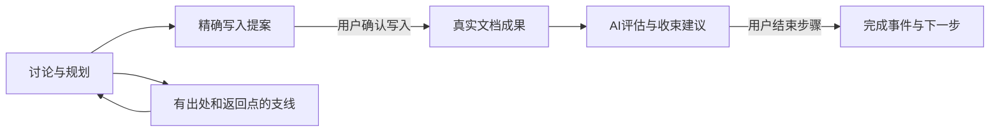

# WALL-E V2.1 文档形成主线设计总览

日期：2026-11-07；更新：2026-11-08（Asia/Hong_Kong）；修订0.9／DRAFT；任务M21-FORMATION-01。当前整体评审入口。业务目标、交互、数据、状态、程序边界和验收设计已整理完备；产品未实现，尚未合入正式规格。

本轮核心交互整体评审已完成，确认结论见[R01—R06：启动、切换、写入、路线维护、结束衔接及恢复](WALL-E.文档形成主线整体评审记录_V_2.1.md)。已替代旧0.8手动开始／切换前置限制；技术细节继续作为实施设计依据，不把本轮确认扩大为正式规格合并或产品验收。

复核补充：除已确认的R01—R06外，Q01已由R07明确完整性主要提示、用户可带遗留结束；Q02支线原则已由R08确认，模型按文档目标／当前成果／已有路线做同轮保守判断，机制与效果仍需按设计验证；Q03正文修改后的成果复核、Q04容量达限体验仍待补评，见[Q01—Q04清单](WALL-E.文档形成主线整体评审记录_V_2.1.md)。本次只识别边界，未自动采纳建议或改变已确认规则。

## 1. 用户得到什么

每份文档有一条形成路线，说明已形成什么、现在推进什么、还有哪些成果需要形成。每个节点可查创建／开始／写入／完成／放弃事件及来源；支线可看最初出处、当前处理步骤和返回点；已放弃节点保留在历史入口。

讨论过程中可以逐段写入真实文档。路线随理解变化而调整，已有内容与未决问题有明确去向。AI输出保持自由说明、必要时提供多种方案和可执行建议；用户决定采用内容和结束步骤。

## 2. 一次完整使用

| 场景 | 用户操作 | 程序保存与界面反馈 |
| --- | --- | --- |
| 开始形成需求说明 | 说明文档目的并发送讨论 | AI给出路线并直接进入第一步；来源可查 |
| 推进“核心操作流程” | 直接继续对话，或选择“在此讨论”切换节点 | 唯一讨论焦点明确；切换不修改旧进展；点击标题仍可只查看 |
| 发现权限问题 | 深入讨论这条支线 | 记录来自哪个节点／消息、影响及返回点；支线可暂缓或返回 |
| 形成可用段落 | 检查精确预览，确认写入 | 正文产生真实版本与成果关联，节点继续进行中 |
| 原流程需要拆分 | 在调整路线中分配原成果、问题和支线去向，检查预览后保存 | 新节点建立，旧节点放弃但历史仍可查；复用内容不产生新正文版本 |
| 准备结束步骤 | 查看AI收束建议，一键结束并继续 | 保存成果证据／遗留处置／支线去向及完成事件，进入推荐节点；不额外发AI请求 |
| 后来又改了正文 | 继续人工编辑或沿原更新入口修改 | 已完成事实保留，受影响成果提示复核；需要时明确重开 |

R02已确认：讨论形成能独立成立的内容即可主动提出精确写入预览，无需等整个节点结束；用户确认后写入，其余部分继续讨论，节点不会因此自动完成。R03明确预览只读；手动修改继续使用现有文档编辑，不新增预览编辑器。R05确认一键结束后直接进入推荐节点，用户主动继续输入；没有下一步时保留完成结果，文档定稿仍需明确决定。

## 3. 什么数据代表什么事实

| 数据 | 代表的事实 | 不能据此推断 |
| --- | --- | --- |
| 当前Markdown／Revision | 当前已保存的文档内容 | 语义必然充分或整份文档已确认 |
| FormationState及D／F | 路线、焦点、成果关联与当前协作快照 | F变化必然表示正文写入 |
| Assessment／Recommendation | AI判断及建议，带读取依据和陈旧情况 | 用户已采用或步骤已完成 |
| 不可变提案卡／binding | 用户可检查的精确内容与程序核实依据 | 卡片生成就获得正文写权限 |
| Closure、result_routes及形成事件 | 用户决定、成果去向、历史及真实状态迁移 | 放弃节点会删除旧正文或撤销旧版本 |
| 程序回执／运行组件结果 | 实际应用、拒绝、无变化和可核实身份 | 模型执行结束等于业务完成 |

## 4. 首版范围与状态

步骤使用PLANNED／IN_PROGRESS／PAUSED／COMPLETED／CANCELLED；AI评估、操作建议、请求等待和提案可用性各自独立。建线直接进入首步；用户可自由切换讨论焦点，无需先暂停／完成旧步骤，写入与结束仍分开。AI在既定目标内细化／补步骤／重排直接维护并留记录；重大调整或人工编辑看完整影响后保存；用户一键结束，AI提示缺口，未完成事项保留；不以成果或处置不齐强制拦截。

用户已确认“AI建议、用户一键结束步骤”，并认可节点原型整体方向；R04进一步确认AI正常路线维护与重大调整确认的边界。自动首步与自由切换已在R01明确；其余按钮、容量及路线编辑细节是本设计采用的默认方案，供整体评审，没有追记为用户逐项确认。单份文档范围保持；项目级跨文档对齐、自动编码、联合写入并结束、自动历史压缩均不在首版范围。

## 5. 实施阅读顺序（R01优先）

1. 本总览理解目标与范围。
2. [交互与接入收口0.9](WALL-E.文档形成主线交互与接入收口_V_2.1.md)：首次开始、编辑器、卡片、字段责任、事务与I01—I10。
3. [当前接入Schema v4](schemas/formation-integration.v4.schema.json)：当前严格结构；[核心Schema](schemas/formation-contract.v1.schema.json)和[前一接入Schema](schemas/formation-integration.v1.schema.json)保留来源，不混用旧请求简写。
4. [主设计](WALL-E.文档形成主线与阶段性写入_V_2.1.md)：业务依据、前期决策与修订记录；[0.6核心附件](WALL-E.文档形成主线实施契约与验收清单_V_2.1.md)保留基础定义，当前规则以整体评审记录R01—R08及接入Schema v4为准。
5. [路线节点原型](previews/formation-route-v04.html)：整体节点视觉方向；路线编辑及异常路径以当前评审结论和详细规则为准，原型无真实业务连接。

R07／Q01确认完整性检查主要提示，用户可以带未写／未决事项结束；结束记录与需求满足分开，后续补写保留独立历史，程序安全校验继续。

R06确认恢复时先核实是否保存，明确区分保存失败与显示待刷新；原提案／用户输入保留，正文变化后重新核对，重新调用AI由用户明确发起。

## 6. 完成设计与实施前置的界限

当前设计包含正常／失败／并发／恢复、完整成果与支线去向、发布提案版本依据、读写契约、AI与程序职责，以及A01—A50未来验收。77个v2结构检查通过；这只检查设计格式和示例，不等于程序业务守卫或产品通过。

实施前需要核对本地实际V2.0的提交、DDL、资源和旧消息／回执；云端无法证明未同步资料的兼容。依据差异分配真实目标数据库版本、生成完整DDL／升级器和发布资源，再按B1—B5实施。升级演练、新资源准入和A01—A50均未执行，服务与正常数据未改。

本轮核心交互评审完成，设计保留0.9／DRAFT、待合并；不自动开始产品代码或正式规格合并。当前接续见[实现进度](../../../project/v2.1/实现进度_V_2.1.md)，实际证据见[0.8核对记录](../../../verification/v2.1/document-formation-design-consistency-2026-11-07.md)。
