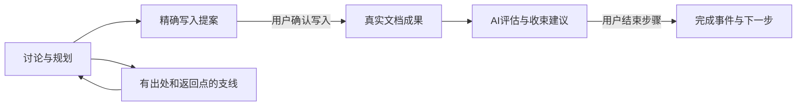

# WALL-E V2.1 文档形成主线设计总览

更新：2026-11-10；修订0.9／DRAFT；任务M21-FORMATION-01。当前设计阅读入口；产品未实现，尚未合入正式规格。Q03成果复核体验与Q04容量达限体验仍待评审，不能宣称全部设计边界已收束。

当前依据为[整体评审R01—R08](WALL-E.文档形成主线整体评审记录_V_2.1.md)与[接入Schema v4](schemas/formation-integration.v4.schema.json)。R01—R07规则已确认；R08支线原则已确认，模型在同轮依据目标／当前成果／已有路线保守判断，机制为技术设计，语义效果尚未验证。设计确认不等于产品实现、正式规格合并或验收。

## 1. 用户得到什么

每份文档有一条形成路线，说明已形成什么、现在推进什么、还有哪些成果需要形成。每个节点可查创建／开始／写入／完成／放弃事件及来源；支线可看最初出处、当前处理步骤和返回点；已放弃节点保留在历史入口。

讨论过程中可以逐段写入真实文档。路线随理解变化而调整，已有内容与未决问题有明确去向。AI输出保持自由说明、必要时提供多种方案和可执行建议；用户决定采用内容和结束步骤。

## 2. 一次完整使用

| 场景 | 用户操作 | 程序保存与界面反馈 |
| --- | --- | --- |
| 开始形成需求说明 | 说明文档目的并发送讨论 | AI给出路线并直接进入第一步；来源可查 |
| 推进“核心操作流程” | 直接继续对话，或选择“在此讨论”切换节点 | 唯一讨论焦点明确；切换不修改旧进展；点击标题仍可只查看 |
| 发现权限问题 | 深入讨论这条支线 | 记录来自哪个节点／消息、影响及返回点；支线可暂缓或返回 |
| 形成可用段落 | 检查精确预览，确认写入 | 正文产生真实版本与成果关联，不自动改变节点生命周期 |
| 原流程需要拆分 | 查看AI整理的影响及成果／问题／支线去向，核对关键取舍后保存；人工编辑仍保留 | 新节点建立，旧节点放弃但历史仍可查；复用内容不产生新正文版本 |
| 准备结束步骤 | 查看AI收束建议，一键结束并继续 | 保存真实Closure与完成事件，未写／未决如实保留；进入推荐节点，不额外发AI请求 |
| 后来又改了正文 | 继续人工编辑或沿原更新入口修改 | 已结束事实保留，受影响成果提示复核；具体复核体验Q03待评审，不自动重开 |

R02已确认：讨论形成能独立成立的内容即可主动提出精确写入预览，无需等整个节点结束；用户确认后写入，其余部分继续讨论，节点不会因此自动完成。R03明确预览只读；手动修改继续使用现有文档编辑，不新增预览编辑器。R05确认一键结束后直接进入推荐节点，用户主动继续输入；没有下一步时保留完成结果，文档定稿仍需明确决定。

## 3. 什么数据代表什么事实

| 数据 | 代表的事实 | 不能据此推断 |
| --- | --- | --- |
| 当前Markdown／Revision | 当前已保存的文档内容 | 语义必然充分或整份文档已确认 |
| FormationState及D／F | 路线、焦点、成果关联与当前协作快照 | F变化必然表示正文写入 |
| Assessment／Recommendation | AI判断及建议，带读取依据和陈旧情况 | 用户已采用或步骤已完成 |
| 不可变提案卡／binding | 用户可检查的精确内容与程序核实依据 | 卡片生成就获得正文写权限 |
| Closure、result_routes及形成事件 | 用户决定、成果去向、历史及真实状态迁移 | 放弃节点会删除旧正文或撤销旧版本 |
| 程序回执／运行组件结果 | 实际应用、拒绝、无变化和可核实身份 | 模型执行结束等于业务完成 |

## 4. 首版范围与状态

步骤使用PLANNED／IN_PROGRESS／PAUSED／COMPLETED／CANCELLED；AI评估、操作建议、请求等待和提案可用性各自独立。建线直接进入首步；用户可自由切换讨论焦点，无需先暂停／完成旧步骤，写入与结束仍分开。AI在既定目标内细化／补步骤／重排直接维护并留记录；重大调整或人工编辑看完整影响后保存；用户一键结束，AI提示缺口，未完成事项保留；不以成果或处置不齐强制拦截。

用户已确认“AI建议、用户一键结束步骤”，并认可节点原型整体方向；R04进一步确认AI正常路线维护与重大调整确认的边界。自动首步与自由切换已在R01明确；其余按钮与路线编辑细节是当前技术方案，没有追记为用户逐项确认；容量达限体验Q04仍待评审。单份文档范围保持；项目级跨文档对齐、自动编码、联合写入并结束、自动历史压缩均不在首版范围。

## 5. 当前阅读顺序

1. 本总览理解目标、边界和未决事项。
2. [主设计](WALL-E.文档形成主线与阶段性写入_V_2.1.md)：业务对象、数据与AI流转、存储及资源方案。
3. [交互与接入设计](WALL-E.文档形成主线交互与接入收口_V_2.1.md)：用户操作、接口／字段责任、读投影、事务与I01—I10。
4. [实施契约与验收清单](WALL-E.文档形成主线实施契约与验收清单_V_2.1.md)：当前契约与A01—A60未来场景，不作为产品验证记录。
5. [当前接入Schema v4](schemas/formation-integration.v4.schema.json)：192个定义／13根DTO，14种NativeRequest变体、13种PathChange；私有binding标识仍为formation_card_binding_v3。Schema版本与binding版本是不同维度，不能一并替换。旧Schema仅为追溯依据，见[索引](README.md)。
6. [整体评审R01—R08](WALL-E.文档形成主线整体评审记录_V_2.1.md)：用户决定来源和未决边界；[路线节点原型](previews/formation-route-v04.html)仅展示整体视觉方向，无真实业务连接，行为以当前设计正文为准。

R07确认完整性检查主要提示：用户可带未写／未决事项结束，程序补齐OUTSTANDING／KEEP_OPEN真实快照，保留原要求和归属，不将结束记录等同需求满足。结束后的适用提案仍可明确写入，后续事件不倒写原Closure，身份／版本／事务校验继续执行。

R06确认恢复时先核实是否保存；保存成功后显示失败只刷新读取，原提案／输入保留，正文变化重新核对，重新调用AI由用户明确发起。

## 6. 实施前置、未决与证据边界

Q03成果复核体验、Q04容量达限体验仍需评审；R08支线判定机制需要后续真实效果验证。当前设计覆盖正常／失败／并发／恢复、成果与支线去向、提案依据、读写契约及AI与程序职责；A01—A60全部是未执行的未来产品场景。

实施前需核对用户实际本地V2.0提交、DDL、资源与旧消息／回执。云端副本不能证明未同步资料兼容。依据真实差异确定目标数据库版本、完整DDL／升级器和新发布资源，再按[计划B1—B5](../../../project/v2.1/实施计划_V_2.1.md)实施；升级演练、新资源准入、联调及产品验收均未完成。

本次只在隔离云端副本清理当前文档，不影响用户本地运行构建，不自动开始编码／迁移／服务操作或正式规格合并。当前断点见[实现进度](../../../project/v2.1/实现进度_V_2.1.md)，能力状态见[需求实现映射](../../../traceability/v2.1/需求实现映射_V_2.1.md)。历史验证保留原记录，不作为本轮重跑结果；本次最终静态结果见[文档清理核对](../../../verification/v2.1/document-formation-current-design-cleanup-2026-11-10.md)。
